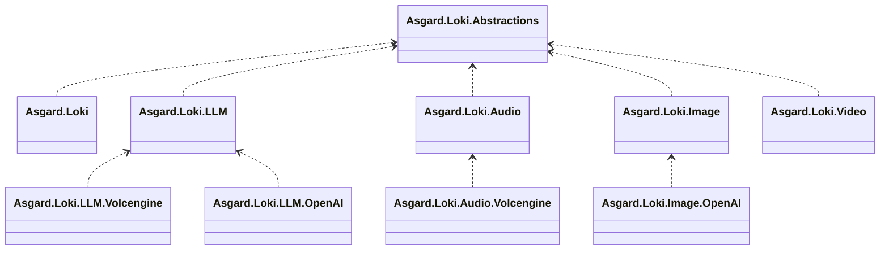
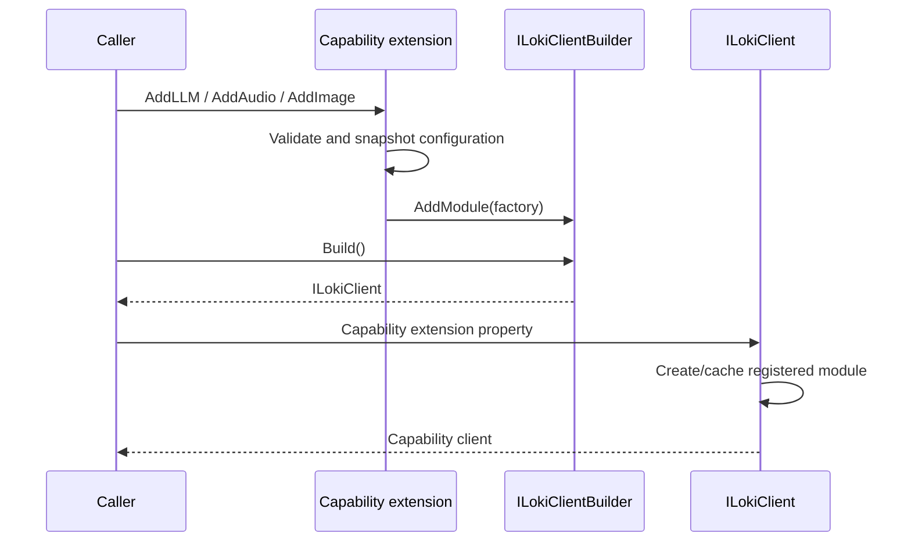
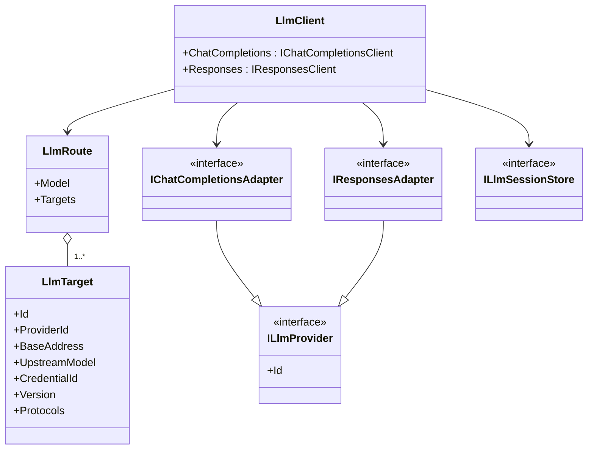
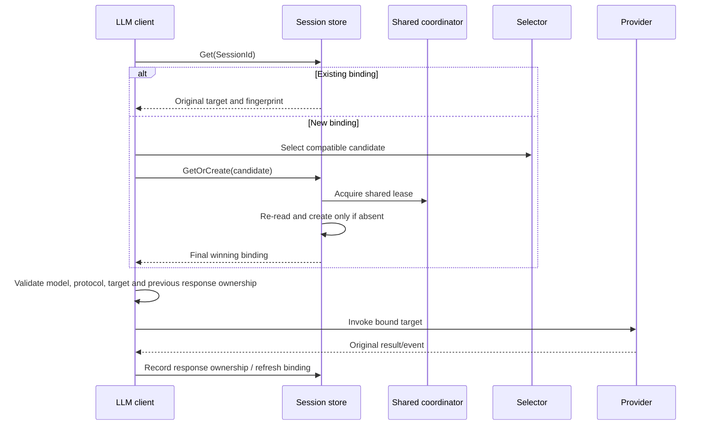

# Asgard.Loki Architecture Specification

This document is the authoritative contract for package boundaries, public API structure and provider extensions. Update it whenever a dependency or public contract changes. Use UML to describe structural changes.

## 1. Package boundaries

Asgard.Loki is a pure .NET library. The entry point is `LokiClient`; it is not a web application. All namespaces begin with `Asgard`.

- Abstractions contains only generic module/client contracts, never capability-specific requests or results.
- The entry implementation references only abstractions. It cannot declare capability-specific initialization methods.
- Each capability owns its public API, protocol models, adapters, routing and state. Capabilities never reference one another.
- Provider naming is `Asgard.Loki.{Capability}.{Vendor}`. Use `Volcengine` for the vendor; Ark is its LLM product.
- Providers depend only on their own capability and necessary standard dependencies. No umbrella vendor package may force all capabilities to install together.
- Private technical helpers such as an SSE parser may be source-linked into provider assemblies. They must remain internal; there is no public LokiTransport project or cross-capability workflow framework.

## 2. Registration and lifecycle

Registration extensions target `ILokiClientBuilder`; access extensions target `ILokiClient`. Neither needs a reference to the entry implementation. Module factories are lazy and a module is cached per client. Duplicate registrations fail explicitly.

The client disposes factory-created modules that implement disposal, once each. Externally supplied providers, caches, coordinators and HTTP factories remain borrowed dependencies and caller-owned. Providers obtain request-local HTTP clients from `IHttpClientFactory`; request/response streams are disposed after use.

## 3. LLM contracts

The public surface is `loki.LLM.ChatCompletions` and `loki.LLM.Responses`, each with complete and streamed calls. They are distinct protocols, not aliases for one text-only message format.

Requests have strongly named core fields and extension JSON parameters. Results own an independent JSON snapshot. Preserve unknown fields/events, input/output items, tools, reasoning, usage, cache controls, errors and original IDs. Only actual model mapping and the method-selected stream switch are changed. Extension parameters cannot override explicitly declared core fields.

The currently implemented providers are Volcengine Ark and OpenAI, both over HTTP/JSON and SSE. Native Responses WebSocket is not implemented and must not be advertised as supported. There is no automatic Chat/Responses conversion.

The scheduling unit is a complete target, not one model with a pool of interchangeable keys. One public model may map to different servers, actual models, credentials and providers. Explicit protocol flags limit candidate selection. Public and upstream model identities are separate result metadata; original provider JSON is not rewritten to disguise its identity.

A new Session uses `ILlmTargetSelector`; an existing Session bypasses selection. A provider must use the target and credential already selected by the capability module.

## 4. LLM Session and cache

Calls explicitly supply a stable SessionId. Authorization and Session ownership isolation belong to the caller. Use a deployment/application-specific cache prefix.

- `DistributedCacheLlmSessionStore` depends on `IDistributedCache`, not a concrete Redis client or the wider Asgard framework.
- Plain cache Get/Set is not atomic. First binding requires `ILlmSessionLock` / `ILlmSessionLease`; a production multi-process implementation must use shared distributed coordination and signal lease loss. Operations observe the lease cancellation token.
- This coordination contract is an integration point, not a bundled Redis-lock implementation. Unit tests use a test-only in-process coordinator with `MemoryDistributedCache`.
- Bindings include public model, protocol, target ID and a fingerprint of connection/model/credential/provider/version identity. API Keys are never stored in bindings. Changing an existing target's semantics invalidates its old Sessions.
- All first-call competitors re-read under coordination and use the actual winner before invoking a model.
- Preserve original response IDs and associate them with their Session. Unknown, expired or foreign `previous_response_id` values fail; they never trigger random new routing.
- Multiple recorded response IDs may be used for branches. A Session is not limited to its latest response.
- Bindings and response records use sliding cache expiration; the default is 24 hours. Retention is bounded by cache/provider lifetimes, not promised forever.
- Existing-target removal, configuration/key changes and cache failures are explicit errors. Never fall back silently or automatically resend a generation whose outcome is unknown.
- Do not force store=true, reconstruct history, summarize messages, change instructions or discard cache/reasoning fields.

Redis preserves logical routing identity, not TCP state or provider prompt caches. Distributed coordination during failover and real cross-process behavior require separate integration verification. The library does not implement durable request idempotency, event replay or reconnecting subscriptions.

## 5. Audio

Audio owns `AudioClient`, `ISpeechClient`, `ISpeechAdapter`, speech routes and audio results. It does not reuse LLM orchestration or Session state.

The first provider implements Volcengine V3 HTTP chunked TTS. Its API Key or legacy app/token credentials and resource ID are configured independently of Ark LLM. Do not assume one key authorizes every vendor product.

Return ordered decoded audio chunks plus complete raw metadata. Aggregate results only after an explicit upstream completion code. Preserve subtitle, usage and unknown frames. Invalid Base64, business errors, unexpected data after completion and truncated streams fail explicitly.

ASR, music generation and bidirectional/WebSocket speech are not implemented.

## 6. Images

Images own `ImageClient`, `IImageGenerationAdapter`, image routes and image results, without LLM or audio dependencies.

The OpenAI provider implements `POST /v1/images/generations` and its SSE generation events. Preserve partial/final image data, URLs, revised prompts, usage and unknown JSON. Public route names and actual image models are distinct. Parameters such as format, quality, size, count, compression and transparency remain caller-selected.

Base64 decoding is explicit and format-preserving. Return URLs without downloading them. Image edits and variations are not implemented. Availability of streaming and individual parameters is determined by the actual upstream model/account.

## 7. HTTP and errors

Providers own address/authentication/protocol mapping. API roots include their version path. Do not hard-code model lists or rewrite model suffixes heuristically.

The library itself never retries or hedges generation requests. Named HTTP clients must also disable automatic unsafe-method retries/hedging. The caller configures timeouts and optional standard resilience components through the supplied factory.

HTTP failures preserve status and original body in capability-specific exceptions. Streaming protocol failures remain complete protocol events where applicable. End-of-stream without the required terminal event is an interruption, not success. SSE parsing respects event boundaries, multiline data and arbitrary UTF-8/network fragmentation.

## 8. Tests, packaging and documentation

- Use xUnit v3 with Microsoft.Testing.Platform. Honor the test framework's cancellation token.
- Use `MemoryDistributedCache`, a test coordinator and local HTTP handlers. Unit tests need no provider key, network, external Redis or wall-clock waits.
- Test whole-target identity, concurrent first binding, cross-client continuation, configuration changes, foreign response IDs and unknown data preservation.
- Verify audio byte order/completion and OpenAI image payloads, partial/final events, URLs and Base64 results.
- Live provider calls, account permissions and Redis cross-process coordination are separate integration checks; never describe stubbed protocol tests as live verification.
- The live-test contract is defined in [testing.md](testing.md), with `.env.example` as a credential-free template. The current Volcengine LLM suite uses four variables: explicit live opt-in, API Key, Chat model and Responses model. Address, parameters, budgets and timeouts live in test code. `eng/Test-Live.ps1` invokes the separate integration project, which is excluded from the ordinary solution and test discovery. Ordinary tests and automatic CI remain offline. These variables are test-fixture configuration, not a library initialization API.
- Pack each library independently. Inspect actual nuspec dependencies to prevent capability/provider leakage. Building or packing does not authorize publishing.
- English README is primary; translations are auxiliary. Every provider README states supported APIs, initialization, limitations and verification status. Unsupported features must remain explicit.

## 9. Design references

New API is a structural reference for separating channels, model mapping and supplier adapters. This is an independent .NET implementation; its web framework, administrative features and billing flow are outside this library.

- [New API adapter interface](https://github.com/QuantumNous/new-api/blob/main/relay/channel/adapter.go)
- [New API channel model](https://github.com/QuantumNous/new-api/blob/main/model/channel.go)
- [New API Volcengine adapter](https://github.com/QuantumNous/new-api/blob/main/relay/channel/volcengine/adaptor.go)
- [OpenAI Responses streaming](https://developers.openai.com/api/docs/guides/streaming-responses)
- [OpenAI image generation](https://developers.openai.com/api/docs/guides/image-generation)
- [Ark quick start](https://docs.volcengine.com/docs/ark/quick-start?lang=en)
- [Volcengine V3 HTTP TTS](https://www.volcengine.com/docs/6561/1598757?lang=zh)
