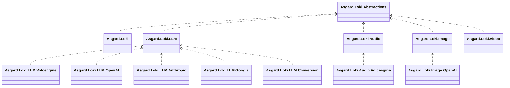
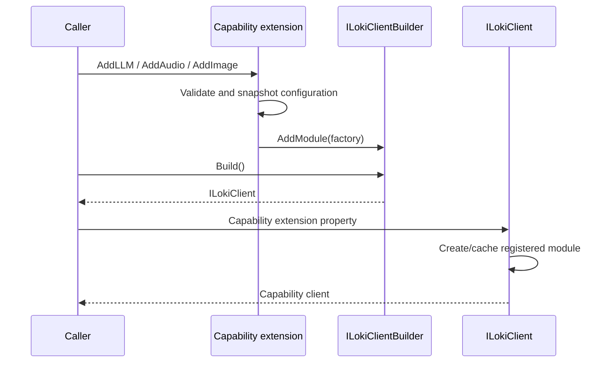
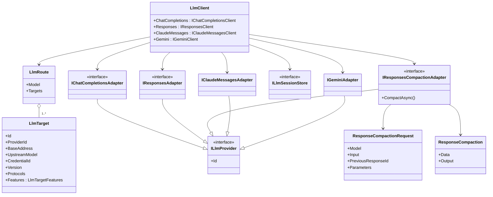
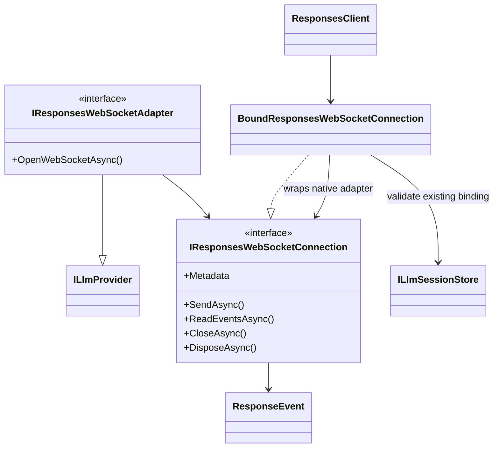
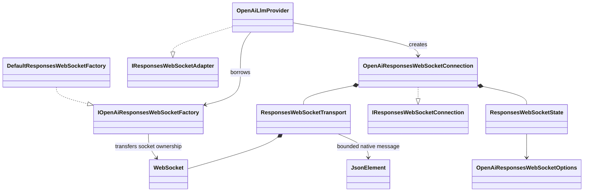
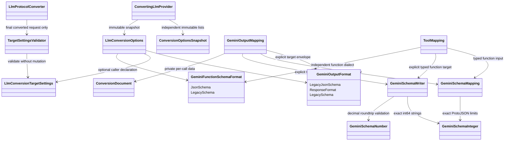
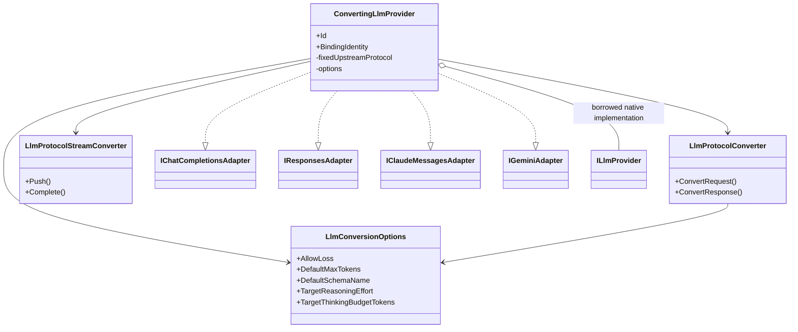
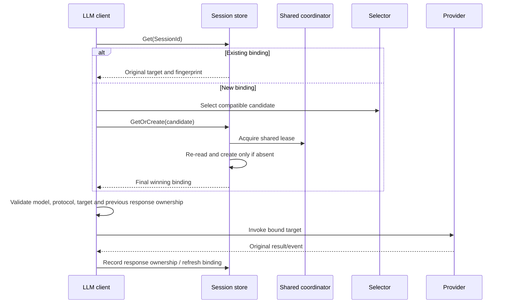

# Asgard.Loki Architecture Specification

This document is the authoritative contract for package boundaries, public API structure and provider extensions. Update it whenever a dependency or public contract changes. Use UML to describe structural changes.

## 1. Package boundaries

Asgard.Loki is a pure .NET library. The entry point is `LokiClient`; it is not a web application. All namespaces begin with `Asgard`.

- Abstractions contains only generic module/client contracts, never capability-specific requests or results.
- The entry implementation references only abstractions. It cannot declare capability-specific initialization methods.
- Each capability owns its public API, protocol models, adapters, routing and state. Capabilities never reference one another.
- Provider naming is `Asgard.Loki.{Capability}.{Vendor}`. Use `Volcengine` for the vendor; Ark is its LLM product.
- Providers depend only on their own capability and necessary standard dependencies. No umbrella vendor package may force all capabilities to install together.
- Private technical helpers such as an SSE parser may be source-linked into provider assemblies. They must remain internal; there is no public LokiTransport project or cross-capability workflow framework.

## 2. Registration and lifecycle

Registration extensions target `ILokiClientBuilder`; access extensions target `ILokiClient`. Neither needs a reference to the entry implementation. Module factories are lazy and a module is cached per client. Duplicate registrations fail explicitly.

The client disposes factory-created modules that implement disposal, once each. Externally supplied providers, caches, coordinators and HTTP factories remain borrowed dependencies and caller-owned. Providers obtain request-local HTTP clients from `IHttpClientFactory`; request/response streams are disposed after use.

## 3. LLM contracts

The public surface is `loki.LLM.ChatCompletions`, `loki.LLM.Responses`, `loki.LLM.ClaudeMessages` and `loki.LLM.Gemini`, each with complete and streamed calls. Each owns native request/result/event contracts; they are distinct protocols, not aliases for one text-only message format. Claude has explicit `MaxTokens`. Gemini keeps its native `contents`, `systemInstruction`, `generationConfig` and tool structure; its actual model is encoded in the endpoint path, and method-selected streaming uses `:streamGenerateContent?alt=sse` rather than a body field.

Requests have strongly named core fields and extension JSON parameters. Results own an independent JSON snapshot. Preserve unknown fields/events, input/output items, tools, reasoning, usage, cache controls, errors and original IDs. Only actual model mapping and the method-selected stream switch are changed. Extension parameters cannot override explicitly declared core fields.

The currently implemented LLM providers are Volcengine Ark, OpenAI, Anthropic Claude Messages and Google Gemini Developer API over HTTP/JSON and SSE. Provider packages reference only LLM and standard HTTP dependencies. Native Responses WebSocket, Gemini Live and Bedrock/Vertex AI authentication are not implemented. There is no automatic protocol conversion in native providers. Claude streams require `message_stop` or an explicit error; Gemini streams require a terminal reason for every observed candidate or an explicit prompt block/error. Native unknown events, signed reasoning and media remain unchanged.

The scheduling unit is a complete target, not one model with a pool of interchangeable keys. One public model may map to different servers, actual models, credentials and providers. Explicit protocol flags limit candidate selection. Public and upstream model identities are separate result metadata; original provider JSON is not rewritten to disguise its identity.

A new Session uses `ILlmTargetSelector`; an existing Session bypasses selection. A provider must use the target and credential already selected by the capability module.

### Optional native Responses operations

`IResponsesCompactionAdapter` is a separate optional provider contract. The OpenAI package implements it; Ark and the conversion decorator do not advertise it. `IResponsesClient.CompactAsync` has a default unsupported implementation for compatibility with older caller-defined clients. The built-in client requires both native Responses support and `LlmTarget.Features.ResponsesCompaction`; target registration rejects a feature without its protocol/adapter implementation. New-session selection filters the explicit feature; after coordinated creation the actual winning binding is checked again. A previously bound target without the feature fails rather than switching to a capable target.

Compaction sends one native `/responses/compact` request, with model mapping and no stream switch. It accepts the native optional text/item input and optional `previous_response_id`; previous-response ownership, target identity, cache failures and cancellation use the same LLM-owned Session contract. The complete response/output window, encrypted state, retained items, tool links, usage and future fields stay unchanged. No automatic compaction, history retrieval/pruning, decryption or retry is introduced. A compaction result ID is not registered as a generated-response ID. The application chooses when and how to use the returned complete window in subsequent native calls.

`Features.None` is omitted from target JSON so adding this optional contract does not change the default basic-target fingerprint representation. Non-default feature declarations are fingerprinted; changing them invalidates affected bindings. Source compaction items remain hard failures in cross-protocol conversion even with `AllowLoss`, while native requests and same-protocol copies retain them.

Responses WebSocket is an optional extension. `IResponsesWebSocketAdapter` opens an `IResponsesWebSocketConnection` exposing metadata, raw JSON send, native `ResponseEvent` enumeration, explicit close and async disposal. `IResponsesClient.OpenWebSocketAsync` defaults to unsupported so existing custom clients remain valid. The built-in client resolves targets explicitly declaring `LlmTargetFeatures.ResponsesWebSocket`, validates the returned connection identity, and wraps the native adapter. `LLM.OpenAI` implements this extension; other providers and conversion decorators do not implicitly advertise it.

The internal bound connection never invokes first-binding resolution after opening: each send verifies the original binding still exists and matches exactly. A missing/replaced Session fails rather than binding a live socket to a new target. The handshake is also checked after its await; invalidated or mismatched connections are disposed. Known response lifecycle IDs are registered under the original Session after revalidation; creation/steering continuation and explicit cancellation response IDs must belong to it. The wrapper serializes writes, permits one active reader, preserves stream IDs and unknown/native JSON, and maps only the public alias on `response.create` to the fixed actual model. It rejects HTTP-only `stream`/`background` fields without silently removing them. Native transport adapters own framing, protocol terminal validation and socket resources; factories/stores remain borrowed. Socket lifetime is separate from logical Session lifetime, with no automatic reconnect, retry or event replay.

For native controls without an independent acknowledgement, bounded existing response records retain a bit recording the possibility of late uncorrelated errors. Known response controls remain lane-scoped; unknown-scope controls use one conservative connection bit. A normal generation terminal does not prove its control cannot still fail. Such ambiguous errors are preserved but never used to consume a new queued generation. Definitively unsent controls roll back their markers. No control transcript, input history or unbounded lane-history collection is added.

`LLM.OpenAI` owns `IOpenAiResponsesWebSocketFactory`, its default `ClientWebSocket` factory, internal `ResponsesWebSocketTransport`, native connection and protocol state. Only the owning provider and its offline tests use these byte/frame/state details. Messages have explicit byte limits; fragmented text is assembled and strictly validated as UTF-8 before JSON parsing. Socket IO failures/cancellation abort the connection without retry; explicit close interrupts pending IO and disposal owns the returned socket, never the borrowed factory. No new package dependency or cross-capability transport abstraction is introduced.

`OpenAiResponsesWebSocketOptions` bounds message bytes, pending submissions and remembered response/event identities. Options are snapshotted; custom factory identity/options enter provider binding identity. Default configuration preserves the existing HTTP constructor signature and basic binding identity. HTTP client headers/settings are separate from the WebSocket factory's handshake configuration. Protocol state associates queued/active/terminal responses by lane and response ID, retains bounded event-ID history after creation or control completion, and checks real sequences/status/closure. A late/unknown-ID error cannot consume another queued create, and a completed control's ID cannot be reused for a new request. Steering acceptance is not a generated response: native automatic successors and caller-supplied required-input continuations are correlated without sending anything automatically. Unallocated steering failures can omit IDs. Native unknown events are preserved; recognized output types are an explicit set rather than a prefix heuristic. State is bounded and never contains a tool executor, history reconstruction service or global scheduler.

### Explicit conversion extension

`Asgard.Loki.LLM.Conversion` is an optional LLM extension with a single project dependency on `Asgard.Loki.LLM`. It owns pure request/response conversion and single-call stream state. Its private conversion representation never replaces the four native contracts or crosses capability boundaries. This remains an embeddable SDK: no listener, HTTP relay endpoint, gateway administration, billing, tool executor or background orchestration is introduced.

`LlmConversionOptions.GeminiOutputFormat` explicitly selects the Gemini target envelope: `LegacyJsonSchema` preserves the current default wire body, `ResponseFormat` writes modern `generationConfig.responseFormat.text`, and explicit `LegacySchema` translates representable JSON Schema into typed `responseSchema`. Source modern text and legacy JSON Schema envelopes are recognized independently; conflicting text settings are rejected and unrepresentable media/unknown fields remain diagnosed. JSON Schema bodies are copied unchanged by default. A private `GeminiSchemaMapping` separately translates typed source input. `GeminiSchemaWriter` owns explicit typed output, exact int64 strings and double decimal-roundtrip validation; unavailable validation keywords hard-fail even with `AllowLoss`. Explicit open-object true is equivalent to the native default; closed/schema-constrained objects are not. Only annotation losses such as multiple examples can receive diagnosed consent. Private `OutputSchemaOrdered` carries the strict OpenAI text-format guarantee into recursive typed property ordering; other sources gain no invented guarantee. Typed function input reuses the reader. Independent `GeminiFunctionSchemaFormat` selects unchanged `parametersJsonSchema` by default or explicit typed `parameters`, reusing the writer without inventing a text-order guarantee for function arguments. Options and the `conversion-v9` algorithm identity enter Session fingerprints, so old conversion Sessions fail validation instead of being silently rebound. Native providers do not reference or inherit this policy.

Optional `LlmConversionTargetSettings` belongs only to the conversion package. `TargetSettingsValidator` checks final converted request fields, including configured defaults/replacements, against caller-declared efforts, native thinking modes, formats, explicit token ranges and control-field support. Violations hard-fail before provider IO even with `AllowLoss`. Missing declarations add no restrictions; missing request arguments are never filled or treated as known upstream defaults. This is not an account/model catalog, usage quota or native-request filter. Same-protocol/native branches and response/event content stay unchanged. `ConversionOptionsSnapshot` deep-copies and canonicalizes list sets at registration/per pure call; profiles enter complete-target implementation identity. Different profiles use separate configured converting providers/targets, not a runtime model-name policy lookup.

The caller explicitly registers the decorator and chooses a fixed upstream protocol; `LlmTarget.Protocols` describes exposed caller protocols. The decorator invokes the supplied native adapter on the target already resolved by LLM. It cannot select another server/model/key, nest another converting provider, retry or reconstruct history. A same-protocol invocation transparently uses the native adapter and leaves `Metadata.Conversion` null.

All twelve off-diagonal protocol directions support the documented common subset for requests, single-candidate responses and streams. [The conversion package matrix](../src/Asgard.Loki.LLM.Conversion/README.md) defines the exact fields and limits. Unknown or non-equivalent fields fail with field-level diagnostics by default. Only caller-selected `AllowLoss` permits diagnosed omissions; opaque reasoning/signatures, cross-protocol response-chain/storage semantics, invalid arguments and ambiguous tool links remain hard failures. Remote media is not downloaded or assigned an invented MIME type. The original request is never mutated.

Converted complete results keep upstream JSON and request/response diagnostics in `LlmResultMetadata.Conversion`. Converted stream events keep the triggering source JSON and cumulative diagnostics; their generated event names/sequences are target-protocol metadata, not upstream SSE delivery identity. Text deltas are incremental. Tool argument fragments are accumulated and emitted only after complete JSON is available. Source transport failure, missing terminal, unsupported interleaving or inconsistent final output fails without emitting a successful terminal. Conversion does not resume streams or transfer native response IDs between incompatible stateful APIs.

The internal call tracker separates all observed IDs from pending results: a result consumes exactly one pending call, and an ID-less Gemini result requires a unique pending name. Generated IDs reserve explicit IDs from the whole request. Source stream state validates block closure, stable item identities, monotonic event sequences and done/final snapshots; target state rejects text that would overtake an unfinished tool. Independent usage tails are allowed after candidate completion, while repeated terminal events and post-completion content are rejected. An explicit length/filter finish remains incomplete in Responses items. Missing token counts are not fabricated for protocols that require them.

Private reasoning conversion state separates effort, numeric budget, dynamic/off mode and requested summary/display. Qualitative levels map only where represented; numeric budget replacement requires an explicit target effort plus diagnosed loss consent. Caller-selected manual Claude budgets must fit the explicit output limit; model-specific support is not inferred from names. Private structured-output state carries the unchanged JSON Schema and wrapper metadata. OpenAI requires an explicit source/default schema name; unsupported metadata or enforcement changes remain diagnosed. Options belong to the conversion package, and the algorithm/options are fingerprinted into Session bindings.

Known descriptive response envelope fields and executed-request echoes are retained in the original upstream JSON, separately from converted content. They never become a new target request or continuation authorization. This classification is explicit and response-only; unknown business fields and opaque reasoning still follow strict conversion rules.

## 4. LLM Session and cache

Calls explicitly supply a stable SessionId. Authorization and Session ownership isolation belong to the caller. Use a deployment/application-specific cache prefix.

- `DistributedCacheLlmSessionStore` depends on `IDistributedCache`, not a concrete Redis client or the wider Asgard framework.
- Plain cache Get/Set is not atomic. First binding requires `ILlmSessionLock` / `ILlmSessionLease`; a production multi-process implementation must use shared distributed coordination and signal lease loss. Operations observe the lease cancellation token.
- This coordination contract is an integration point, not a bundled Redis-lock implementation. Unit tests use a test-only in-process coordinator with `MemoryDistributedCache`.
- Bindings include public model, protocol, target ID and a fingerprint of connection/model/credential/provider/version identity. `ILlmProvider.BindingIdentity` includes the adapter implementation; the conversion decorator additionally includes wrapped identity, fixed upstream protocol, algorithm version and conversion options. API Keys are never stored in bindings. Changing an existing target's semantics invalidates its old Sessions. Existing bindings from before implementation identities were fingerprinted require new Sessions or caller-managed expiration/removal; they are never silently rebound.
- All first-call competitors re-read under coordination and use the actual winner before invoking a model.
- Preserve original response IDs and associate them with their Session. Unknown, expired or foreign `previous_response_id` values fail; they never trigger random new routing.
- Multiple recorded response IDs may be used for branches. A Session is not limited to its latest response.
- Bindings and response records use sliding cache expiration; the default is 24 hours. Retention is bounded by cache/provider lifetimes, not promised forever.
- Existing-target removal, configuration/key changes and cache failures are explicit errors. Never fall back silently or automatically resend a generation whose outcome is unknown.
- Do not force store=true, reconstruct history, summarize messages, change instructions or discard cache/reasoning fields.

Redis preserves logical routing identity, not TCP state or provider prompt caches. Distributed coordination during failover and real cross-process behavior require separate integration verification. The library does not implement durable request idempotency, event replay or reconnecting subscriptions.

## 5. Audio

Audio owns `AudioClient`, `ISpeechClient`, `ISpeechAdapter`, speech routes and audio results. It does not reuse LLM orchestration or Session state.

The first provider implements Volcengine V3 HTTP chunked TTS. Its API Key or legacy app/token credentials and resource ID are configured independently of Ark LLM. Do not assume one key authorizes every vendor product.

Return ordered decoded audio chunks plus complete raw metadata. Aggregate results only after an explicit upstream completion code. Preserve subtitle, usage and unknown frames. Invalid Base64, business errors, unexpected data after completion and truncated streams fail explicitly.

ASR, music generation and bidirectional/WebSocket speech are not implemented.

## 6. Images

Images own `ImageClient`, `IImageGenerationAdapter`, image routes and image results, without LLM or audio dependencies.

The OpenAI provider implements `POST /v1/images/generations` and its SSE generation events. Preserve partial/final image data, URLs, revised prompts, usage and unknown JSON. Public route names and actual image models are distinct. Parameters such as format, quality, size, count, compression and transparency remain caller-selected.

Base64 decoding is explicit and format-preserving. Return URLs without downloading them. Image edits and variations are not implemented. Availability of streaming and individual parameters is determined by the actual upstream model/account.

## 7. HTTP and errors

Providers own address/authentication/protocol mapping. API roots include their version path. Do not hard-code model lists or rewrite model suffixes heuristically.

The library itself never retries or hedges generation requests. Named HTTP clients must also disable automatic unsafe-method retries/hedging. The caller configures timeouts and optional standard resilience components through the supplied factory.

HTTP failures preserve status and original body in capability-specific exceptions. Streaming protocol failures remain complete protocol events where applicable. End-of-stream without the required terminal event is an interruption, not success. SSE parsing respects event boundaries, multiline data and arbitrary UTF-8/network fragmentation.

## 8. Tests, packaging and documentation

- Use xUnit v3 with Microsoft.Testing.Platform. Honor the test framework's cancellation token.
- Use `MemoryDistributedCache`, a test coordinator and local HTTP handlers. Unit tests need no provider key, network, external Redis or wall-clock waits.
- Test whole-target identity, concurrent first binding, cross-client continuation, configuration changes, foreign response IDs and unknown data preservation.
- Verify audio byte order/completion and OpenAI image payloads, partial/final events, URLs and Base64 results.
- Live provider calls, account permissions and Redis cross-process coordination are separate integration checks; never describe stubbed protocol tests as live verification.
- Verify final wire payloads through the public LLM client for both protocols and stream modes. Native tools, strict schemas, reasoning fields and opaque items follow each protocol's own shape; do not infer Chat-to-Responses conversion. The [parameter verification record](llm-parameter-verification.md) distinguishes transmission checks, actual model behavior and known upstream failures. Preserve strict failing assertions when the upstream ignores a correctly sent parameter.
- The live-test contract is defined in [testing.md](testing.md), with `.env.example` as a credential-free template. The current Volcengine LLM suite uses four variables: explicit live opt-in, API Key, Chat model and Responses model. Address, parameters, budgets and timeouts live in test code. `eng/Test-Live.ps1` invokes the separate integration project, which is excluded from the ordinary solution and test discovery. Ordinary tests and automatic CI remain offline. These variables are test-fixture configuration, not a library initialization API.
- Pack each library independently. Inspect actual nuspec dependencies to prevent capability/provider leakage. Building or packing does not authorize publishing.
- English README is primary; translations are auxiliary. Every provider README states supported APIs, initialization, limitations and verification status. Unsupported features must remain explicit.

## 9. Design references

The [model-call gap assessment and roadmap](model-call-roadmap.md) records the pinned comparison, delivery order and proposed dependency UML for future capabilities. Its planned APIs/packages are not part of the implemented architecture until delivered; any implementation must update this specification and preserve the boundaries above.

New API is a structural reference for separating channels, model mapping and supplier adapters. This is an independent .NET implementation; its web framework, administrative features and billing flow are outside this library.

- [New API adapter interface](https://github.com/QuantumNous/new-api/blob/main/relay/channel/adapter.go)
- [New API channel model](https://github.com/QuantumNous/new-api/blob/main/model/channel.go)
- [New API Volcengine adapter](https://github.com/QuantumNous/new-api/blob/main/relay/channel/volcengine/adaptor.go)
- [OpenAI Responses streaming](https://developers.openai.com/api/docs/guides/streaming-responses)
- [OpenAI image generation](https://developers.openai.com/api/docs/guides/image-generation)
- [Ark quick start](https://docs.volcengine.com/docs/ark/quick-start?lang=en)
- [Volcengine V3 HTTP TTS](https://www.volcengine.com/docs/6561/1598757?lang=zh)
