# Asgard.Loki Architecture Specification

This document is the authoritative contract for package boundaries, public API structure and provider extensions. Update it whenever a dependency or public contract changes. Use UML to describe structural changes.

## 1. Package boundaries

Asgard.Loki is a pure .NET library. The entry point is `LokiClient`; it is not a web application. All namespaces begin with `Asgard`.

```mermaid
classDiagram
direction BT
class Abstractions["Asgard.Loki.Abstractions"]
class Client["Asgard.Loki"]
class LLM["Asgard.Loki.LLM"]
class Audio["Asgard.Loki.Audio"]
class Image["Asgard.Loki.Image"]
class Embedding["Asgard.Loki.Embedding"]
class Rerank["Asgard.Loki.Rerank"]
class OpenAIEmbedding["Asgard.Loki.Embedding.OpenAI"]
class GoogleEmbedding["Asgard.Loki.Embedding.Google"]
class OllamaEmbedding["Asgard.Loki.Embedding.Ollama"]
class JinaEmbedding["Asgard.Loki.Embedding.Jina"]
class CohereRerank["Asgard.Loki.Rerank.Cohere"]
class JinaRerank["Asgard.Loki.Rerank.Jina"]
class AliRerank["Asgard.Loki.Rerank.Ali"]
class SiliconFlowRerank["Asgard.Loki.Rerank.SiliconFlow"]
class Video["Asgard.Loki.Video"]
class Ark["Asgard.Loki.LLM.Volcengine"]
class OpenAILLM["Asgard.Loki.LLM.OpenAI"]
class AnthropicLLM["Asgard.Loki.LLM.Anthropic"]
class GoogleLLM["Asgard.Loki.LLM.Google"]
class OllamaLLM["Asgard.Loki.LLM.Ollama"]
class AzureLLM["Asgard.Loki.LLM.Azure"]
class VertexLLM["Asgard.Loki.LLM.GoogleVertex"]
class Conversion["Asgard.Loki.LLM.Conversion"]
class Speech["Asgard.Loki.Audio.Volcengine"]
class OpenAISpeech["Asgard.Loki.Audio.OpenAI"]
class OpenAIImage["Asgard.Loki.Image.OpenAI"]
Client ..> Abstractions
LLM ..> Abstractions
Audio ..> Abstractions
Image ..> Abstractions
Embedding ..> Abstractions
Rerank ..> Abstractions
OpenAIEmbedding ..> Embedding
GoogleEmbedding ..> Embedding
OllamaEmbedding ..> Embedding
JinaEmbedding ..> Embedding
CohereRerank ..> Rerank
JinaRerank ..> Rerank
AliRerank ..> Rerank
SiliconFlowRerank ..> Rerank
Video ..> Abstractions
Ark ..> LLM
OpenAILLM ..> LLM
AnthropicLLM ..> LLM
GoogleLLM ..> LLM
OllamaLLM ..> LLM
AzureLLM ..> LLM
VertexLLM ..> LLM
Conversion ..> LLM
Speech ..> Audio
OpenAISpeech ..> Audio
OpenAIImage ..> Image
```

- Abstractions contains only generic module/client contracts, never capability-specific requests or results.
- The entry implementation references only abstractions. It cannot declare capability-specific initialization methods.
- Each capability owns its public API, protocol models, adapters, routing and state. Capabilities never reference one another.
- Provider naming is `Asgard.Loki.{Capability}.{Vendor}`. Use `Volcengine` for the vendor; Ark is its LLM product.
- Providers depend only on their own capability and necessary standard dependencies. No umbrella vendor package may force all capabilities to install together.
- Private technical helpers such as an SSE parser may be source-linked into provider assemblies. They must remain internal; there is no public LokiTransport project or cross-capability workflow framework.

## Azure native provider

`Asgard.Loki.LLM.Azure` implements the existing Chat/Responses JSON/SSE adapter contracts and references only LLM plus standard HTTP. It adds no protocol flag, public universal message format or dependency on OpenAI/Conversion/another capability. Native SSE is provider-owned; it does not change the core protocol contracts. See the [provider support matrix](../src/Asgard.Loki.LLM.Azure/README.md).

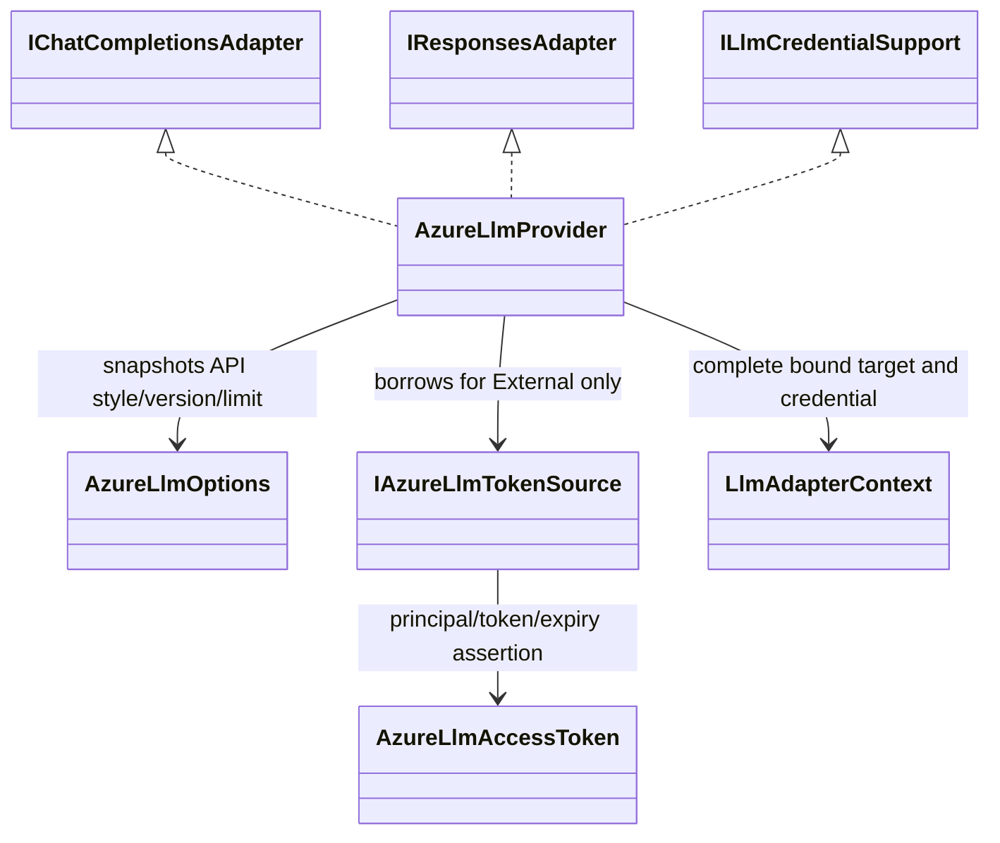

`AzureLlmApiStyle.V1` uses the caller's `/openai/v1/` root; dated style uses `/openai/` with an explicit nonempty version and deployment path for Chat. Responses uses the selected root's `responses` endpoint. No hostname, deployment-dot removal, historical channel dates or model-suffix heuristics apply. Only deployment/model placement and method stream mode change; native reasoning, tools, schema, filters, usage and unknown fields remain untouched.

External authentication is provider-owned. The borrowed source has a captured stable `BindingIdentity` (tenant/audience/auth configuration) and returns an immutable token carrying its asserted principal and expiry. Core fingerprints contain only the stable principal/configuration, never token content. The source must validate its actual principal and own login/refresh; the provider checks the assertion, source identity and expiry before sending. It calls the source once per explicit operation and adds no refresh retry, reauthentication, environment discovery or alternate-target attempt. Configuration drift requires a new provider and invalidates old Sessions; token rotation with the same principal retains complete-target affinity and original Responses ownership.

Requests are snapshotted before awaiting token acquisition. Conflicting unselected authentication defaults fail before send. Complete results wait for normal bounded UTF-8 body EOF, declared-length checks, response/client disposal and cancellation. `MaximumBodyBytes` bounds raw JSON/error bodies. Duplicate properties, malformed strings/encoding, truncated JSON and unexpected SSE media fail; root native errors preserve original body and HTTP status. The factory, token source and clock remain application-owned. Conversion is an explicit separate decorator with its existing strict loss rules; native Azure filter retention does not grant automatic cross-protocol equivalence.

155 independent offline cases cover native JSON/SSE, authentication, continuation/Session identity and transport/resource boundaries. Chat retains empty-identity annotations, unknown native metadata and per-choice original indices; the first possible finish starts a bounded tail buffer through filter/usage records, DONE, normal EOF and disposal. Responses preserves unknown events and holds completed/incomplete/failed/error without changing native status; missing/repeated/late terminals or changed response identity fail. Raw bytes are bounded before SSE line parsing; pending tail records and tracked choice indices have separate explicit limits. Tool/item/call IDs remain native, with no tool execution or argument aggregation. The new SSE binding identity/resource policies require fresh Sessions for the earlier JSON-only checkpoint rather than silently rebinding. Core legacy fingerprints and conversion-v24 are unchanged. Cloud login, actual token refresh, live model verification and optional compact/WebSocket/Realtime operations are not claimed.

## Vertex standard Gemini provider

`LLM.GoogleVertex` owns native Vertex Gemini/Claude JSON/SSE through the existing `IGeminiAdapter`, `IClaudeMessagesAdapter` and `ILlmCredentialSupport`. It references only LLM and standard HTTP, with no dependency on `LLM.Google`, Azure, Conversion, a cloud identity SDK or another capability. It adds no new core protocol or canonical message model. Other Vertex dialects remain separate pending work.

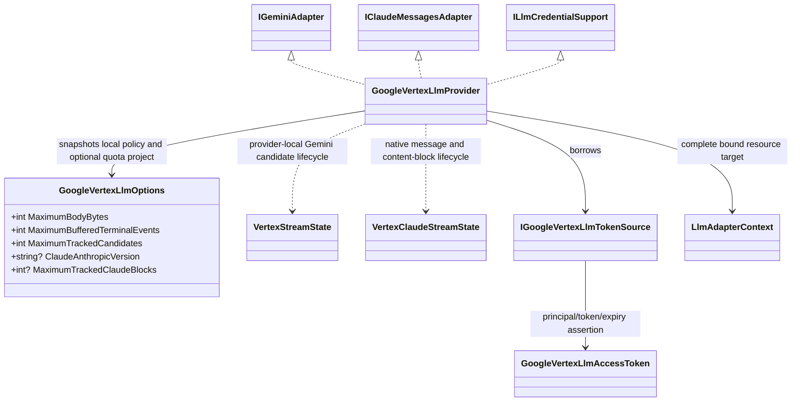

The caller supplies the versioned HTTP root and the full `UpstreamModel` resource: publisher form `projects/{project}/locations/{location}/publishers/{publisher}/models/{model}`, or tuned `projects/{project}/locations/{location}/endpoints/{endpoint}`. Components are validated/escaped individually. Resource project/location and native method are not inferred from hostnames/model suffixes or credential files. The existing complete-target fingerprint therefore includes project/location/resource identity without introducing a universal cloud coordinator or a loose model-plus-key pool. No resource management endpoint is added.

Only External credentials are supported. The application owns source login/scopes/refresh and the truth of its principal assertion. The provider captures stable source configuration, invokes it once per operation, verifies principal/source/expiry before send and never stores a short-lived token in Session. Optional quota-project header is explicit and fingerprinted; inherited unselected Key/project headers fail. Rotating tokens keep a Session; changing project/location/model/server/version/principal/provider settings rejects it. Factories, sources and clocks remain borrowed.

Native request snapshots precede token acquisition; only routed model and method stream flags are removed from Gemini's body. Tools/IDs, thought signatures, media, schema/thinking settings, safety, cached-content references and unknown fields remain native. This does not promise that a selected Vertex model accepts Developer API-only fields; the SDK never silently strips IDs or weakens schemas. Complete JSON uses strict bounded UTF-8, duplicate/escape/length checks and waits for EOF, disposal and cancellation. Original native errors and prompt blocks remain distinguishable from answer success. No generation retry, rerouting, file fetching, tool execution or implicit history replay is introduced.

150 Gemini offline cases cover complete wire/results and native SSE, both resource forms, stable identity recovery, authentication and resource faults. Provider-local SSE state retains original sparse/default candidate indices, signatures, tools and unknown data without aggregation. The first candidate finish or prompt block starts a bounded tail buffer through usage/metadata, EOF, length checks and disposal; incomplete/filtered/future reasons stay native, with no synthesized success. Missing/repeated/reopened candidates, changed response/model identity and late errors fail before held terminals. Precise ProtoJSON int32/enum representations avoid float rounding or normalization. Raw bytes are bounded before line parsing, and pending terminal/candidate counts have separate explicit limits. The new SSE binding identity requires fresh Sessions for the prior JSON-only checkpoint; core credential fingerprints and conversion-v24 are unchanged. Conversion remains a separate explicit decorator with existing strict loss rules; common text integration does not establish Vertex-specific tool/schema equivalence. Live cloud authentication/model verification and Live/Interactions remain unverified or unimplemented; separate Express and MaaS delivery is documented below. See the [provider matrix](../src/Asgard.Loki.LLM.GoogleVertex/README.md).

### Vertex Claude complete JSON

The same independent supplier implements the existing `IClaudeMessagesAdapter` complete JSON operation. The explicit caller protocol chooses `:rawPredict` with a full `projects/{project}/locations/{location}/publishers/anthropic/models/{model}` target, rather than guessing from model names or moving a Gemini Session. No new core protocol, provider dependency or universal cloud coordinator is added. Claude SSE uses its own provider-local message/block state described below.

Only routed model, method stream mode and the selected body `anthropic_version` change. Tools and error-result association IDs, signed/redacted thinking, media, output schema/cache blocks, usage and unknown fields remain native. A supplied conflicting/null/wrong-type version fails before token acquisition; no first-party Anthropic Key/version header is added, and inherited versions/Keys are rejected before send. The nullable `ClaudeAnthropicVersion` option defaults through omission to the native Vertex version, and is omitted from binding serialization when null. An independent legacy-byte test proves that unchanged Gemini options retain the preceding provider identity; explicit version configuration participates in binding. Core credential fingerprint algorithms and conversion-v24 are unchanged.

Both protocols reuse this supplier's borrowed token/factory/clock and bounded strict JSON transport, keeping complete-target/principal affinity, original HTTP/root errors, normal EOF/length/disposal and cancellation requirements. No generation retry, model mapping, history replay or tool execution is introduced. Forty additional offline cases verify complete Claude wire/results, version/resource/header boundaries, legacy Gemini identity, token-refresh target recovery, changed protocol/principal/version rejection, explicit common-text conversion and transport faults. Vertex coverage at the Claude SSE checkpoint was 248 cases; real cloud authentication/model acceptance remains unverified. See the [Claude provider section](../src/Asgard.Loki.LLM.GoogleVertex/README.md#native-claude-complete-json).

### Vertex Claude native SSE

The explicit Claude adapter posts `stream=true` to the same bound resource's `:streamRawPredict`. Its provider-local state is independent of Gemini. It retains original sparse block indices, unique known tool IDs, partial JSON and signature deltas without assembling content or executing tools. Unknown blocks/deltas/events remain native; known block association/type, message start/stop and conflicting stop-reason boundaries are checked. Cumulative same-reason message deltas retain original usage records.

The first native stop reason starts a finite tail buffer. Native message stop and later ping/unknown metadata keep their order and wait for normal EOF/declared length, response/client disposal and cancellation. Native error before possible success remains a failed-terminal event, even before message start; native/platform errors after possible success fail without releasing held success. Untyped platform root errors preserve raw body/status. Read/disposal/cancellation failures and early consumer exit create no completion/retry/reconnection. No EOF-synthesized stop, reason normalization, signature reconstruction or tool execution is added.

Total raw bytes are bounded before SSE line parsing; the existing pending-tail limit applies. Nullable `MaximumTrackedClaudeBlocks` defaults through omission to 128, bounds total seen block associations and avoids allocating by index. Omitted policy preserves preceding Gemini/Claude JSON provider binding bytes; explicit changed policy participates in fingerprints and invalidates old Sessions. Core credential/protocol contracts and conversion-v24 remain unchanged. Fifty-eight new offline cases verify independent full native events, lifecycle/association/limits, faults, snapshots, JSON-to-stream Session recovery and explicit common-text conversion streams. Native signed/opaque fidelity still does not establish cross-protocol equivalence or live model acceptance.

### Vertex Express explicit Gemini provider

`GoogleVertexExpressLlmProvider` is a separate Gemini/API-Key-only implementation in the same supplier package, with its own `GoogleVertexExpressLlmOptions`. It does not expose Claude or require an OAuth source. Standard provider construction/authentication/binding identities remain unchanged. The caller explicitly selects the Express provider, versioned root and `publishers/google/models/{model}` short resource; no project/region/model-name inference or account management is introduced.

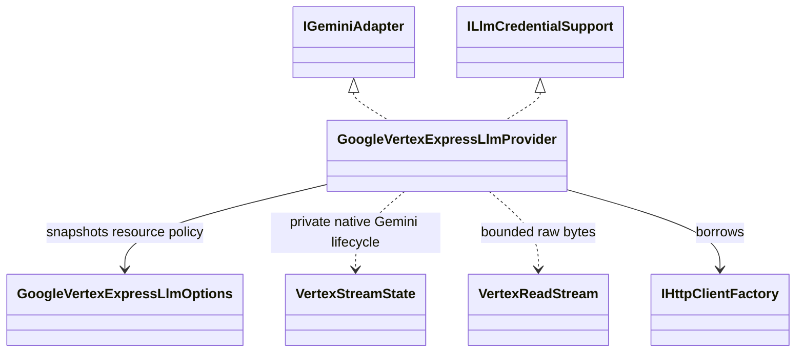

Selected Keys enter only `x-goog-api-key`, with no automatic URL/body credential. Same-kind defaults are overridden per request, while unselected Authorization/other Key/quota-project defaults fail before HTTP. Registration rejects unsupported credentials/protocols. Sessions bind complete Express target/resource, credential Key identity and local resource policy; changes reject prior Sessions without reselection. Existing core fingerprint algorithms and conversion-v24 are unchanged.

Native bodies/results retain full tools/IDs, thinking/schema/media/safety, exact values and unknown members. JSON and SSE use this supplier's strict bounded readers and native Gemini state, including delayed terminal/usage tails through normal EOF/length/disposal and final cancellation. The provider does not reinterpret standard resource names, fetch tokens/files, execute tools, reassemble signatures, infer model capabilities, retry or switch authentication/targets. Factories stay borrowed; operation HTTP resources are disposed. Explicit conversion is a separate fixed-upstream decorator with existing strict field/loss limits.

Sixty-seven additional offline cases verify independent complete wire/result and native SSE event goldens, header identity, snapshots, fixed-target/Key/configuration affinity, bounds/faults and common-text conversion. Vertex coverage at the Express checkpoint was 315 cases; real account/model acceptance remains unverified. This adds no production package, capability dependency or universal cloud coordinator. See the [Express support and initialization](../src/Asgard.Loki.LLM.GoogleVertex/README.md#explicit-express-gemini-jsonsse).

## 2. Registration and lifecycle

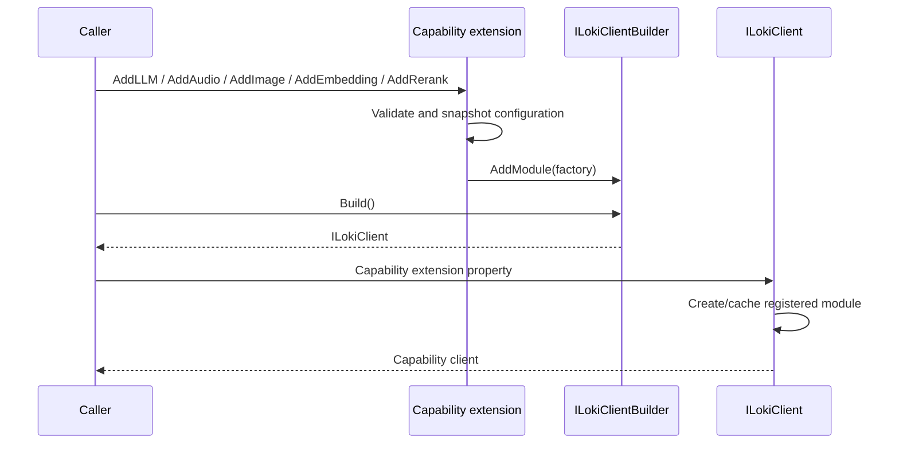

Registration extensions target `ILokiClientBuilder`; access extensions target `ILokiClient`. Neither needs a reference to the entry implementation. Module factories are lazy and a module is cached per client. Duplicate registrations fail explicitly.

The client disposes factory-created modules that implement disposal, once each. Externally supplied providers, caches, coordinators and HTTP factories remain borrowed dependencies and caller-owned. Providers obtain request-local HTTP clients from `IHttpClientFactory`; request/response streams are disposed after use.

## 3. LLM contracts

The public surface is `loki.LLM.ChatCompletions`, `loki.LLM.Responses`, `loki.LLM.ClaudeMessages`, `loki.LLM.Gemini`, `loki.LLM.OllamaChat` and `loki.LLM.OllamaGenerate`, each with complete and streamed calls. Each owns native request/result/event contracts; they are distinct protocols, not aliases for one text-only message format. Claude has explicit `MaxTokens`. Gemini keeps its native `contents`, `systemInstruction`, `generationConfig` and tool structure; its actual model is encoded in the endpoint path, and method-selected streaming uses `:streamGenerateContent?alt=sse` rather than a body field. Ollama Chat has its own protocol flag (16), native messages/extensions and JSON/NDJSON transport; the four-protocol converter does not automatically support it. Existing default target protocol flags remain unchanged.

Requests have strongly named core fields and extension JSON parameters. Results own an independent JSON snapshot. Preserve unknown fields/events, input/output items, tools, reasoning, usage, cache controls, errors and original IDs. Only actual model mapping and the method-selected stream switch are changed. Extension parameters cannot override explicitly declared core fields.

The currently implemented LLM providers are Volcengine Ark, OpenAI, Anthropic Claude Messages and Google Gemini Developer API over HTTP/JSON and SSE, plus native Ollama Chat/generate over JSON/NDJSON. Provider packages reference only LLM and standard HTTP dependencies. OpenAI additionally implements explicit native Responses compaction and WebSocket through optional LLM contracts; Gemini Live and Bedrock/Vertex AI authentication remain unimplemented. There is no automatic protocol conversion in native providers. Claude streams require `message_stop` or an explicit error; Gemini streams require a terminal reason for every observed candidate or an explicit prompt block/error. Native unknown events, signed reasoning and media remain unchanged.

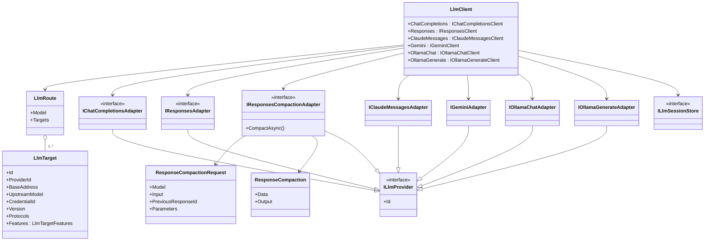

### Native Ollama Chat

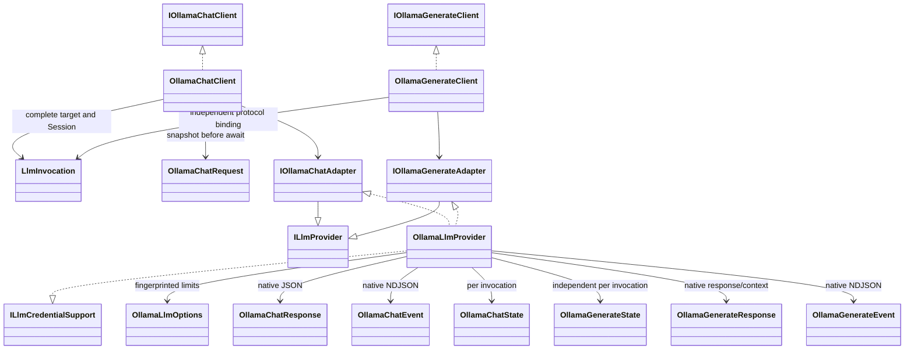

The native generate client uses protocol flag 32 and `OllamaGenerateRequest`, whose routed model is named and whose remaining fields use native extension JSON. This retains optional prompt omission versus empty/null and original suffix/system/template/context/images/think/format/options without a Chat wrapper. `IOllamaGenerateAdapter.GenerateAsync` and its explicit streaming implementation append `generate` to the configured API root. Generate state validates native response/model/done independently of Chat; only pure UTF-8/JSON/NDJSON/error utilities and request construction are shared within the provider. Returned context stays application-owned and is never automatically cached or replayed. Both operations use complete Session affinity, explicit credentials and delayed terminal publication. Provider implementation identity includes `generate-v1`, invalidating bindings from the preceding Chat-only checkpoint; no new package/dependency or automatic protocol upgrade is introduced.

`LLM.Ollama` depends only on LLM and standard HTTP. It implements explicit `POST chat` relative to the caller's `/api/` root, preserving proxy prefixes. `OllamaChatRequest` owns `Model`, `Messages` and extension parameters; `think`, `format`, `options`, `keep_alive`, images, tool IDs/object arguments/history and future fields remain native. Only method stream mode and configured actual model change. No model-name branch, model registry/download, tool executor, server or shared Embedding workflow is added. Native `/api/generate` is delivered through its own client and state below; cross-protocol Ollama conversion remains pending.

Anonymous authentication requires a stable explicit identity, per-provider support and no inherited default Authorization; selected API Key calls use their own Bearer value. Named clients and resource limits participate in implementation fingerprints. Session changes fail without reselection. Request-owned messages, responses and clients are disposed; factories/caches/coordinators remain borrowed.

Provider-local bounded readers retain exact UTF-8 JSON, numbers and unknown records; duplicate properties, invalid Unicode, malformed/truncated/late records and declared-length mismatch fail without trimming. Complete JSON requires a native terminal; NDJSON partials stay incremental and native done/error terminals wait for normal EOF and transport disposal. HTTP status/body and native error events remain distinct; no successful stop/usage/tool ID is synthesized. Stream error events expose `IsError`; a terminal event is not a claim of model or tool success. Cancellation, read/disposal failure and early consumer exit do not trigger retry or fallback. See the [provider matrix and independent offline evidence](../src/Asgard.Loki.LLM.Ollama/README.md).

The scheduling unit is a complete target, not one model with a pool of interchangeable keys. One public model may map to different servers, actual models, credentials and providers. Explicit protocol flags limit candidate selection. Public and upstream model identities are separate result metadata; original provider JSON is not rewritten to disguise its identity.

A new Session uses `ILlmTargetSelector`; an existing Session bypasses selection. A provider must use the target and credential already selected by the capability module.

### Optional native Responses operations

`IResponsesCompactionAdapter` is a separate optional provider contract. The OpenAI package implements it; Ark and the conversion decorator do not advertise it. `IResponsesClient.CompactAsync` has a default unsupported implementation for compatibility with older caller-defined clients. The built-in client requires both native Responses support and `LlmTarget.Features.ResponsesCompaction`; target registration rejects a feature without its protocol/adapter implementation. New-session selection filters the explicit feature; after coordinated creation the actual winning binding is checked again. A previously bound target without the feature fails rather than switching to a capable target.

Compaction sends one native `/responses/compact` request, with model mapping and no stream switch. It accepts the native optional text/item input and optional `previous_response_id`; previous-response ownership, target identity, cache failures and cancellation use the same LLM-owned Session contract. The complete response/output window, encrypted state, retained items, tool links, usage and future fields stay unchanged. No automatic compaction, history retrieval/pruning, decryption or retry is introduced. A compaction result ID is not registered as a generated-response ID. The application chooses when and how to use the returned complete window in subsequent native calls.

`Features.None` is omitted from target JSON so adding this optional contract does not change the default basic-target fingerprint representation. Non-default feature declarations are fingerprinted; changing them invalidates affected bindings. Source compaction items remain hard failures in cross-protocol conversion even with `AllowLoss`, while native requests and same-protocol copies retain them.

Responses WebSocket is an optional extension. `IResponsesWebSocketAdapter` opens an `IResponsesWebSocketConnection` exposing metadata, raw JSON send, native `ResponseEvent` enumeration, explicit close and async disposal. `IResponsesClient.OpenWebSocketAsync` defaults to unsupported so existing custom clients remain valid. The built-in client resolves targets explicitly declaring `LlmTargetFeatures.ResponsesWebSocket`, validates the returned connection identity, and wraps the native adapter. `LLM.OpenAI` implements this extension; other providers and conversion decorators do not implicitly advertise it.

The internal bound connection never invokes first-binding resolution after opening: each send verifies the original binding still exists and matches exactly. A missing/replaced Session fails rather than binding a live socket to a new target. The handshake is also checked after its await; invalidated or mismatched connections are disposed. Known response lifecycle IDs are registered under the original Session after revalidation; creation/steering continuation and explicit cancellation response IDs must belong to it. The wrapper serializes writes, permits one active reader, preserves stream IDs and unknown/native JSON, and maps only the public alias on `response.create` to the fixed actual model. It rejects HTTP-only `stream`/`background` fields without silently removing them. Native transport adapters own framing, protocol terminal validation and socket resources; factories/stores remain borrowed. Socket lifetime is separate from logical Session lifetime, with no automatic reconnect, retry or event replay.

For native controls without an independent acknowledgement, bounded existing response records retain a bit recording the possibility of late uncorrelated errors. Known response controls remain lane-scoped; unknown-scope controls use one conservative connection bit. A normal generation terminal does not prove its control cannot still fail. Such ambiguous errors are preserved but never used to consume a new queued generation. Definitively unsent controls roll back their markers. No control transcript, input history or unbounded lane-history collection is added.

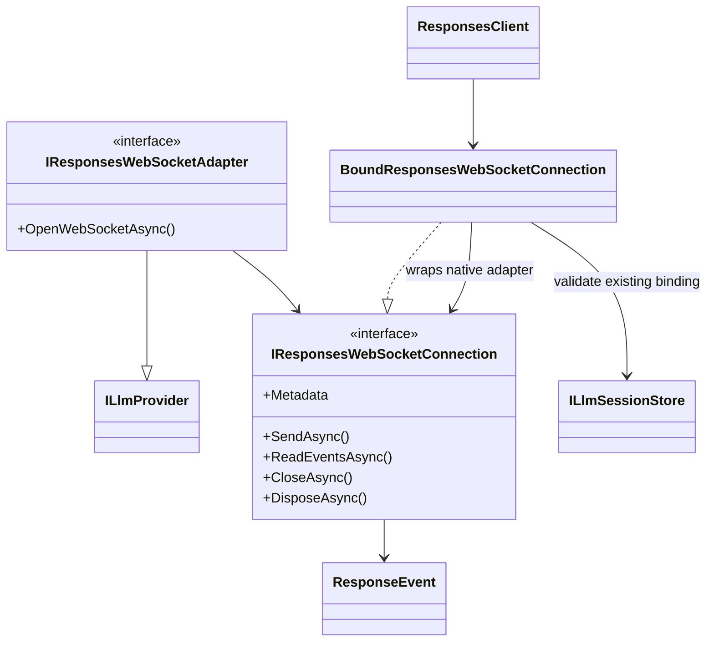

`LLM.OpenAI` owns `IOpenAiResponsesWebSocketFactory`, its default `ClientWebSocket` factory, internal `ResponsesWebSocketTransport`, native connection and protocol state. Only the owning provider and its offline tests use these byte/frame/state details. Messages have explicit byte limits; fragmented text is assembled and strictly validated as UTF-8 before JSON parsing. Socket IO failures/cancellation abort the connection without retry; explicit close interrupts pending IO and disposal owns the returned socket, never the borrowed factory. No new package dependency or cross-capability transport abstraction is introduced.

`OpenAiResponsesWebSocketOptions` bounds message bytes, pending submissions and remembered response/event identities. Options are snapshotted; custom factory identity/options enter provider binding identity. Default configuration preserves the existing HTTP constructor signature and basic binding identity. HTTP client headers/settings are separate from the WebSocket factory's handshake configuration. Protocol state associates queued/active/terminal responses by lane and response ID, retains bounded event-ID history after creation or control completion, and checks real sequences/status/closure. A late/unknown-ID error cannot consume another queued create, and a completed control's ID cannot be reused for a new request. Steering acceptance is not a generated response: native automatic successors and caller-supplied required-input continuations are correlated without sending anything automatically. Unallocated steering failures can omit IDs. Native unknown events are preserved; recognized output types are an explicit set rather than a prefix heuristic. State is bounded and never contains a tool executor, history reconstruction service or global scheduler.

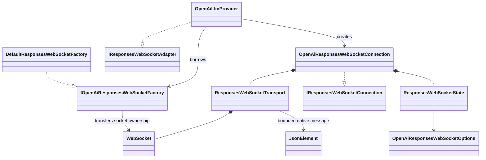

### Explicit conversion extension

`Asgard.Loki.LLM.Conversion` is an optional LLM extension with a single project dependency on `Asgard.Loki.LLM`. It owns pure request/response conversion and single-call stream state. Its private conversion representation never replaces the four native contracts or crosses capability boundaries. This remains an embeddable SDK: no listener, HTTP relay endpoint, gateway administration, billing, tool executor or background orchestration is introduced.

`LlmConversionOptions.GeminiOutputFormat` explicitly selects the Gemini target envelope: `LegacyJsonSchema` preserves the current default wire body, `ResponseFormat` writes modern `generationConfig.responseFormat.text`, and explicit `LegacySchema` translates representable JSON Schema into typed `responseSchema`. Source modern text and legacy JSON Schema envelopes are recognized independently; conflicting text settings are rejected and unrepresentable media/unknown fields remain diagnosed. JSON Schema bodies are copied unchanged by default. A private `GeminiSchemaMapping` separately translates typed source input. `GeminiSchemaWriter` owns explicit typed output, exact int64 strings and double decimal-roundtrip validation; unavailable validation keywords hard-fail even with `AllowLoss`. Explicit open-object true is equivalent to the native default; closed/schema-constrained objects are not. Only annotation losses such as multiple examples can receive diagnosed consent. Private `OutputSchemaOrdered` carries the strict OpenAI text-format guarantee into recursive typed property ordering; other sources gain no invented guarantee. Typed function input reuses the reader. Independent `GeminiFunctionSchemaFormat` selects unchanged `parametersJsonSchema` by default or explicit typed `parameters`, reusing the writer without inventing a text-order guarantee for function arguments. Options and the `conversion-v25` algorithm identity enter Session fingerprints, so old conversion Sessions fail validation instead of being silently rebound. Native providers do not reference or inherit this policy.

Optional `LlmConversionTargetSettings` belongs only to the conversion package. `TargetSettingsValidator` checks final converted request fields, including configured defaults/replacements, against caller-declared efforts, native thinking modes, formats, explicit token ranges and control-field support. Violations hard-fail before provider IO even with `AllowLoss`. Missing declarations add no restrictions; missing request arguments are never filled or treated as known upstream defaults. This is not an account/model catalog, usage quota or native-request filter. Same-protocol/native branches and response/event content stay unchanged. `ConversionOptionsSnapshot` deep-copies and canonicalizes list sets at registration/per pure call; profiles enter complete-target implementation identity. Different profiles use separate configured converting providers/targets, not a runtime model-name policy lookup.

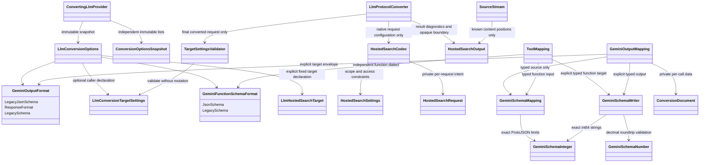

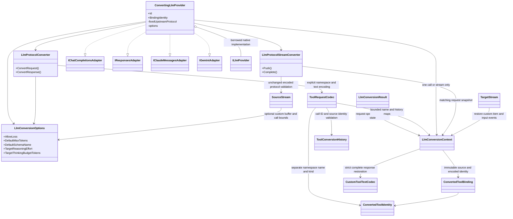

The caller explicitly registers the decorator and chooses a fixed upstream protocol; `LlmTarget.Protocols` describes exposed caller protocols. The decorator invokes the supplied native adapter on the target already resolved by LLM. It cannot select another server/model/key, nest another converting provider, retry or reconstruct history. A same-protocol invocation transparently uses the native adapter and leaves `Metadata.Conversion` null.

Explicit `EnableCustomToolConversion` encodes Responses free-text custom definitions/history into ordinary function structures for Chat/Claude/Gemini. `LlmConversionResult.Context` carries immutable request-local generated-name and historical-ID maps; matching complete-response and stream overloads restore calls. The provider keeps this context only for one call/stream, never on itself or in Session/cache. Ordinary/custom names remain distinct, wrappers accept exactly one string input, and historical ID reuse/context mismatches fail. Completed message/tool item metadata remains in OriginalData; unfinished history fails. The explicit custom-only Gemini result envelope is an object containing the original text; ordinary function results retain their native rules. Limits bound names, historical/returned calls and strict UTF-8 input/results. Grammar, program/async/deferred semantics and unknown tool fields remain hard failures. No prefix-based restoration, tool execution or shared business coordinator is introduced.

Independent `EnableNamespacedToolConversion` expands one-level Responses namespace function/custom definitions. Private immutable `ConvertedToolIdentity` compares namespace/name/kind as separate components; `ConvertedToolBinding` records the generated name. Root ordinary functions stay unchanged, root prefix lookalikes cannot collide with namespace tools, and same-name function/custom definitions remain distinct. `Context.MappedToolCount` counts encoded identities once, with overlapping namespace/custom subset counts. Namespace-only functions activate the same complete/stream restoration and resource bounds without requiring custom conversion. `ToolConversionHistory` consumes original call IDs and validates optional function-result name/namespace against the pending source identity; it never pairs by display name or strips metadata before checking it.

Nonempty group descriptions produce a precise loss diagnostic and require explicit consent; original grouping guidance is not injected into a function description. Global choice modes retain the tool set; unambiguous root named choices remain supported. Namespace-specific selectors, matching child-name selectors and allowed-tool subsets remain unsupported rather than being inferred from punctuation. Unknown/nested/deferred namespace fields are hard failures. The identity and separately bounded group tables remain within this optional LLM extension; no cross-capability coordinator, registry or authorization service is introduced. Native protocol calls preserve the full original structures.

`LlmProtocolStreamConverter(context)` creates independent single-use source/target state from the immutable request context. It validates the original encoded source document without rewriting it, then `TargetStream` writes restored custom items/input delta/input done/item done/final snapshots. Parameters remain buffered until a complete JSON wrapper passes validation; the decoded string is emitted as one custom delta. Ordinary functions retain their own argument events and text stays incremental. Missing source terminal/errors/wrong IDs fail without successful final events; explicit length/filter finishes remain incomplete. Source aggregation checks raw argument bytes (`6 * input limit + 64`) and the combined ordinary/custom returned-call count before appending state. These optional bounds apply only with an active mapped tool context; native/stateless stream behavior is unchanged. Context and stream state never cross capability-package boundaries.

All twelve off-diagonal protocol directions support the documented common subset for requests, single-candidate responses and streams. [The conversion package matrix](../src/Asgard.Loki.LLM.Conversion/README.md) defines the exact fields and limits. Unknown or non-equivalent fields fail with field-level diagnostics by default. Only caller-selected `AllowLoss` permits diagnosed omissions; opaque reasoning/signatures, cross-protocol response-chain/storage semantics, invalid arguments and ambiguous tool links remain hard failures. Remote media is not downloaded or assigned an invented MIME type. The original request is never mutated.

Converted complete results keep upstream JSON and request/response diagnostics in `LlmResultMetadata.Conversion`. Converted stream events keep the triggering source JSON and cumulative diagnostics; their generated event names/sequences are target-protocol metadata, not upstream SSE delivery identity. Text deltas are incremental. Tool argument fragments are accumulated and emitted only after complete JSON is available. Source transport failure, missing terminal, unsupported interleaving or inconsistent final output fails without emitting a successful terminal. Conversion does not resume streams or transfer native response IDs between incompatible stateful APIs.

The internal call tracker separates all observed IDs from pending results: a result consumes exactly one pending call, and an ID-less Gemini result requires a unique pending name. Generated IDs reserve explicit IDs from the whole request. Source stream state validates block closure, stable item identities, monotonic event sequences and done/final snapshots; target state rejects text that would overtake an unfinished tool. Independent usage tails are allowed after candidate completion, while repeated terminal events and post-completion content are rejected. An explicit length/filter finish remains incomplete in Responses items. Missing token counts are not fabricated for protocols that require them.

Private reasoning conversion state separates effort, numeric budget, dynamic/off mode and requested summary/display. Qualitative levels map only where represented; numeric budget replacement requires an explicit target effort plus diagnosed loss consent. Caller-selected manual Claude budgets must fit the explicit output limit; model-specific support is not inferred from names. Private structured-output state carries the unchanged JSON Schema and wrapper metadata. OpenAI requires an explicit source/default schema name; unsupported metadata or enforcement changes remain diagnosed. Options belong to the conversion package, and the algorithm/options are fingerprinted into Session bindings.

Known descriptive response envelope fields and executed-request echoes are retained in the original upstream JSON, separately from converted content. They never become a new target request or continuation authorization. This classification is explicit and response-only; unknown business fields and opaque reasoning still follow strict conversion rules.

### Rich tool-result conversion boundary

Private `ToolResultMapping` keeps scalar strings distinct from content arrays and reuses private image/PDF payload mapping inside the original result container. The temporary private user-content role permits parsing user-provided tool data; it never emits a new user message, changes instruction authority or executes a tool. Text arrays map among Chat/Responses/Claude; image/PDF arrays map between Responses/Claude. Unknown fields remain diagnosed, while unsupported content/container kinds, explicit errors and opaque replay state fail rather than being coerced into another business result.

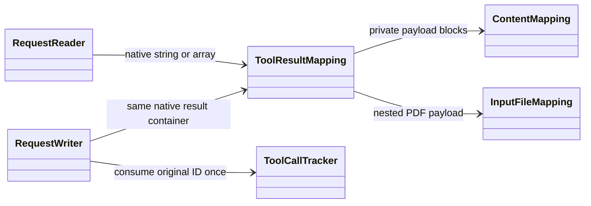

Request-local namespace/custom identity remains independent of content kind. Supported custom result arrays share the existing opt-in and identity map; their full JSON UTF-8 size uses `MaxCustomToolInputBytes`, with original string/key Unicode validation and a pre-serialization lower-bound check. No Gemini array wrapper is invented. Native Claude `is_error: true` requires the explicit Claude/Gemini format below; default policy and other target protocols retain hard rejection. Encrypted citations nested in valid tool-result text remain hard native-only boundaries even with ordinary loss consent. False remains equivalent to the normal native default; native JSON copies preserve all fields.

The call tracker also exposes private pending state to the Chat writer. Adjacent Responses calls are grouped into one Chat `tool_calls` turn; unrelated messages or a new turn before all pending results are consumed fail instead of producing invalid native ordering. Text after all results can remain a separate user message. This is protocol encoding/validation, not a history-reconstruction or agent loop. Rich history supports both complete and SSE model-reply calls without adding result-delta streaming.

### Explicit Claude/Gemini tool-error formats

The optional conversion package owns `LlmToolErrorFormat` and `LlmConversionOptions.ToolErrorFormat` / `MaxToolErrorBytes`. These describe request-history representation only. No public universal result model, native provider operation, tool executor or cross-capability dependency is introduced.

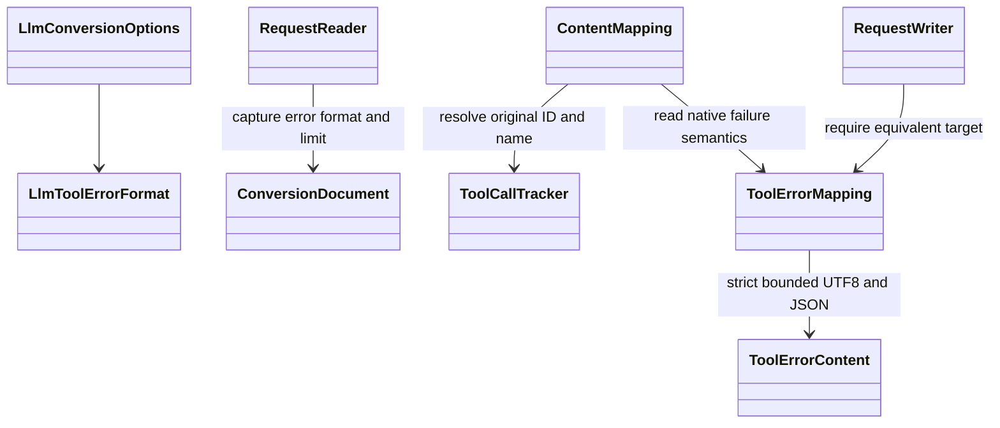

The default `NativeOnly` rejects both Claude `is_error:true` and Gemini root `functionResponse.response.error` during cross-protocol request conversion, even with loss consent. `GeminiResponseObject` declares Claude string content to contain the complete Gemini response object: all native error/output/business members and exact JSON values remain intact, and the object must contain non-null root error details. `GeminiErrorText` instead declares original Claude error text and a Gemini response with exactly one string error member. No JSON-looking text is guessed or parsed in the text format. Missing/null errors, malformed/duplicate JSON, mixed formats and rich Claude error arrays fail explicitly. Gemini error results carrying parts, willContinue or scheduling also hard-fail rather than losing media/continuation/execution semantics. JSON arrays inside Gemini error details stay business data and do not become media blocks.

Converted Claude errors regain `is_error:true`; Chat/Responses remain unsupported error destinations. A successful source result whose parsed object has a root error key cannot implicitly become a Gemini failure: `tool_result_error_semantics_conflict` is a hard boundary. Nested business keys are not interpreted. Existing pending-call validation still enforces original IDs/names, one-time consumption and parallel association before result conversion. No reordering or automatic history repair occurs.

The configured positive error-byte limit applies to raw error text and full compact JSON; strict Unicode and lower-bound checks precede expanded serialization. These are local conversion resource limits, not upstream quotas. Formats and bounds are immutable snapshots included in `conversion-v25` fingerprints; prior converting-provider Sessions fail rather than silently rebind. Native provider identities are unchanged. Independent complete fixtures and public SDK HTTP/SSE tests separately verify request history, model-error propagation and terminal suppression after late failures. See the [format matrix and limitations](../src/Asgard.Loki.LLM.Conversion/README.md#explicit-claudegemini-tool-errors).

### PDF input conversion boundary

Private `InputFileMapping` belongs to `LLM.Conversion` and handles user PDF request blocks across Chat, Responses, Claude and Gemini. It carries only the caller's inline Base64 or verified native URL reference plus an optional filename through private content blocks. Base64 validity is checked without materializing a decoded file; no public universal file model, file parsing service, resolver or cross-capability coordinator is introduced. Native providers and package dependencies are unchanged.

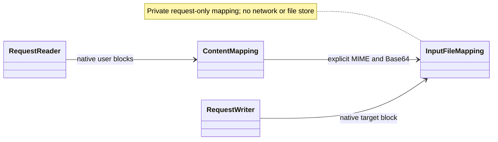

OpenAI filenames transfer between its two text protocols. A target without an equivalent field needs an explicit filename-loss diagnostic; Claude title/context/citation/cache controls are never invented as filename equivalents. Unknown fields and rendering detail retain diagnostics. Only explicit PDF MIME is supported in this slice; bare Base64, incompatible types, malformed/empty data, ambiguous sources and non-user file roles fail. No MIME is inferred from extensions or payload sniffing. Native JSON preserves other formats and metadata.

Claude URL-PDF can be represented as Responses `file_url` without fetching it inside the SDK. Other URLs needing type/access resolution remain explicit failures. Provider file IDs and Gemini file references cannot be assumed portable even with loss consent; no hidden upload/download or credential borrowing is performed. Native identity copies retain those structures. Generated-file output, document formats beyond PDF/declared UTF-8 text and an optional explicitly borrowed resolver remain separate work; supported rich tool results reuse the PDF payload mapping described above. The current conversion identity is `conversion-v23`.

### Hosted search conversion boundary

`HostedSearchTarget` is an explicit enum declaration owned by the optional conversion package: disabled, Responses GA web search, classic Claude direct search, Gemini Google Search or Chat search-before-answer options. `AllowHostedSearchWithFunctionTools` independently declares the configured target's mixed-tool support. These values enter the conversion binding identity; no native provider references this policy. `HostedSearchCodec` separates one hosted tool before namespace/custom identity encoding, leaves ordinary function processing intact and appends a genuine native search declaration after request generation. Private `HostedSearchRequest` is request-local configuration, not a public model, executor, registry or standalone search capability.

The first slice covers six request directions and explicit native tool choices. Common DNS allow lists and approximate location fields map only where supported. Unavailable access/scope/count/trigger constraints hard-fail even with ordinary loss consent; context-size guidance can receive an explicit diagnostic and consented omission. No model inference, location default, budget ratio, search query, tool removal to mask none, retry or target change is generated. Final target-setting checks still apply. Four additional Chat ↔ Responses/Claude request directions preserve required-search intent. Chat source options emit a named required search selector; Chat target options require named search or required/any with search as the only tool. Default/auto/none intent and Chat ↔ Gemini are hard trigger boundaries, including with ordinary loss consent. Chat function mixing is not enabled by the existing three-protocol combination flag. Nested Chat approximate locations translate to/from flat native locations; Chat/Responses context-size values transfer unchanged. No model name or search query is synthesized. Dynamic filtering and additional server tools remain separately audited native surfaces.

```mermaid
sequenceDiagram
participant Caller
participant Codec as HostedSearchCodec
participant Settings as HostedSearchSettings
participant Native as Native request JSON
Caller->>Codec: Explicit fixed-target declaration and source request
Codec->>Codec: Preserve required search; reject trigger mismatch
Codec->>Settings: Validate native location, context and constraints
Settings-->>Codec: Native configuration only
Codec->>Native: Chat options OR genuine tool and selector
Note over Codec,Native: No HTTP, model selection or tool execution
```

`HostedSearchOutput` identifies unrepresented execution/results/citations and generateContent grounding metadata at their native content positions, including history and streaming frames. The guard never scans arbitrary JSON keys inside function arguments or Schema. Known Claude search result/reference types and encrypted content/indices are hard native-only replay boundaries. Native copies bypass conversion and retain their JSON. Complete Web grounding ↔ Chat/Responses is mapped only with declared endpoint units as described below; the explicit single-text-part Responses ↔ Gemini stream profile is described below; broader result/stream mappings remain pending; request wiring with a substitute text reply is not live search or full conversation verification. The current conversion algorithm identity is `conversion-v25`; native providers version their own binding identities independently.

Private `ResponseCitations` maps complete Chat nested URL annotations and Responses flat URL annotations through private text blocks only. It preserves URL/title/order and unchanged-text indices. With default unknown units, rebasing still requires an ASCII prefix and range validation uses only a UTF-8 byte-length plausibility bound. Public `LlmCitationIndexUnit` and `LlmConversionOptions.OpenAiCitationIndexUnit` let callers declare verified endpoint behavior; they do not change endpoint behavior or infer model support. Private `CitationOffsets` then validates exact Unicode scalar boundaries and computes scalar/UTF-16/UTF-8 offsets without normalization. This scalar option is snapshotted and participates in `conversion-v23` binding. No public universal citation model, resolver or dependency is introduced.

Private `GeminiGrounding` maps complete Gemini Web grounding into those private citation blocks only when the target is Chat/Responses and its index unit is explicitly declared. It associates original native part/source indices, validates UTF-8 byte ranges and optional segment text, and preserves source/title/order/duplicates. Omitted Proto3 non-optional indices default to zero; explicit null or malformed values fail. Chat concatenation rebases by the declared unit; Responses retains block-local offsets. Unknown/query/display/confidence metadata, unsupported/missing source data and unassociated source/support entries are diagnosed separately. Broken ranges/associations are hard failures even with loss consent. No search call IDs, downloaded sources or tool execution are invented. Source JSON remains independent, and native identity conversion bypasses the mapper.

Private `GeminiCitationWriter` performs the complete reverse Chat/Responses → Gemini mapping only with an explicitly declared OpenAI index unit. It writes one Web chunk/support per annotation in original order, including duplicates, overlapping and empty ranges. Segment bytes and exact substring are computed through `CitationOffsets`; `partIndex` follows actual emitted text/function parts, skipping only blocks the target writer already diagnoses and omits. Non-HTTP(S) sources receive dedicated diagnosed loss rather than a fake Web URI. Unknown annotation fields retain source-reader diagnostics; invalid native ranges cannot be bypassed. No representable citations means no injected metadata. `LlmProtocolConverter.ConvertResponse` alone opts into this writer; `TargetStream.Complete` retains its default strict/consented citation boundary. The existing public scalar option is reused; no new abstraction, capability dependency, execution loop or supplier policy is added.

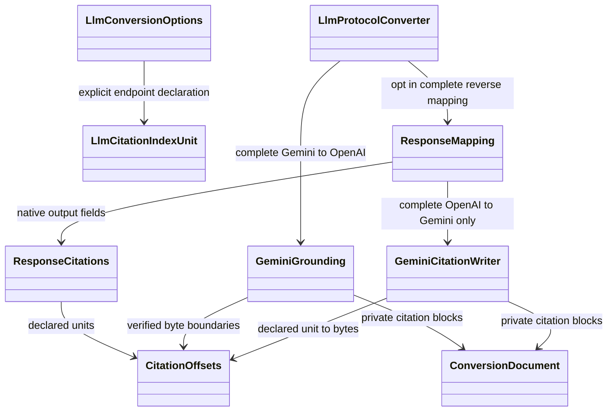

```mermaid
sequenceDiagram
participant Caller
participant Converter as LLM.Conversion
participant Guard as HostedSearchOutput
participant Mapping as ResponseMapping / ResponseCitations
Caller->>Converter: Convert complete native response
Converter->>Guard: Check execution and opaque replay state
Converter->>Mapping: Read private text and URL citations
Mapping-->>Converter: Native target + field/offset diagnostics
Converter-->>Caller: Converted result + original JSON
Note over Converter,Mapping: Complete mapping; declared Gemini to Responses stream profile is separate below
```

The verified Chat stream/request contracts do not provide matching citation fields. Complete-response support therefore does not automatically enable citation stream/history conversion. `SourceStream` continues to diagnose unrepresentable citations, and its complete snapshots are read under the same stream loss policy; it never fabricates a citation delta or a successful terminal after strict failure. Search execution and opaque replay data remain distinct from display-only citations.

### Converted Responses annotation integrity

Private `ResponseStreamAnnotations` retains bounded, per-call raw annotation state independently of the private text/tool conversion document. `SourceStream` validates output/item/content identity and closure; annotation indices may arrive out of order but cannot repeat. Source part/item/final snapshots must agree on every retained annotation field and order, including data the target cannot represent. The first authoritative snapshot may supply entries not observed as individual events; it is charged and range-checked just like event-originated entries. Loss consent never authorizes inconsistent source state or a successful terminal after truncation.

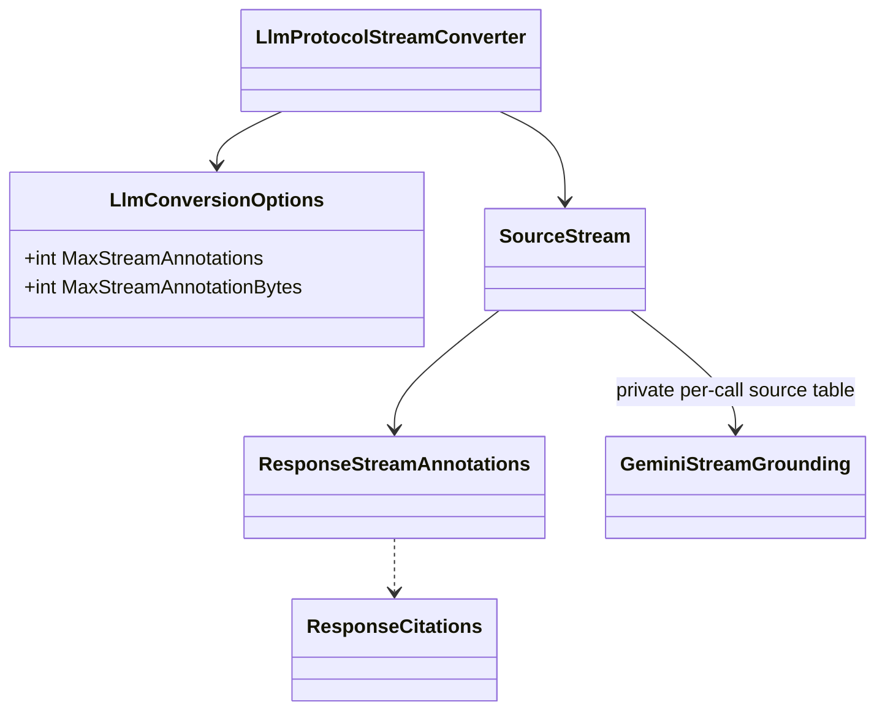

The new public scalar bounds default to 1024 unique annotations and 1 MiB of annotation JSON serialized to UTF-8 across all parts. Repeated matching completion snapshots are not counted twice. State uses sparse dictionaries, and overflow fails without dropping fields even under `AllowLoss`. `OpenAiCitationIndexUnit` also validates completed native URL ranges; unspecified units do not acquire guessed Unicode semantics. Options are captured and serialized into the `conversion-v23` binding identity; changed limits reject old conversion Sessions before HTTP. Native provider identities and same-protocol copy behavior remain unchanged. Target Chat citation streams and general Gemini layouts remain separately unsupported; the explicit Responses ↔ Gemini profile is documented below; no public universal citation model, media resolver, tool executor or shared capability coordinator is introduced.

`GeminiStreamGrounding` separately appends the original stream-wide groundingChunks and retains support snapshots. Chunk order and duplicate URLs remain native; support indices are never reset by frame or inferred from text. With the default disabled mapping profile, explicit int32/container/oneof and structural segment-order checks are made; missing global sources fail at source completion, without allocating by the highest index. Chunks plus supports share the existing count/serialized-UTF-8 byte limits. Metadata-only candidates may extend grounding after candidate finish without content/tools/a second finish. Without the explicit profile below, part/text offset binding and target citation generation remain unsupported; strict conversion keeps its grounding diagnostics, and consented loss cannot bypass malformed/unresolved/over-limit source state. Forty-nine additional offline cases include full native/request/lossy-target fixtures, fifteen public SDK cases and a real old-version Session rejection. No raw upstream model/account/search behavior is certified. The updated `conversion-v23` identity changes only converting-provider bindings; native providers and capability dependencies are unchanged.

### Explicit reverse citation stream

The existing SingleTextPart declaration also enables Responses → Gemini. SourceStream's Responses state validates original annotation/item/content indices, IDs and raw snapshots with ResponseStreamAnnotations. Canonical citations are copied into the private document only after final source snapshot consistency, keeping incremental text/tool comparisons separate from already validated annotations. TargetStream reuses ResponseMapping/GeminiCitationWriter/CitationOffsets, while private GeminiCitationStreamTarget checks the one-text-block association and independently bounds expanded source/support output. No public message/citation model or extra dependency is introduced.

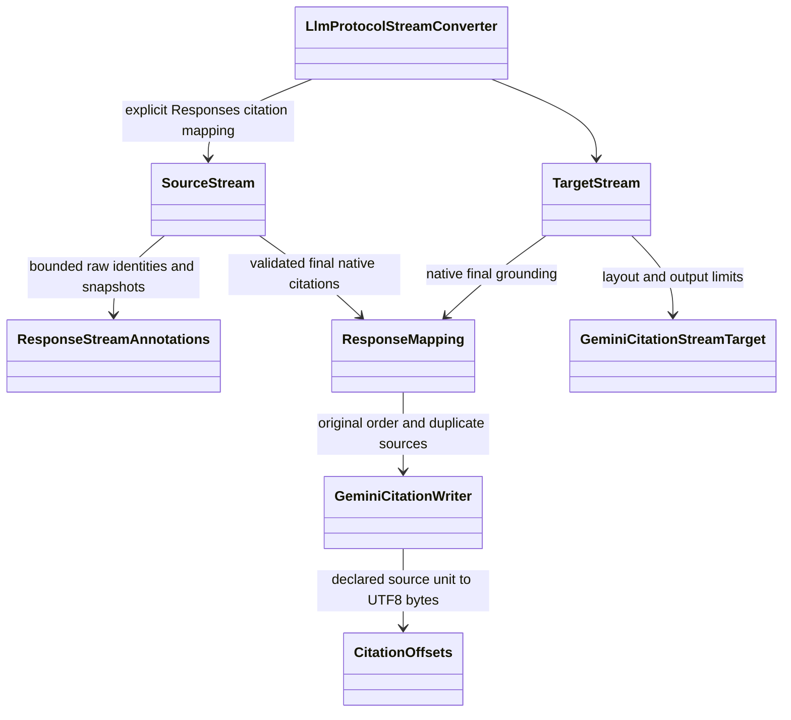

Text remains incremental; grounding/usage/finish is delivered only after upstream enumeration/disposal and final cancellation succeed. Multiple cited text blocks or tool layouts hard-fail rather than relabeling part identity; citation-free tools keep their existing behavior. Source annotations and target chunks plus supports have independent count/byte budgets, including under AllowLoss. Unknown fields retain diagnostics/original JSON, while malformed source state, bad ranges, truncation and late native/transport errors cannot release success. Fifty-four cases bring current conversion coverage to 1852 and overall coverage to 5489, still 28 packages. Conversion binding domain is now conversion-v25; exact native/core supplier identities remain unchanged, and v24 converting Sessions are rejected before HTTP. No hosted tool execution or live search acceptance is claimed.

### Explicit sequential text concatenation

The additive enum value GeminiGroundingStreamMode.ConcatenatedTextParts is scoped to Responses → Gemini. SourceStream's Responses branch additionally proves the original output/content key set and native part ordering before copying final citations; matching text alone does not establish identity. TargetStream tracks the order of nonempty text changes, allowing empty part starts without inventing content interleaving. Only the new mode enables these extra order/concatenation paths; default and SingleTextPart semantics stay unchanged.

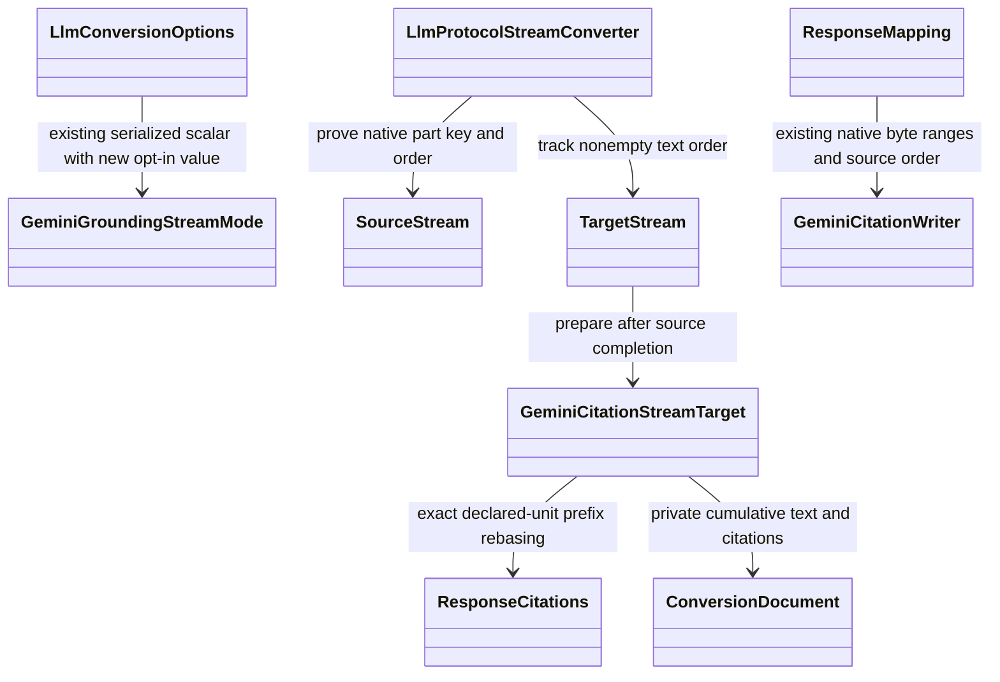

After successful source completion, the private working document combines only declared sequential text blocks, reusing ResponseCitations.Chat and Read plus the existing Gemini writer/offset codec. Original upstream JSON is not changed, no separators are added and message/part grouping is explicitly cumulative in the target. Tools, native part reversals and nonempty text interleaving fail rather than relabeling citations; invalid native index sets fail as source corruption. Source and expanded-output budgets and terminal/disposal/cancellation checks remain independent. Forty-seven new cases bring totals to 5536 (1899 conversion), 28 packages. New enum value 2 uses the existing snapshotted field, preserving exact default/SingleTextPart v25 binding bytes and previous enum values; mode changes participate in normal Session invalidation. No provider, capability dependency, business coordinator or execution service is added.

### Explicit text-file encoding

Public `LlmTextFileEncoding` and `LlmConversionOptions.TextFileEncoding` require a caller declaration before converting `text/plain`; `MaxTextFileBytes` independently bounds decoded UTF-8 bytes per file (1 MiB by default). `RequestReader` copies the immutable scalar options into the private `ConversionDocument` before reading content. `InputFileMapping` delegates only these declared pure-text files to private `TextFileMapping`; PDF byte handling remains separate.

```mermaid
classDiagram
LlmConversionOptions --> LlmTextFileEncoding : explicit UTF-8 declaration
LlmConversionOptions : +int MaxTextFileBytes
RequestReader --> ConversionDocument : per-request scalar snapshot
InputFileMapping --> TextFileMapping : exact text/plain only
TextFileMapping --> ConversionDocument : private file bytes and verified text
ToolResultMapping --> InputFileMapping : preserve result arrays and call IDs
TextFileMapping ..> RequestWriter : Responses / Claude / Gemini document blocks
```

Six request/history directions retain native file containers rather than replacing documents with message text. Chat file inputs are PDF-only under the official contract, so both Chat non-PDF source and non-PDF target conversion hard-fail. Responses uses a MIME-declared Base64 data URL, Claude uses its native `text` document source and Gemini uses inlineData. Unknown file/document settings and filename/title distinctions keep their loss diagnostics. Rich Responses/Claude tool-result arrays reuse the same mapping without inventing a user turn; error flags and Gemini multipart result boundaries remain intact.

Base64 syntax and decoded size are checked before allocation, followed by strict UTF-8 decoding; Claude raw strings undergo strict byte counting before encoding. Invalid Unicode, empty/missing/null data, source ambiguity, non-user roles and byte limits cannot be consented away. BOM, NUL, combining characters and newlines retain their original content. Other MIME/charset/office formats and provider-owned references remain separate work, with no hidden resolution, upload or model guessing. Both new scalar options enter the `conversion-v23` binding. One hundred new offline cases include complete independent native/golden/replay fixtures, 34 public SDK HTTP/SSE cases and boundaries/identity/immutability tests. No new package, dependency, universal file API or source fetch is introduced.

### Declared Gemini grounding stream mapping

Public `GeminiGroundingStreamMode.SingleTextPart` declares a fixed endpoint convention rather than universal Gemini semantics: one logical cumulative text part, segment byte offsets into that aggregate, and support records appended in arrival order. Responses ↔ Gemini streaming enables this profile, together with a declared `OpenAiCitationIndexUnit` describing the OpenAI endpoint. Missing units fail before upstream HTTP; default `Disabled`, other target pairs and native copies retain their own contracts. The scalar is snapshotted into the conversion binding, first introduced at v23 and currently v25; old converting-provider Sessions are rejected before HTTP.

```mermaid
classDiagram
LlmConversionOptions --> GeminiGroundingStreamMode : explicit fixed endpoint convention
LlmConversionOptions --> LlmCitationIndexUnit : OpenAI endpoint unit
LlmProtocolStreamConverter --> SourceStream : enable only Gemini to Responses
SourceStream --> GeminiStreamGrounding : append immutable source and support snapshots
GeminiStreamGrounding --> GeminiGrounding : map after normal source completion
GeminiGrounding --> CitationOffsets : exact aggregate byte ranges
GeminiGrounding --> ConversionDocument : private text citations
TargetStream --> ConversionDocument : native annotation events and identical final snapshots
```

Text deltas still emit immediately; source EOF plus resource disposal must succeed before the provider calls converter completion. `GeminiStreamGrounding` then validates one pure-text block, original source indices, byte ranges and optional segment text through the shared complete mapper. Multi-part/non-text/tool layouts or nonempty rendered-part links hard-fail even with loss consent. No repeated-text search, part guessing or URI deduplication occurs. Source chunks plus supports and expanded target annotations independently use the same configured count/serialized-UTF-8 byte bounds. Empty known confidence/rendered arrays normalize only inside the private mapper; nonempty confidence/query/display/unknown fields retain diagnostics and original JSON.

`TargetStream` emits native Responses annotation-added indices/sequences before text/part/item done and the response terminal. The same annotations appear in every completed snapshot; explicit length/filter finishes remain incomplete. `ConvertingLlmProvider` checks cancellation at source enumeration boundaries and before each delivered converted event, including final events. EOF/disposal failure, cancellation or invalid source state cannot precede a successful terminal. Standalone converter callers own correct invocation of `Complete` after source success. Fifty-four new offline cases include independent full native/golden fixtures, three declared units, cross-parser lifecycle checks, immutable snapshots, resource/layout/field boundaries, binding and eighteen public SDK cases. Other citation stream/history pairs remain separate; no universal message API, tool executor, HTTP listener or capability/provider dependency is added.

### Explicit LLM authentication kind

`LlmCredentialKind` belongs only to LLM. The existing two-argument credential constructor remains nonempty API Key authentication; the explicit `Anonymous(id)` factory creates a stable no-authentication identity without a readable Key. `ApiKey` throws for this kind, protecting direct legacy adapter paths. API Key JSON/default formatting remains compatible, and no secret enters serialized credentials or Session bindings.

```mermaid
classDiagram
LlmCredential --> LlmCredentialKind
LlmConfiguration --> LlmCredential : validate every configured target
LlmConfiguration --> ILlmCredentialSupport : optional native support declaration
ILlmProvider <|.. ConvertingLlmProvider
ConvertingLlmProvider ..|> ILlmCredentialSupport
ConvertingLlmProvider --> ILlmProvider : delegate fixed upstream support
LlmConfiguration --> LlmSessionBinding : same API Key domain or separate anonymous domain
```

Providers without the optional support contract remain API-Key-only. All configured targets must match their selected credential kind during module registration, before resolution/cache/HTTP activity; no fallback or endpoint/model inference is added. A converting provider delegates the fixed native support declaration, independently of conversion loss policy. Credentials remain immutable and collections are captured.

API Key fingerprint bytes are unchanged. Anonymous fingerprints use a distinct prefix domain and include the complete serialized target plus provider identity, preserving server/model/logical credential identity/protocol/version binding. Switching authentication kind or target semantics invalidates existing Sessions rather than rebinding them. Twenty-five core, nine converting and six direct OpenAI offline cases verify this behavior, including real legacy cache entries and coordinated concurrent first binding.

This credential prerequisite is now used by the separate native Ollama Chat client/provider described above; cloud refresh/signing remains pending. Native adapter header/default handling stays provider-owned, with 159 additional Ollama Chat/generate transport/public-SDK tests. Entry/abstractions, other capabilities and borrowed HTTP factory/cache ownership remain unchanged; existing four-protocol conversion still has its own declared matrix.

## 4. LLM Session and cache

### External LLM authentication identity

`LlmCredentialKind.External` and `LlmCredential.External(id, principalIdentity)` are LLM-owned explicit identity contracts. They contain no token source or short-lived access token. `ApiKey` throws for this kind; `PrincipalIdentity` throws for other kinds, and is ignored by default JSON/formatting. Credential/principal references are required and strict-UTF-8-validated at registration. Only providers explicitly declaring external-kind support can receive these targets; fixed converting upstreams delegate that declaration.

```mermaid
classDiagram
LlmCredential --> LlmCredentialKind
LlmCredential : +External(id, principalIdentity)
LlmCredential : +PrincipalIdentity
LlmConfiguration --> ILlmCredentialSupport : validate every target
LlmConfiguration --> LlmSessionBinding : structured external principal fingerprint
ConvertingLlmProvider --> ILlmCredentialSupport : fixed upstream declaration
```

API Key and anonymous fingerprint bytes remain unchanged. External fingerprints use their own prefix and JSON-encoded target/principal/provider components, retaining unambiguous boundaries even when principal or implementation text contains newlines. Principal/kind/configuration changes reject old Sessions; externally refreshed tokens are deliberately absent from core/cache metadata. This does not acquire tokens, sign cloud requests, probe endpoints or add a shared authentication coordinator for other capabilities. Cloud sources and SDK dependencies belong in their capability-specific provider packages, remain borrowed and must enforce the declared principal identity. Thirty-eight new offline cases verify identity/getter/serialization guards, all kind transitions, legacy caches, separator isolation, snapshots, coordinated first binding, conversion delegation and direct Key-only operation rejection; no real authentication is performed.

### Original JSON encoding before snapshots

The private LLM-owned `LlmJsonInput` validates original native DOM strings/property names, extension `JsonElement` string escapes and named model/response fields before public clients serialize a snapshot. All six native protocol clients use it; Responses compaction and bound WebSocket sends also validate before snapshot/cache/send. This prevents malformed UTF-16 from being replaced before the converter sees original tool/error identity. Configuration and fingerprint identity strings and call Session IDs use the same strict UTF-8 check. Valid fingerprint bytes, native fields and borrowing/coordination rules remain unchanged.

```mermaid
classDiagram
ChatCompletionsClient ..> LlmJsonInput
ResponsesClient ..> LlmJsonInput
ClaudeMessagesClient ..> LlmJsonInput
GeminiClient ..> LlmJsonInput
OllamaChatClient ..> LlmJsonInput
OllamaGenerateClient ..> LlmJsonInput
BoundResponsesWebSocketConnection ..> LlmJsonInput
LlmConfiguration ..> LlmJsonInput
LlmInvocation ..> LlmJsonInput
```

The guard is a private pure encoding utility, not a public universal message model, cross-capability coordinator or native schema validator. It does not normalize valid text, fetch data, change stream/terminal behavior, retry calls or inspect business properties through reflection. Custom `JsonValue`/converter serialization remains caller-owned. Raw direct provider/adaptor serialization outside this public-client boundary remains provider-owned. Sixty-five new offline cases exercise original malformed tool/error strings, exact valid Unicode/data, pre-cache failure, complete/streaming and optional operations without actual HTTP/model/Redis calls.

Calls explicitly supply a stable SessionId. Authorization and Session ownership isolation belong to the caller. Use a deployment/application-specific cache prefix.

```mermaid
sequenceDiagram
participant LLM as LLM client
participant Store as Session store
participant Lock as Shared coordinator
participant Selector
participant Provider
LLM->>Store: Get(SessionId)
alt Existing binding
  Store-->>LLM: Original target and fingerprint
else New binding
  LLM->>Selector: Select compatible candidate
  LLM->>Store: GetOrCreate(candidate)
  Store->>Lock: Acquire shared lease
  Store->>Store: Re-read and create only if absent
  Store-->>LLM: Final winning binding
end
LLM->>LLM: Validate model, protocol, target and previous response ownership
LLM->>Provider: Invoke bound target
Provider-->>LLM: Original result/event
LLM->>Store: Record response ownership / refresh binding
```

- `DistributedCacheLlmSessionStore` depends on `IDistributedCache`, not a concrete Redis client or the wider Asgard framework.
- Plain cache Get/Set is not atomic. First binding requires `ILlmSessionLock` / `ILlmSessionLease`; a production multi-process implementation must use shared distributed coordination and signal lease loss. Operations observe the lease cancellation token.
- This coordination contract is an integration point, not a bundled Redis-lock implementation. Unit tests use a test-only in-process coordinator with `MemoryDistributedCache`.
- Bindings include public model, protocol, target ID and a fingerprint of connection/model/credential/provider/version identity. `ILlmProvider.BindingIdentity` includes the adapter implementation; the conversion decorator additionally includes wrapped identity, fixed upstream protocol, algorithm version and conversion options. API Keys are never stored in bindings. Changing an existing target's semantics invalidates its old Sessions. Existing bindings from before implementation identities were fingerprinted require new Sessions or caller-managed expiration/removal; they are never silently rebound.
- All first-call competitors re-read under coordination and use the actual winner before invoking a model.
- Preserve original response IDs and associate them with their Session. Unknown, expired or foreign `previous_response_id` values fail; they never trigger random new routing.
- Multiple recorded response IDs may be used for branches. A Session is not limited to its latest response.
- Bindings and response records use sliding cache expiration; the default is 24 hours. Retention is bounded by cache/provider lifetimes, not promised forever.
- Existing-target removal, configuration/key changes and cache failures are explicit errors. Never fall back silently or automatically resend a generation whose outcome is unknown.
- Do not force store=true, reconstruct history, summarize messages, change instructions or discard cache/reasoning fields.

Redis preserves logical routing identity, not TCP state or provider prompt caches. Distributed coordination during failover and real cross-process behavior require separate integration verification. The library does not implement durable request idempotency, event replay or reconnecting subscriptions.

## 5. Audio

Audio owns `AudioClient`, `ISpeechClient`, `ISpeechAdapter`, speech routes and audio results. It does not reuse LLM orchestration or Session state.

Optional `INativeSpeechAdapter` extends the existing adapter with an explicit native JSON method. Capability-owned `NativeSpeechRequest` carries the public route Model and unchanged native parameter dictionary; `NativeSpeechResult` aggregates bytes/frames without a guessed format. `ISpeechClient.GenerateNativeAsync` / `StreamNativeAsync` have default unsupported implementations so existing external clients remain source compatible. The convenience string-based request and its methods are unchanged. Native field/type and wire validation remain supplier responsibilities, not a universal speech model.

```mermaid
classDiagram
ISpeechAdapter <|-- INativeSpeechAdapter
ISpeechClient <|.. SpeechClient
SpeechClient --> SpeechRoute : existing complete target set
SpeechClient --> ISpeechAdapter : convenience request
SpeechClient --> INativeSpeechAdapter : explicit native JSON only
INativeSpeechAdapter --> NativeSpeechRequest
INativeSpeechAdapter <|.. OpenAiSpeechAdapter
OpenAiSpeechAdapter --> OpenAiSpeechOptions : fixed native target
OpenAiSpeechAdapter ..> OpenAiSpeechSse : internal speech event state
OpenAiSpeechSse ..> SseReader : source-linked private framing
SpeechClient --> NativeSpeechResult : native ordered bytes and frames
```

The core snapshots native JSON independently of mutable dictionaries/documents, reserves root `model`, rejects Undefined and checks that every configured route target supports the optional contract before selection. It never filters targets or falls back to another protocol/provider. Registration snapshots, existing selection state and borrowed target ownership remain Audio-owned; no LLM Session, distributed cache or other capability dependency is introduced. A supplier/native route must use a payload compatible with every configured target; the core does not translate dialects.

`Audio.OpenAI` implements the optional native adapter and convenience mapping for `POST audio/speech` binary audio or explicitly selected SSE. Its fixed target binds API root, actual model, credential, optional organization/project and named borrowed HTTP factory. JSON snapshots preserve native custom voice objects, unknown fields and omission/null; convenience SampleRate/nonempty AudioParameters fail explicitly because there is no verified mapping. File transcription/translation use a separate adapter described below. Successful binary completion means a nonempty normal HTTP EOF, observed Content-Length consistency and successful stream/response/client disposal; it cannot certify codec validity or detect an otherwise normal early EOF when length is absent. Binary Data/Frames explicitly contain SDK `http_audio` metadata and cumulative counts, not invented upstream JSON or usage. SSE envelopes use `transport: sse`, complete native JSON under data, exact raw_data, SSE name/ID/retry and target/HTTP metadata. Speech delta audio is decoded from native Base64 once; unknown events/fields are retained without guessed audio or completion. One speech.audio.done with unchanged native usage, normal strict UTF-8/event/length completion and transport disposal are required before success. Duplicate/late data, error events (even after a held done), incomplete tails, cancellation or disposal failures cannot first publish success. SSE framing is an internal source-linked helper with opt-in strict UTF-8; its default behavior for existing providers is unchanged. Pure Audio state and the provider have no other capability/provider dependency or shared business coordinator.

Common and native streams share a private completion guard. Nonterminal chunks are immediate; the original terminal chunk is held until source enumeration and disposal finish successfully. Extra/duplicate chunks, missing completion, tail/disposal errors and cancellation fail without first exposing success. This buffers one terminal chunk only, retaining its audio/metadata once; it does not reconstruct history or invent an application-level end marker from EOF. Thirty-eight offline core cases include 35 new regressions across both paths, optional-client source compatibility, snapshots, non-failover and borrowed ownership. No bundled native JSON supplier, binary/SSE protocol or live speech call is implemented by this core checkpoint.

The first provider implements Volcengine V3 HTTP chunked TTS. Its API Key or legacy app/token credentials and resource ID are configured independently of Ark LLM. Do not assume one key authorizes every vendor product.

Return ordered decoded audio chunks plus complete raw metadata. Aggregate results only after an explicit upstream completion code. Preserve subtitle, usage and unknown frames. Invalid Base64, business errors, unexpected data after completion and truncated streams fail explicitly.

### Native file operations

Audio also owns AudioFileRequest, AudioUpload, ordered AudioMultipartField values, AudioFileResult, AudioResultMetadata, AudioFileUpstreamException and AudioTranscriptionEvent. These contracts separate file transcription and translation from speech synthesis; they do not introduce a new capability/package or a common LLM workflow. Audio.OpenAI implements native multipart file results and explicit transcription SSE.

```mermaid
classDiagram
AudioClient --> AudioTranscriptionClient
AudioClient --> AudioTranslationClient
AudioTranscriptionClient --> AudioTranscriptionRoute
AudioTranslationClient --> AudioTranslationRoute
AudioTranscriptionClient --> IAudioTranscriptionAdapter
IAudioTranscriptionAdapter <|-- IStreamingAudioTranscriptionAdapter
AudioTranslationClient --> IAudioTranslationAdapter
AudioFileRequest --> AudioUpload : borrowed current-position stream
AudioFileRequest --> AudioMultipartField : ordered repeated native text
IAudioTranscriptionAdapter --> AudioFileResult
IAudioTranslationAdapter --> AudioFileResult
IStreamingAudioTranscriptionAdapter --> AudioTranscriptionEvent : complete native JSON and SSE identity
IStreamingAudioTranscriptionAdapter <|.. OpenAiAudioFileAdapter
IAudioTranslationAdapter <|.. OpenAiAudioFileAdapter
OpenAiAudioFileAdapter --> OpenAiAudioFileOptions : fixed native target
OpenAiAudioFileAdapter ..> AudioFileUpstreamException : raw failure bytes and HTTP status
OpenAiAudioFileAdapter ..> OpenAiTranscriptionSse : provider-local native events
OpenAiTranscriptionSse --> OpenAiTranscriptionState : bounded per-call segment identities
AudioFileUpstreamException --> AudioTranscriptionEvent : optional original error event
```

AudioOptions has independent optional SpeechRoutes, TranscriptionRoutes and TranslationRoutes; at least one must be configured. Existing speech initialization/interfaces stay compatible, and accessing an unconfigured operation fails. File configurations/target arrays are copied at registration. Each file-operation client/model route owns its selection state, selecting one complete adapter without retry/failover or shared conversational Session. Stream requests validate every target's optional streaming support before selection; no target filtering occurs.

AudioFileRequest snapshots route/file metadata and literal text fields while borrowing the original stream at its current position. Streams are excluded from JSON serialization and validated as readable at dispatch. The core never opens filenames, inspects length/position, buffers/rewinds uploads or closes borrowed streams/targets. Native repeated part names, order, empty/raw values and nested/array part syntax remain unchanged. Root model/file overrides, null fields/values and header controls fail locally; native multipart encoding and semantic field validation belong to the provider. AudioFileResult copies raw response bytes and content type without inventing a transcript schema; adapters validate native success/error/format rules. AudioTranscriptionEvent clones full JSON/SSE identity and carries the adapter's protocol completion marker. The core holds at most the original terminal until enumeration/disposal succeeds; extra/missing terminals, tail errors or cancellation cannot first expose success. It does not merge deltas, map supplier timestamps/speakers, guess completion names, or add translation streaming without a native contract. Eighty-four offline file tests complement the 38 speech tests; these 122 core tests do not certify HTTP multipart or a live recognizer.

OpenAiAudioFileAdapter uses separate fixed file-target options rather than borrowing Speech/LLM model or credentials. It snapshots literal multipart fields, binds model/file once and reads caller-owned uploads only from their current position. Private HttpContent has unknown computed length, never queries/seeks the source, leaves it open on disposal and rejects repeated serialization. Request/control validation precedes HTTP; nonstream methods preserve false/omission, while the explicit streaming method adds true only when absent and rejects a conflicting false. Complete raw JSON/text/subtitle bodies and content type are returned after normal read/length/resource completion, with no segment/word/speaker normalization or usage arithmetic. Native JSON success requires an unambiguous UTF-8 object/text for known formats; all native HTTP/business errors preserve actual status, content type and raw bytes in AudioFileUpstreamException. Unknown response encoding in text/error bodies is not replaced. Ninety-nine offline native file tests compare five complete independent serialized multipart goldens and original response bytes, plus upload/download/error/cancellation/disposal and no replay/failover cases. Speech's 173 protocol cases and the 122 Audio core cases remain separate from those file-provider tests. Other ASR suppliers, music generation and bidirectional/WebSocket speech remain unimplemented; no live recognizer/translator or semantic quality is certified.

OpenAiTranscriptionSse preserves complete native JSON/GetRawText and independent SSE name/id/retry in AudioTranscriptionEvent. Provider-local state tracks at most MaxTrackedTranscriptionSegments unique pending/completed ids per call (default 100,000); id uniqueness, closed references at done and no reopened/completed-segment deltas are checked without combining text or speaker ranges. Interleaving and overlapping segment times are allowed. Optional logprobs/languages/usage and unknown fields/events remain original; finite known numeric types and exact decimal range/byte-integer comparisons do not rewrite native values. Unknown usage variants are retained without counter arithmetic. One native transcript.text.done is held until strict UTF-8/SSE/length EOF and stream/response/client disposal all succeed. EOF, generic [DONE], duplicate/late data, unresolved identities, read/disposal/cancellation failures and native errors cannot first expose success. AudioFileUpstreamException optionally retains the complete original native error event/target/SSE identity; ordinary HTTP errors retain full bytes and leave that optional event null. 106 additional offline cases bring Audio.OpenAI to 378 tests; no cross-call cache, reconnect, text reconstruction, media/recognition processing or other capability dependency is added.

## 6. Images

Images own `ImageClient`, `IImageGenerationAdapter`, image routes and image results, without LLM or audio dependencies.

The OpenAI provider implements `POST /v1/images/generations` and its SSE generation events. Preserve partial/final image data, URLs, revised prompts, usage and unknown JSON. Public route names and actual image models are distinct. Parameters such as format, quality, size, count, compression and transparency remain caller-selected.

Base64 decoding is explicit and format-preserving. Return URLs without downloading them. Availability of streaming and individual parameters is determined by the actual upstream model/account.

Native editing has separate `ImageEditRequest` JSON and `ImageMultipartEditRequest` upload contracts, exposed by `EditAsync` and `EditMultipartAsync`. Optional `IStreamingImageEditAdapter` adds their explicit streaming counterparts. `ImageOptions.EditRoutes` selects complete editing targets independently from generation routes; either operation can be configured alone. Registration copies configuration/target arrays, and the module factory builds independent client selection state. Each editing model owns its target counter. There is no retry, capability filtering, automatic JSON/multipart conversion or shared LLM/Audio coordinator.

```mermaid
classDiagram
ImageExtensions --> ImageConfiguration : registration snapshot
ImageConfiguration --> ImageClient : fresh module per client
ImageClient --> ImageEditingClient : editing operations
ImageEditingClient --> ImageEditRouteState : per-model selection
ImageEditRouteState --> IImageEditAdapter : one complete borrowed target
IStreamingImageEditAdapter --|> IImageEditAdapter
IImageEditAdapter --> ImageEditRequest : native JSON
IImageEditAdapter --> ImageMultipartEditRequest : ordered uploads and mask
ImageMultipartEditRequest --> ImageUpload : borrowed stream
ImageMultipartEditRequest --> ImageMultipartField : literal repeated text
IImageEditAdapter --> ImageGenerationResult : full native image response
IStreamingImageEditAdapter --> ImageEditEvent : native JSON and SSE identity
OpenAiImageEditAdapter ..|> IStreamingImageEditAdapter
OpenAiImageEditAdapter --> OpenAiImageOptions : explicit fixed target
OpenAiImageEditAdapter --> ImageEditUpstreamException : raw HTTP or business failure
OpenAiImageAdapter ..|> IImageGenerationAdapter
OpenAiImageAdapter --> ImageUpstreamException : native generation failure
ImageUpstreamException --> ImageGenerationEvent : optional original SSE error
OpenAiImageAdapter --> ImageNativeJson : pure container validation
OpenAiImageEditAdapter --> ImageNativeJson : pure container validation
```

JSON extension values are cloned without downloading references or resolving file IDs. Multipart snapshots preserve original image order, a separate mask role, names/content types and literal repeated/empty fields. Each image/mask slot requires a distinct readable stream object. The core neither reads nor queries length/position, rewinds, opens filenames, decodes media or disposes borrowed uploads/adapters. Native part encoding, reference eligibility, mask association semantics and format constraints belong to the provider. The existing `ImageGenerationResult` preserves the common complete image response container, without falling back to generation.

Editing streams require every configured target to implement the optional interface before selection. `ImageEditEvent` retains full JSON, metadata and SSE name/id/retry plus an adapter-confirmed completion marker. Only the original terminal is held until source enumeration and disposal succeed; absent/duplicate/late events, tail errors and cancellation cannot first expose success. Unknown names and EOF never imply completion. Generation retains its separate event contract and native provider state/guards described below. Ninety-six offline core tests verify custom-adapter routing, snapshots, ownership and terminal boundaries. No HTTP multipart, real image or model-quality verification is claimed by the core tests.

`OpenAiImageEditAdapter` implements native JSON and multipart nonstream edits within Image.OpenAI, reusing the image target options type through explicit separate registration. It has no Audio/LLM dependency. JSON references retain native images/mask and unknown fields; multipart uses ordered image[] uploads, a separate mask and literal text fields. It does not convert between formats, infer capabilities by model name or inject native defaults. The provider snapshots before creating the HTTP client, checks explicit stream conflicts and ambiguous inputs, preserves original current-position file bytes and rejects repeated serialization without closing borrowed streams. It never decodes pixels or repairs masks. Complete JSON is returned only after valid UTF-8, native container/field checks, EOF, declared length and response/client disposal. ImageEditUpstreamException preserves actual status, original bytes and content type for HTTP/native business failures. Four complete independent wire goldens and full response fixtures are covered by 119 additional offline tests; existing generation cases remain separate. Variations remain pending. No real OpenAI/image acceptance is claimed.

The same adapter implements optional native JSON/multipart edit SSE through explicit methods. It snapshots before enumeration, binds stream=true only if absent and rejects explicit false. The returned native enumerable executes once, so repeat enumeration cannot send a second upload. Provider-private ImageCountingStream validates original byte lengths without taking source ownership; OpenAiImageEditSse uses strict source-linked SSE decoding, retaining full JSON and independent delivery identity. It stores at most the original terminal, with no media aggregation or output-association table. Known indices/counts use exact decimal integer validation without floating-point rounding or allocating by their value. Fewer/no partial images are permitted. Unknown event names do not imply success. Native completion waits for normal EOF and all source/response/client disposal; duplicate/late/truncated/error/control/encoding/cancellation tails cannot first expose success. ImageEditUpstreamException.EditEvent preserves native SSE failure data/target/identity, while ordinary HTTP errors leave it null. Two full stream request goldens, full native/expected event fixtures and 132 additional offline cases verify editing SSE; the separate 94-case generation checkpoint brings Image.OpenAI to 350 cases. Multiple-output streaming semantics and actual image/model/visual quality remain unverified.

Generation now snapshots through the public SDK before enumeration and through the native adapter before HTTP. OpenAiImageGenerationSse owns a separate per-call terminal; it retains native partial/unknown data and holds image_generation.completed until EOF/length and all transport disposal succeeds. Native errors, duplicate/late/malformed/truncated/DONE/encoding/cancellation tails cannot first publish completion. Nonstream generation uses the same strict ImagesResponse container shape while retaining its own exception policy. ImageUpstreamException keeps the old text constructor/ResponseBody and adds copied Body/ContentType plus optional GenerationEvent; byte-body ResponseBody uses explicit strict UTF-8 decoding. Nonstream transport omission/false remains intact and conflicting modes fail. Shared ImageNativeJson, ImageSseData, ImageJsonNumber and ImageResponseBody are private pure protocol helpers inside Image.OpenAI, with no routing, cross-operation state or capability dependencies. Ninety-four independent generation regressions include full fixtures and interleaved generation/edit consumption. Existing generation methods/results and the entry package dependency boundary remain unchanged.

## 6a. Embeddings

`Asgard.Loki.Embedding` is a separate capability referencing only Abstractions. `AddEmbedding(EmbeddingOptions)` validates and snapshots route/target collections at registration. The existing module factory then creates one lazy `EmbeddingClient` per client, with independent per-route selection counters. The entry package, LLM and other capabilities have no new dependency or initialization API.

```mermaid
classDiagram
ILokiClientBuilder --> EmbeddingExtensions : AddEmbedding
EmbeddingExtensions --> EmbeddingConfiguration : validated snapshot
EmbeddingConfiguration --> EmbeddingClient : per-client module
EmbeddingClient --> EmbeddingRouteState : per-route selection
EmbeddingRouteState --> IEmbeddingAdapter : one complete target
IEmbeddingAdapter --> EmbeddingRequest : native Parameters
IEmbeddingAdapter --> EmbeddingResult : native Data and Metadata
EmbeddingResult --> EmbeddingResultMetadata
```

Each borrowed `IEmbeddingAdapter` encapsulates its own server, actual model, credentials and native dialect; it exposes a stable instance `Id` and one `EmbedAsync` operation. Routes match exact public model names. A call snapshots the request parameters, selects one complete target and forwards cancellation; it never retries or fails over. A pre-cancelled call does not consume a target selection. Client disposal does not dispose caller-owned adapters or their dependencies. No conversational Session, cache or cross-capability scheduler is introduced.

`EmbeddingRequest.Model` is a public routing alias. Its extension `Parameters` retain native fields such as OpenAI `input` or Google `content`; core reserves only root `model` and never assumes that different suppliers accept the same input shape. Future provider operations must preserve their own protocol and cannot silently convert those fields. `EmbeddingResult.Data` is an independent native object snapshot; metadata distinguishes public/upstream model and provider identity. Core does not sort vectors, invent indices, tokenize, infer usage, normalize dimensions or decode encodings. Each supplier adapter owns native response validation and provider-specific convenience views. `EmbeddingUpstreamException` retains raw HTTP status/body. Core tests use custom in-memory adapters; the separately packaged native OpenAI and Google providers are described below.

Multi-input synchronous requests are distinct from a hosted asynchronous Batch API. Vector databases, similarity search, RAG, chunking, billing, gateway catalogs and background processing are outside this capability. No live embedding acceptance or vector quality has been verified.

### Native OpenAI Embeddings

`Asgard.Loki.Embedding.OpenAI` depends only on Embedding and standard HTTP components. `OpenAiEmbeddingAdapter` encapsulates an explicit API root, actual model, API Key, optional organization/project and named borrowed HTTP factory. It implements one native `POST embeddings` operation, with public-route model mapping as the only mandatory body rewrite. It never injects an encoding default or stream switch, tokenizes, splits inputs or retries. The API Key is constructor-validated and excluded from options JSON.

```mermaid
sequenceDiagram
participant Caller
participant Core as EmbeddingClient
participant Adapter as OpenAiEmbeddingAdapter
participant HTTP as Borrowed IHttpClientFactory
Caller->>Core: Native input/parameters and public model
Core->>Adapter: One selected complete target, request snapshot
Adapter->>Adapter: Validate native input count, format and dimensions
Adapter->>HTTP: Create named request-local client
HTTP-->>Adapter: One native HTTP response
Adapter->>Adapter: Validate original indices, count, width and encoding
Adapter-->>Caller: Native Data, metadata and provider-owned views
```

Native input is nonempty text, a text batch, one token array or a token-array batch. Actual token/model limits remain upstream decisions. Complete result validation requires one item per input with unique original indices, uniform nonempty vector widths/encoding and agreement with explicit format/dimensions. Unknown JSON is retained; missing usage is unknown. Float arrays contain finite numbers. Base64 syntax and full float32 byte widths are validated without decoding or assuming an endianness. Malformed/truncated JSON, duplicate JSON properties, broken association, mismatched results, SSE and explicit business errors cannot become a successful empty vector list.

`OpenAiEmbeddingVector` and `EmbeddingResult.OpenAiVectors` are provider-owned native views. They preserve original array order and `Index`; numeric `Values` is an optional copied double view, and `Base64`/explicit `DecodeBytes()` retain original encoded bytes. Raw `Data` is not replaced with a normalized embedding model. The native returned model stays in `Data`, while metadata records configured public/upstream/provider identities. HTTP errors preserve actual status/body; a 200 business error keeps its actual status. Requests/responses and factory-created clients are disposed per call; factory and target adapters remain borrowed. There is no conversational state, hosted Batch/SSE API, vector database or RAG pipeline. Offline final-wire and lifecycle tests do not certify live acceptance or vector quality.

### Jina compatibility and native supplier boundary

The existing OpenAI provider has independent Jina text/dense compatibility fixtures, not a new vendor dependency or branch. Native `embedding_type`/task/late-chunking/normalization/truncation settings pass unchanged through the existing JSON parameter contract; compatible single-vector numeric/float32-sized Base64 output retains actual indices and raw JSON. No OpenAI/Jina option alias is deleted or renamed, no model lookup occurs, and provider authentication remains its own fixed target. Nineteen added offline cases establish this subset and its boundaries; they do not implement a native Jina supplier or verify a model.

Native TextDoc/media/PDF/fused groups do not fit the OpenAI input forms. Native per-token `embeddings`, sparse maps, nullable dimensions and packed/multiple encodings have different output/validation semantics. A binary numeric array may pass generic shape checks if dimensions are omitted; that is not native packing support. Declared bit dimensions must not be silently reinterpreted as numeric-element dimensions. The native `Embedding.Jina` package now implements object/media/fused inputs and dense Float/Base64 single/per-token output independently. Remaining PDF, packed/multiple and sparse formats still need provider-owned association/format validation. Sparse response-schema variants and PDF page counts need stronger contract-specific evidence before claiming native model support. No flattening, fabricated source indices, guessed page expansion, media resolver or implicit asynchronous Batch coordinator is introduced by the compatibility audit.

### Native Google Embeddings

`Asgard.Loki.Embedding.Google` references only Embedding and standard HTTP dependencies. `GoogleEmbeddingOptions` binds a bare actual model ID, API root, Key, named factory and explicit `GoogleEmbeddingOperation` to one target. `EmbedContent` is the default; `BatchEmbedContents` is an explicit synchronous operation, never inferred from Content part count or converted into a hosted batch job. Authentication uses `x-goog-api-key`, not a URI query or another capability's credentials.

```mermaid
sequenceDiagram
participant Caller
participant Core as EmbeddingClient
participant Google as GoogleEmbeddingAdapter
participant Payload as GoogleEmbeddingPayload
Caller->>Core: Public alias and native Google parameters
Core->>Google: Selected complete target
Google->>Payload: Configured native operation and actual resource
Payload->>Payload: Validate Content, batch models and per-item dimensions
Google->>Google: POST models/{actual}:configuredMethod
Google->>Google: Validate envelope, count and per-position dimensions
Google-->>Caller: Native Data plus GoogleEmbeddings view
```

Single bodies retain their native Content/configuration without a root model alias. Batch items missing a model receive the exact target resource; explicit mismatches/nulls are rejected rather than remapped. Both old settings and current `embedContentConfig`, including ProtoJSON aliases and nulls, remain in the supplied envelope. Local dimension checks support exact positive int32 numeric/string/exponent representations without decimal rounding; conflicting declarations/aliases fail. Task/title/media/truncation semantics remain native upstream decisions. No task, budget, dimension, truncation or model default is invented.

Native single/batch response shapes remain separate. Vectors require nonempty finite numerical values; count and each declared dimension match the original request position. Different batch items may request different dimensions, so no uniform-width rule from OpenAI is reused. Numeric ProtoJSON strings retain their original JSON. Google does not provide native input indices here: `GoogleEmbeddingVector` and `EmbeddingResult.GoogleEmbeddings` preserve array order without adding an index. Unknown shape/statistics/usage fields are retained, missing usage stays unknown, and first-party shape-only tensors are not silently converted into public vectors. Metadata records the configured complete target; no conversational Session is introduced.

The adapter rejects invalid/error/duplicate/incomplete JSON and unexpected SSE; the latter is rejected at headers before reading. HTTP/business errors preserve actual status/body. Cancellation, borrowed factory/adapter ownership and per-call request/response disposal follow the Embedding contract. No retries, automatic batch splitting, media upload/download, tokenizer, vector store, RAG or billing are added. Six complete request fixtures and public SDK/lifecycle tests are offline transport evidence, not live media/model acceptance or vector-quality verification. Async batch jobs and Vertex identity are separate operations/providers.

### Native Ollama Embeddings

`Asgard.Loki.Embedding.Ollama` references only Embedding and standard HTTP dependencies. `OllamaEmbeddingOptions` binds a complete native API root, actual model, optional explicit Bearer Key and named borrowed factory. `OllamaEmbeddingAdapter` appends `embed` to the root (default `http://localhost:11434/api/`), preserving tenant prefixes. Model namespace/tag/digest text remains unchanged. A null Key adds no authentication; no environment lookup, login, process launch or model installation is performed.

```mermaid
classDiagram
IEmbeddingAdapter <|.. OllamaEmbeddingAdapter
OllamaEmbeddingAdapter --> OllamaEmbeddingOptions : complete fixed target
OllamaEmbeddingAdapter --> OllamaEmbeddingPayload : native input snapshot
OllamaEmbeddingAdapter --> OllamaEmbeddingResponse : ordered native arrays
OllamaEmbeddingExtensions --> OllamaEmbeddingVector : provider owned view
OllamaEmbeddingExtensions --> EmbeddingResult : complete native JSON
```

The private payload reader snapshots native parameters and counts scalar text, media objects and mixed batches without changing their shape. Current `text`/`image`/`audio` objects retain caller-provided standard Base64 and all original fields; known types/encoding are checked without file decoding or download. Current video inputs are explicitly rejected; unknown fields remain forwarded rather than establishing future acceptance. Missing/null/empty scalar/empty array input expects zero vectors, while each batch empty string remains one input. Only caller-issued requests can exercise that native empty-input behavior; no automatic warm-up or lifecycle coordinator is added.

Positive native integer dimensions require exact returned lengths; zero/negative/null dimensions retain native no-reduction/unset semantics. Nullable `truncate`, `keep_alive` and runtime options keep their native values. The SDK neither parses duration strings nor infers model-specific settings. The response reader validates the required returned model and `embeddings` array, exact input count, nonempty finite vectors, batch dimension consistency and optional nonnegative Int64 durations/token count. It does not inject absent counters, normalize vectors, rewrite a returned canonical model or create OpenAI indices/usage. Provider-owned `OllamaEmbeddingVector` retains the original array and exposes numeric values in native order. Count/order checks cannot establish embedding quality or a server's actual input association.

One complete JSON HTTP call is made; status/body and 200 business errors are preserved. SSE/NDJSON, duplicate properties, truncated/multiple JSON values and inconsistent counts/dimensions fail. Cancellation reaches send/body reads, response resources are disposed and the factory/handler remain borrowed. No LLM, conversion, Session, cache or other capability dependency is introduced. Deprecated native `embeddings` and OpenAI-compatible `v1/embeddings` are distinct contracts with no automatic fallback. Six independent complete wire fixtures and 125 offline cases verify transport/shape/lifecycle, not live models or renderable media.

### Native Jina Embeddings

`Asgard.Loki.Embedding.Jina` depends only on Embedding and standard HTTP components. `JinaEmbeddingOptions` fixes the API root, actual model, Key and borrowed named factory. `JinaEmbeddingAdapter` makes one native `POST embeddings`, without OpenAI/Rerank dependencies, model heuristics, field aliases or generation retries. This is separate from the retained OpenAI-compatible text/dense fixtures.

```mermaid
classDiagram
IEmbeddingAdapter <|.. JinaEmbeddingAdapter
JinaEmbeddingAdapter --> JinaEmbeddingOptions : complete target
JinaEmbeddingAdapter --> JinaEmbeddingPayload : native snapshot and explicit settings
JinaEmbeddingPayload --> JinaEmbeddingInput : top level input and fused groups
JinaEmbeddingAdapter --> JinaEmbeddingResponse : original index coverage
JinaEmbeddingResponse --> JinaEmbeddingItemCodec : single or token matrix
JinaEmbeddingItemCodec --> JinaEmbeddingVectorCodec : width and format
JinaEmbeddingExtensions --> JinaEmbeddingItem : provider owned raw view
```

Native text/media objects and ordered batch-only content groups retain their containers and unknown fields. Each top-level item, including a fused group, maps to one indexed result. Groups are neither flattened nor downloaded; empty string, empty batch and zero token matrix remain distinct. Known nullable settings remain null and absent settings stay absent. Explicit multi-vector/token flags enforce their documented dependency, and explicit multi-vector mode cannot combine with nonnull dimensions. Native per-token output without that switch is recognized from its fields rather than a model catalog. The private reader validates known types/text-only late chunking without inferring model-specific maxima or rewriting a foreign OpenAI encoding field.

The response reader requires the native model, usage and indexed data array, with exact count/unique covering indices. Items have one single-vector or matrix field, homogeneous shape/width/encoding across the batch, and token strings matching each matrix's row count. Item token counts may differ. Exact nonnegative token counters are retained, including optional per-modality null fields, without inventing usage or prices. Numeric vectors are finite; Base64 validates complete float32-sized byte groups without interpreting encoded values or endianness. `JinaEmbeddingItem` keeps complete raw JSON, source Index, single/matrix data and optional tokens; copied convenience arrays cannot modify it. Native arrays remain ordered and unpooled.

Known PDF and packed/multiple-encoding requests fail before HTTP until their association/packing contracts are separately implemented. Sparse replies remain unsupported and are not assigned synthetic indices. These are outstanding native formats, not implemented by arbitrary JSON retention. Native status/body and `error`/`detail`/`code` failures, including HTTP 200, are preserved. SSE/NDJSON, duplicate/truncated JSON, bad counts/token links or contradictory output fail without retry. Cancellation reaches send/body reads, responses are disposed and the factory/handler remain borrowed. Eight independent complete wire fixtures and 134 offline cases verify this slice; they do not establish live model/media, PDF, packed or sparse behavior. No Session, LLM, media processing, job coordinator or other capability dependency is introduced.

## 6b. Reranking

`Asgard.Loki.Rerank` is a separate capability referencing only Abstractions. It owns `RerankClient`, `RerankRequest`, `RerankResult`, `RerankResultMetadata`, `RerankOptions`, `RerankRoute`, `IRerankAdapter` and `RerankUpstreamException`. It never references Embedding/LLM, reuses their request/result types or adds business contracts to the unified abstractions.

```mermaid
classDiagram
ILokiClientBuilder --> RerankExtensions : AddRerank
RerankExtensions --> RerankConfiguration : eager validated snapshot
RerankConfiguration --> RerankClient : lazy per-client module
RerankClient --> RerankRouteState : independent selection
RerankRouteState --> IRerankAdapter : one complete native target
IRerankAdapter --> RerankRequest : native Parameters
IRerankAdapter --> RerankResult : native Data and Metadata
RerankResult --> RerankResultMetadata
```

Registration snapshots route/target collections. Each client gets separate per-route round-robin counters over caller-owned adapters. Each adapter encapsulates the complete native server/model/credentials/dialect. A call snapshots native JSON, selects once and forwards cancellation, with no retry/failover or conversational Session. Unknown model aliases, root model overrides and non-JSON Undefined parameters fail before target dispatch. Pre-cancelled calls do not advance selection. Client disposal does not take ownership of borrowed adapters or factories.

The core reserves public routing `Model` and retains all native query/documents/options in `Parameters`. It neither rewrites structured or multimodal documents nor imposes one supplier's top-n/score/index representation on another. Complete native result Data is an independent snapshot; metadata distinguishes public/upstream model and provider ID. Native supplier adapters must validate successful/error responses and original document association, and provide their own convenience views. Core does not compute scores, sort results, fabricate indices, normalize missing values or calculate usage. Raw upstream usage/metadata preservation is not billing logic.

The core contract is verified with custom in-memory adapters. `Asgard.Loki.Rerank.Cohere`, `Asgard.Loki.Rerank.Jina`, `Asgard.Loki.Rerank.Ali` and `Asgard.Loki.Rerank.SiliconFlow` add independent native suppliers. No ranking quality/live provider claim is made. Rerank is a single explicitly requested model operation, not an embedding database, retriever, RAG coordinator, application search endpoint, background service or hosted batch system.

### Native Cohere reranking

`CohereRerankAdapter` implements only `IRerankAdapter` and references only Rerank plus standard HTTP dependencies. Its immutable target options bind service root, actual model, API Key, explicit `CohereRerankApiVersion.V1` or `V2`, optional client header and named borrowed HTTP factory. A fixed version selects `v1/rerank` or `v2/rerank`; the adapter never infers a version from input shape or switches it after a failure.

```mermaid
classDiagram
CohereRerankAdapter ..|> IRerankAdapter
CohereRerankAdapter --> CohereRerankOptions
CohereRerankOptions --> CohereRerankApiVersion
CohereRerankAdapter ..> RerankResult
CohereRerankExtensions ..> RerankResult
CohereRerankExtensions ..> CohereRerankItem
```

v1 string/document inputs, rank-fields order and returned-document intent stay native. v2 accepts string inputs, including caller-authored YAML, and keeps native token/priority settings. Unknown fields, omitted/false/null values and exact JSON numbers are not filtered or migrated. Only the public root model is replaced. Snapshots exist before HTTP awaits, including direct adapter calls. The adapter never changes top-n, injects version defaults, converts objects to text/YAML, tokenizes, truncates or splits requests.

Native JSON results retain complete order and metadata. The adapter checks the requested result count, unique original input indices and finite unit-interval scores without sorting or normalizing. v1 returned document text and every original object field must match the indexed input exactly; explicitly requested documents must be present. Provider-owned `CohereRankings`/`CohereRerankItem` expose raw data and convenience fields without adding a shared ranking schema to the core. Views constructed without a request cannot certify request association. `double` views do not replace original JSON number precision.

HTTP and successful-envelope errors propagate with native status/body. Non-JSON, duplicates, truncated JSON, invalid associations or successful SSE fail explicitly; SSE is rejected before body reading. Each call owns its HTTP request/client/response, while factories and adapters remain borrowed. Cancellation before dispatch, during send/body reads and after body aggregation cannot become a successful result. No retry, fallback, score-quality claim, billing operation or live Cohere verification is introduced. See the [supplier support matrix](../src/Asgard.Loki.Rerank.Cohere/README.md).

### Native Jina reranking

`JinaRerankAdapter` implements only `IRerankAdapter`; its package references only Rerank and standard HTTP dependencies. Complete target options hold actual model, versioned base address, credential and named borrowed HTTP factory. The model string is sent unchanged, with no local model-name catalog, automatic modality selection or fallback. Jina owns the acceptance of each model's native text/multimodal/listwise request form.

```mermaid
classDiagram
JinaRerankAdapter ..|> IRerankAdapter
JinaRerankAdapter --> JinaRerankOptions
JinaRerankAdapter ..> RerankResult
JinaRerankExtensions ..> RerankResult
JinaRerankExtensions ..> JinaRerankItem
```

Queries retain native strings or ImageDoc objects; documents retain string/TextDoc/ImageDoc arrays, media references and extension fields. The SDK does not fetch images, convert objects, guess MIME, trim text or add native defaults. Known `text`/`image` ambiguity is rejected explicitly. Nullable options remain distinct from omission/false. Exact integer validation preserves native numeric JSON and does not cap top-n or raw token counters at Int32. Current max-doc-length validation follows the native 1–8192 bound; upstream model acceptance remains separate.

Successful JSON must contain native model, usage and complete ranked results. Original indices must be unique and belong to the dispatched candidates; document content must match its indexed original text/image. A returned bare string keeps its native container and can be matched through the original index; an explicitly typed object cannot silently change modality. Unknown input metadata has no promised upstream echo. Required documents follow the native omitted-option default or explicit true; null is not reinterpreted as true. Explicit returned embeddings must exist for every ranked item and stay attached to its index. No shared Embedding contract, vector computation or normalization is added.

Jina scores require finite numbers without importing Cohere's unit-interval rule. Full raw numbers, usage, item/media/embedding containers and future fields remain unchanged in `Data`; convenience vectors are copied. Without a request, provider-owned views can validate native shape but cannot certify original-document identity or the expected result count. HTTP status/native error bodies, strict JSON/truncation/duplicate handling, header-stage SSE refusal, cancellation and borrowed ownership follow the independent supplier pattern. No retry/failover, live model or quality claim is added. See the [Jina supplier guide](../src/Asgard.Loki.Rerank.Jina/README.md).

### Native DashScope reranking

`Asgard.Loki.Rerank.Ali` references only Rerank and standard HTTP components. `AliRerankOptions` explicitly binds the native API root (workspace/region), actual model, Key and named borrowed factory. `AliRerankAdapter` appends `services/rerank/text-rerank/text-rerank` and performs one complete JSON call, preserving any root prefix. No model-name routing, region inference, Key borrowing or fallback is introduced.

```mermaid
classDiagram
IRerankAdapter <|.. AliRerankAdapter
AliRerankAdapter --> AliRerankOptions : explicit complete target
AliRerankAdapter --> AliRerankPayload : native input and parameters
AliRerankPayload --> AliRerankDocument : source identity snapshot
AliRerankAdapter --> AliRerankResponse : nested output and source indices
AliRerankExtensions --> AliRerankItem : provider owned view
AliRerankExtensions --> RerankResult : unchanged native JSON
```

The private payload reader snapshots native nested `input.query`/`input.documents` and `parameters`; it does not flatten the DashScope HTTP contract into another supplier's shape. Query strings or native text/image objects and text/image/video document arrays retain their original containers, order, Unicode and unknown fields. The provider validates a nonempty supported container, positive integer `top_n`, boolean return flag, string instructions and exact unit-interval `fps`; it never injects default limits/return flags or guesses model-specific media/token limits. Unknown fields are forwarded rather than certified. No Image/Video dependency, SDK media download or format interpretation is required to transmit caller-owned native references.

The private response reader validates native `request_id`, `output.results` and exact nonnegative `usage.total_tokens`, plus `prompt_tokens` when present. Results must match the input/top-n count and retain unique in-range original indices. Returned documents are validated even without a return request; explicit `return_documents=true` requires them. Text wrappers match exact indexed source content, including native text wrappers echoing a media reference; explicit media modality/value must agree with that source. This validates protocol identity without proving server media interpretation. Scores retain original JSON and exact `[0,1]` validation without recalibration or resorting. `AliRerankItem` exposes original Index/score/document and independent raw item JSON; no universal result, invented model or generic usage wrapper is added.

Native code/message/error failures remain errors even with HTTP 200 and apparent results. Original status/body are retained; malformed/truncated/duplicate JSON and SSE/NDJSON fail. Cancellation reaches send/body reads; responses are released and borrowed factory/handler ownership remains with the caller. Six independently authored complete request/response fixtures and 124 offline cases verify HTTP, shape, association, precision, unknown data, cancellation and ownership; no live regional/model/media or relevance claim is made. Entry/abstraction, LLM, Embedding, other suppliers and conversational state are unchanged.

### Native SiliconFlow reranking

`Rerank.SiliconFlow` references only Rerank and standard HTTP dependencies. Its fixed options bind versioned API root, actual model, API Key and named borrowed HTTP factory. It appends `rerank` without model-name routing, Key borrowing or protocol fallback. The native operation uses neither LLM Session state nor Embedding/Image dependencies.

```mermaid
classDiagram
IRerankAdapter <|.. SiliconFlowRerankAdapter
SiliconFlowRerankAdapter --> SiliconFlowRerankOptions : complete fixed target
SiliconFlowRerankAdapter --> SiliconFlowRerankPayload : unchanged scalar or array wire shape
SiliconFlowRerankPayload --> SiliconFlowRerankDocument : indexed private snapshot
SiliconFlowRerankAdapter --> SiliconFlowRerankResponse : native id and results
SiliconFlowRerankExtensions --> SiliconFlowRerankItem : provider owned view
SiliconFlowRerankExtensions --> RerankResult : unchanged native JSON
```

Query strings/ImageDoc and scalar or array document inputs retain their native containers, order, text/media references and extensions. Known option types and exact integer/overlap bounds are validated without injected defaults, local chunking, MIME guessing or model catalogs. A private singleton array supports index-zero association for a scalar input, while the wire scalar stays unchanged. Complete result counts, unique original indices and returned value/modality links are checked against the immutable request snapshot, including optional returns. Scores remain finite native numbers without cross-supplier calibration; required documents cannot disappear.

The supplier validates native `id/results` rather than inventing Jina model/usage fields or inheriting Cohere's array/version rules. Optional current `meta.tokens` and older `tokens` envelopes retain their raw forms; known counters are exact nonnegative integers, missing values remain unknown and billing metadata is passive raw JSON. Standalone views own snapshots but cannot prove original-request identity. Video is not asserted from an intro alone when the current concrete schema defines only text/image objects.

Success requires complete strict UTF-8 JSON, valid native/business status and normal response/client disposal. Header-stage non-JSON success rejection, body/tail/disposal failure and cancellation through final disposal prevent successful return. Borrowed factories/handlers are never disposed. Six independent full native wire fixtures and 143 offline cases cover protocol, association, precision, metadata, errors and lifetime. No source download, media decoder, score-quality/live-account claim, RAG pipeline or billing implementation is added. See the [supplier guide](../src/Asgard.Loki.Rerank.SiliconFlow/README.md).

### Vertex MaaS explicit Chat provider

`GoogleVertexMaaSLlmProvider` adds native Chat JSON/SSE within the existing supplier package. The target base includes the complete project/location `endpoints/openapi` resource and its actual model is the exact `publisher/model` body selector. Authentication borrows the existing supplier token-source/token contracts. No core protocol, credential fingerprint, standard/Express provider identity or package dependency changes.

```mermaid
classDiagram
IChatCompletionsAdapter <|.. GoogleVertexMaaSLlmProvider
ILlmCredentialSupport <|.. GoogleVertexMaaSLlmProvider
GoogleVertexMaaSLlmProvider --> GoogleVertexMaaSLlmOptions : snapshots policy
GoogleVertexMaaSLlmProvider --> IGoogleVertexLlmTokenSource : borrows
GoogleVertexMaaSLlmProvider --> IHttpClientFactory : borrows
GoogleVertexMaaSLlmProvider ..> VertexJson : private bounded strict JSON
GoogleVertexMaaSLlmProvider ..> VertexMaaSStreamState : private choice and tool association
GoogleVertexMaaSLlmProvider ..> VertexReadStream : bounded raw SSE bytes
```

MaaS has a separate explicit provider/Session identity. Stable principal/source and complete endpoint/model/policy bind a Session; refreshed short-lived tokens do not. The request only replaces routed model and method stream, retaining raw history, tools/IDs, reasoning/schema and unknown native data. HTTP/root errors remain native; EOF, lengths, strict encoding, disposal and final cancellation precede success. It does not infer suppliers from suffixes, acquire cloud credentials, retry/fail over, manage projects or execute tools.

SSE retains original choice/tool indices, IDs, name/argument fragments, reasoning, usage and unknown event metadata without aggregation or rewriting. The private state bounds association counts, validates exact numeric indices, stable IDs and native choice finishes, and rejects repeated/reopened/missing or mismatched state. Every event from the first finish onward waits for native DONE, EOF/length and complete disposal before delivery; no successful terminal escapes late errors or cancellation. A bounded pending tail avoids unbounded terminal buffering; raw-byte bounds apply before line parsing. Unknown native finish reasons remain native. The SSE semantics change the MaaS binding domain, requiring fresh Sessions for its JSON-only predecessor. Sixty-two additional cases bring Vertex coverage to 451; real cloud identity/model acceptance remains unverified. See the [MaaS initialization and limits](../src/Asgard.Loki.LLM.GoogleVertex/README.md#explicit-maas-chat-jsonsse).

### AWS Bedrock native Claude provider

`Asgard.Loki.LLM.AWS` references only the LLM capability and standard HTTP. Its `AwsLlmProvider` implements the existing ClaudeMessages adapter for InvokeModel JSON and native binary InvokeModelWithResponseStream; it does not reference another supplier or Conversion. The Runtime root/proxy and actual model ID/profile/ARN are explicit target fields. Region, body version, byte policy, named client and independently snapshotted native request headers are explicit provider configuration.

```mermaid
classDiagram
IClaudeMessagesAdapter <|.. AwsLlmProvider
ILlmCredentialSupport <|.. AwsLlmProvider
AwsLlmProvider --> AwsLlmOptions : snapshots
AwsLlmProvider --> IAwsLlmCredentialSource : borrows
IAwsLlmCredentialSource --> AwsLlmSigningCredentials : immutable principal and expiry assertion
AwsLlmProvider --> IHttpClientFactory : borrows
AwsLlmProvider ..> AwsSigV4 : private HMAC signing
AwsLlmProvider ..> AwsJson : private strict bounded JSON
AwsLlmProvider ..> AwsEventStreamReader : bounded CRC and typed headers
AwsLlmProvider ..> AwsClaudeStreamState : private native block lifecycle
AwsEventStreamExtensions --> AwsEventStreamFrame : immutable supplier frame view
```

The existing External principal contract binds stable source/role identity and complete target/configuration; refreshed access keys/tokens do not invalidate Sessions. Credentials are acquired once, with assertion/source/expiry checks and another check immediately before signing/sending. Signing uses the actual host/body/native headers, optional Session Token, explicit region and service bedrock. Model slashes stay within an escaped path parameter; canonical non-S3 SigV4 double encoding is independent of wire escaping. Default authentication/request settings cannot inject an unselected token or native control. Derived signing keys are cleared, not cached. No cloud login, default credential discovery, role assumption, clock-skew retry or model failover is implemented.

Only routed model/stream and selected anthropic_version change in the body; native tool/results IDs, reasoning/signatures, schemas/cache/usage and unknown values remain raw. Strict encoding/duplicate JSON, exact raw lengths, EOF/disposal and final cancellation guard success; native errors preserve status/body. Native Nova InvokeModel and Mantle remain separate pending operations; native Runtime Bearer is documented below; Converse JSON/EventStream is documented below, not inferred from a model name. Ninety-one offline cases verify independent full native and signing vectors, public SDK wire, stable Sessions/source faults, transport boundaries and explicit text conversion. No real AWS identity or model acceptance is claimed. See the [supplier initialization and limits](../src/Asgard.Loki.LLM.AWS/README.md).

Native binary framing validates lengths/prelude CRC/message CRC before publication. Exact typed headers and raw outer payload/wire remain in an immutable AWS-owned frame view attached weakly to original native events or frame-specific exceptions; the core result API is unchanged. Claude JSON is decoded only from chunk bytes without injected fields. Unknown outer JSON and native metadata remain in order; unknown binary payloads fail explicitly with raw frames available. Block/tool association and native terminal state stay provider-local, with finite frame/header/block/tail policies and raw total bytes. First finish/failure plus all tails wait for complete source EOF/length/disposal and final cancellation; no native success escapes late errors. A new AWS binding domain requires fresh JSON-only predecessor Sessions. At the EventStream checkpoint, 97 additional cases brought AWS coverage to 188 and total offline coverage to 5311; the 28-package dependency graph is unchanged. Native frame extensions are scoped to original events/exceptions, not newly constructed cross-protocol events. No task hosting, shared business coordinator or cloud identity discovery is added.

### Native Bedrock Converse contracts and JSON/EventStream

The LLM capability owns a distinct `BedrockConverse` protocol flag (64), native request/response/event contracts, client and adapter interface. The entry package still depends only on Abstractions; the capability references no AWS SDK or vendor package. The existing AWS supplier implements `IBedrockConverseAdapter` alongside Claude, reusing only its private HTTP/signing/source layer. API selection is explicit, never inferred from model names. ConverseStream uses an independent supplier-local lifecycle; cross-protocol mapping remains a separate pending milestone.

```mermaid
classDiagram
LlmClient --> IBedrockConverseClient
IBedrockConverseClient <|.. BedrockConverseClient
BedrockConverseClient --> BedrockConverseRequest
BedrockConverseClient --> BedrockConverseResponse
BedrockConverseClient --> BedrockConverseEvent
BedrockConverseClient ..> LlmInvocation : existing complete target binding
IBedrockConverseAdapter <|.. AwsLlmProvider
AwsLlmProvider ..> BedrockConverseResponse : unchanged native JSON
AwsLlmProvider ..> BedrockConverseEvent : direct native frame JSON
AwsLlmProvider ..> AwsConverseStreamState : independent bounded block and terminal state
AwsLlmProvider ..> AwsEventStreamReader : shared private binary framing only
LlmJsonEvent <|-- BedrockConverseEvent : Type uses EventName
AwsEventStreamExtensions --> AwsEventStreamFrame : original native event or exception
```

The DTO exposes only logical Model plus native JSON extension Parameters so messages may remain absent or explicitly null. Core snapshots before Session waits, changes only its routed model, checks explicit adapter/protocol registration and final cancellation, and synthesizes no stream or provider settings. The provider moves the actual model ID/profile/ARN to the converse URI, removes only SDK model and retains all native body fields. Unlike Claude, it does not remove explicit unknown stream fields or inject/check anthropic_version; unknown response type fields do not acquire Claude event semantics. Result output/stopReason/usage/metrics/trace/extra fields remain native. Source, region, identity, byte/JSON/length/EOF/disposal/error boundaries are the existing AWS private transport contract.

Existing protocol numbers, fingerprint algorithms and AWS default binding bytes remain unchanged. A Session still cannot switch protocol; changing declared target flags invalidates its fingerprint as usual. At the complete-JSON checkpoint, fifty-two cases (11 core, 41 AWS) brought totals to 5363 offline tests and 28 packages, including independent full native/signature goldens and public SDK calls. ConverseStream adds 71 AWS cases and one core event-type case, bringing totals at that checkpoint to 5435 (300 AWS; 179 core), still 28 packages. The stream uses the explicit converse-stream URI/Accept and unchanged Converse body without Claude headers/Base64. Native event names remain authoritative through the base event Type view; payload type/error/bytes extensions remain raw. Private Converse state permits implicit text/reasoning starts and validates explicit tool/result/image starts, exact indices and native closure. messageStop and all tails wait for metadata usage/metrics, EOF/length/disposal and final cancellation. Unknown fields/events and image-delta errors remain native; transport/service errors preserve status, payload and valid raw frames. No aggregation, synthetic completion or tool/history execution is introduced. The optional nullable MaximumTrackedConverseBlocks policy defaults effectively to 128; default omission preserves exact preceding AWS identity bytes, while an explicit value invalidates old bindings normally. JSON/stream token rotation and complete-target recovery remain stable.

No universal message shape, capability coordination layer, model catalog, tool/media execution or application service is introduced. Real Converse/Nova acceptance is unverified; see the [native supplier guide](../src/Asgard.Loki.LLM.AWS/README.md#explicit-native-converse-json).

### Explicit AWS Runtime API Key mode

The additive AwsLlmProvider constructor without IAwsLlmCredentialSource selects native Runtime API Key/Bearer; the existing source-taking signature still selects External/SigV4. A private immutable mode selects the single supported LlmCredentialKind and a separate non-secret binding domain. No public universal credential service, new protocol flag or dependency is introduced. Options/headers are still snapshotted; required region participates in configuration binding without rewriting the explicit target root/model.

```mermaid
classDiagram
LlmOptions --> AwsLlmProvider : explicit constructor selection
AwsLlmProvider --> LlmCredentialKind : External for source ctor or ApiKey for source-free ctor
AwsLlmProvider --> IAwsLlmCredentialSource : borrows only for SigV4
AwsLlmProvider ..> AwsSigV4 : SigV4 only
AwsLlmProvider --> IHttpClientFactory : borrowed in both modes
AwsLlmProvider ..> AwsEventStreamReader : same private framing
AwsLlmProvider ..> AwsClaudeStreamState : same native Claude lifecycle
AwsLlmProvider ..> AwsConverseStreamState : same independent Converse lifecycle
```

Bearer mode sends one opaque selected Authorization value and actual Host, emits no signing/date/hash/token headers and rejects unselected authentication/native-control defaults. It never reads an environment/profile or invokes a signing source, discovers principals, issues/refreshes keys or retries/falls back. Existing native body/version policies and JSON/binary bounds/CRC/identity/terminal/disposal/cancellation remain shared without a business coordinator. The opaque key follows existing core API-Key fingerprints: changes require a new binding, while unchanged configuration supports cross-client/JSON/stream fixed-target recovery. Exact old SigV4 default identity bytes, core credential algorithms and conversion-v25 stay unchanged.

Eighty-one new offline cases bring current totals to 5617 (381 AWS; 1899 conversion), 28 packages. Eight authored HTTP manifests and existing full native/signature/binary/frame fixtures cover all four methods and actual models/ARNs through direct/public paths, default isolation, snapshots, secret-free bindings, key/config/auth changes, recovery and late native/transport failures. Separate public common-text conversion tests prove authentication delegation without a production Conversion reference. Runtime compatible Messages/Chat/Responses variants, Mantle, native Nova InvokeModel and real authentication/model acceptance remain pending. See the [supplier initialization](../src/Asgard.Loki.LLM.AWS/README.md#explicit-bedrock-runtime-api-key-authentication).

### OpenAI HTTP boundary and binding migration

`LLM.OpenAI` retains its existing constructor signatures and adds immutable `OpenAiHttpOptions` (32 MiB raw body, 128 buffered terminal/tail events by default) and a combined HTTP/WebSocket overload. Only supplier-local JSON/byte/terminal helpers and the existing independently compiled SSE parser are used. There is no provider-to-provider reference or new capability/business coordinator.

```mermaid
classDiagram
    OpenAiLlmProvider --> OpenAiHttpOptions : snapshots limits
    OpenAiLlmProvider --> IHttpClientFactory : borrows
    OpenAiLlmProvider --> OpenAiHttpJson : strict JSON and complete bytes
    OpenAiLlmProvider --> OpenAiHttpReadStream : bounded raw SSE bytes
    OpenAiLlmProvider --> OpenAiHttpStreamState : native HTTP terminal state
    OpenAiLlmProvider --> SseReader : compiles existing transport parser
```

Complete results and terminal candidates are published after real EOF, declared-length checks, owned response/client disposal and final cancellation. DONE is not an early return; append/truncation/late failures invalidate held success. Initial deltas remain incremental. Responses known lifecycle IDs/status/terminal closure are checked; Chat keeps original sparse choices/tools and requires native DONE or error. The adapter does not aggregate arguments, execute tools or certify every choice/tool schema. Unknown native objects/events remain raw. Error/incomplete states are preserved rather than converted into successful completion.

`openai-http-v2` includes HTTP limits and named client in supplier identity. All predecessor OpenAI Sessions (including its WebSocket bindings) need new IDs/expiry; core fingerprint algorithms, other supplier identities and conversion-v25 remain unchanged. Sixty-four new offline cases bring this supplier to 275 and total coverage to 5681, with 28 packages. Full native HTTP/JSON/SSE manifests and public SDK snapshots test reasoning/schema transmission, tools/IDs, precision, unknown fields, cancellation and resource failures. Native cloud-compatible endpoint coverage and live model behavior are separate pending evidence.

### HTTP Responses ownership boundaries

The existing core HTTP Responses client records ownership only for explicitly known created/in-progress/queued/completed/failed/incomplete lifecycle events. It uses the existing native event `Type` contract (JSON type, otherwise SSE name). Unknown event bodies, including business `response.id` and `error` members, remain raw rather than affecting Session response ownership. No new public type, provider dependency, fingerprint algorithm or coordinator is added. Complete-result and existing WebSocket registration remain unchanged; the SDK does not purge previous cached entries. Nine public SDK regressions cover raw delivery, valid lifecycle registration before publication, empty unknown IDs and pre-HTTP continuation rejection. Current totals are 5690 offline cases (284 OpenAI) and 28 packages.

### Anthropic native HTTP and explicit authentication

`LLM.Anthropic` keeps the original constructor signature and adds immutable `AnthropicHttpOptions` plus `AnthropicAuthentication`. Authentication is an explicit Key/Bearer choice consuming the existing core API Key credential kind. It does not acquire cloud identities, parse gateway credentials or infer the mode from host/model. Version, named client, auth and limits bind under the new `anthropic-http-v2` domain; predecessor Sessions need new IDs/expiry. Other native identities and core/conversion-v25 algorithms are unchanged.

```mermaid
classDiagram
    AnthropicLlmProvider --> AnthropicHttpOptions : snapshots
    AnthropicHttpOptions --> AnthropicAuthentication : explicit header
    AnthropicLlmProvider --> IHttpClientFactory : borrows
    AnthropicLlmProvider --> AnthropicHttpJson : bounded strict bytes and JSON
    AnthropicLlmProvider --> AnthropicHttpReadStream : raw SSE bounds
    AnthropicLlmProvider --> AnthropicStreamState : own block and terminal lifecycle
    AnthropicLlmProvider --> SseReader : independently compiled transport parser
```

The supplier now owns its complete HTTP boundary rather than the old generic native HTTP helper. Source message/content/tool association uses finite supplier-local state; unknown data remains raw and indices/IDs are not renumbered. No argument aggregation, image/document interpretation, reasoning/signature rewriting or tool execution is introduced. Stop-reason candidates and native terminal/tail events wait for EOF/length, async/sync disposal and final cancellation; late errors discard held success. Strict bytes/JSON and policy limits fail without trimming or retrying. A named client's selected auth/version/Host is overridden per request, while unselected auth/signature defaults fail without send.

Three full independent manifests and 104 additional offline cases verify standard Messages and explicit Runtime/Mantle native Messages root reuse, 24 direct/public JSON/SSE paths, all raw fields/frame metadata, authentication, snapshots, legacy/changed/recovered bindings and late failures. Current totals are 5794 tests (126 Anthropic) and 28 packages. No provider-to-provider reference is added: native Key-mode Messages uses the existing Anthropic package; InvokeModel/Converse and eventual Mantle SigV4 remain AWS-owned. Generic explicit Bearer transport is not proof of endpoint/model acceptance. No live account, cloud login, background worker or remote Actions run is added.

### Native Messages settings and sample integrity follow-up

The separate conversion test composition fixes the existing decorator to ClaudeMessages and the existing Anthropic transport, keeping production dependencies unchanged. Sixteen new public SDK tests compare independent complete final requests for high/off thinking and Schema constraints under explicit Key/Bearer modes. Schema naming loss still requires explicit consent and a diagnostic; budgets cannot override an off source, and late native errors cannot release converted finish. No algorithm/option/contract change is introduced. Full native fixtures align block indices with final array positions; an extra raw sparse-index passthrough test is kept separate from two strict conversion rejection cases. Current totals: 5811 offline cases (127 Anthropic, 1915 conversion), 28 packages.

### Explicit Mantle SigV4 native Messages

`LLM.AWS` adds `AwsMantleLlmProvider` and `AwsMantleLlmOptions` inside the existing supplier package. The provider implements the existing Claude adapter and External-credential declaration; it does not advertise Converse, Chat, Responses or other operations. It borrows the existing AWS source/factory and reuses only AWS-private JSON/signing/Claude association helpers. SSE transport parsing is independently compiled from the existing shared non-business parser. There is no reference to Anthropic/Conversion/another capability and no common cross-capability coordinator.

```mermaid
classDiagram
    IClaudeMessagesAdapter <|.. AwsMantleLlmProvider
    AwsMantleLlmProvider --> AwsMantleLlmOptions : snapshots
    AwsMantleLlmProvider --> IAwsLlmCredentialSource : borrows stable principal source
    AwsMantleLlmProvider --> IHttpClientFactory : borrows
    AwsMantleLlmProvider --> AwsSigV4 : service bedrock-mantle
    AwsLlmProvider --> AwsSigV4 : service bedrock unchanged
    AwsMantleLlmProvider --> AwsClaudeStreamState : native block and terminal association
    AwsMantleLlmProvider --> AwsSseReadStream : bounded raw SSE
    AwsMantleLlmProvider --> SseReader : compiled transport parser
```

Mantle selects a native `/messages` operation under the explicitly supplied prefix, keeps model in the body and fixes only actual model/method stream. Version is an explicit header, not an injected InvokeModel body field. Unknown fields and tool/reasoning/signature/encrypted content remain native. Optional selected native headers are snapshotted/signed/bound; unselected auth/signing/native defaults cannot leak into a complete target. Source/principal/expiry checks bracket acquisition and client creation; there is one signed call without retry, target switch, identity discovery or resource management.

JSON/SSE reads validate raw limits, encoding, duplicate JSON and declared lengths. Claude association stays finite; native terminal candidates/tails wait for real EOF, async/sync disposal and final cancellation, while initial deltas remain incremental. Late native errors retain status/body and invalidate held success. Native SSE does not expose a fabricated AWS EventStream binary frame. New `aws-mantle-messages-sigv4-v1` identity binds fixed service, region/version/header/policy/client/source; temporary key/token rotation for the same source/principal remains stable. Runtime/AWS identities and exact default signatures, core fingerprint algorithms and conversion-v25 are unchanged.

Four independent native resources and sixteen Python signature vectors cover final byte order, encoded roots/ports, complete/stream, direct/public paths and temporary credentials. 107 additional offline cases include auth/default isolation, snapshots, source/expiry failures, stable full-target recovery, state/transport faults and separate explicit converter delegation. Totals: 5918 offline tests (488 AWS), 28 packages. Native Nova, other cloud-compatible operations and remaining roadmap work are still pending; no actual account/model or remote/Linux execution is claimed.

### Native Nova Invoke JSON and separate core protocol

The LLM capability adds `BedrockNova` (128), `IBedrockNovaClient`/`IBedrockNovaAdapter`, native request/response/event types and `.LLM.BedrockNova`. Existing protocol numbers/default flags remain unchanged. The request reserves only model and preserves all other raw JSON before Session waits; core routing writes only the selected actual model. Nova event envelopes retain a decoded native type separately from original outer event name; root business type fields do not select a lifecycle. Core depends on no supplier; entry still depends only on Abstractions.

```mermaid
classDiagram
    LlmClient --> IBedrockNovaClient : BedrockNova
    IBedrockNovaClient <|.. BedrockNovaClient
    BedrockNovaClient --> LlmInvocation : complete target and Session
    BedrockNovaClient --> IBedrockNovaAdapter : fixed explicit protocol
    IBedrockNovaAdapter <|.. AwsLlmProvider
    AwsLlmProvider --> AwsSigV4 : existing bedrock service
    AwsLlmProvider --> AwsJson : native complete bytes
```

The existing AWS provider shares its own Runtime authentication/HTTP preparation, with an explicit Nova operation branch instead of model-name dispatch. It removes only the SDK model, uses the same single escaped InvokeModel path segment and keeps native schemaVersion/settings/media/tool/opaque fields. Claude version/stream stripping is not applied to Nova. Complete Nova JSON retains all original content and stop/usage/metrics. Nova awaits async source disposal as well as normal EOF/length, owned response/client release and final cancellation. Source/factory ownership and generation no-retry rules remain unchanged.

Nova binary streaming is explicitly unsupported before acquisition/HTTP at this JSON checkpoint; core stream contracts are tested using an application-owned adapter. No fake stream, nonstream fallback or automatic Converse conversion is added. Converter matrix remains four protocols, with two new strict/allow-loss rejection cases. No options are added to existing AWS configuration, so prior Runtime/Mantle/Key binding bytes and signatures remain unchanged. Protocol flags and Session protocol participate in normal complete-target validation.

Full independent v1/v2 native examples and sixteen Python final-byte/HMAC vectors plus 51 AWS, 12 core and two conversion cases bring totals to 5983 (539 AWS, 191 core, 1917 conversion), 28 packages. Fixtures prove wire fidelity and native resource/error boundaries, not real account/model/media acceptance. Stream decoding/lifecycle and explicit Nova/Converse mapping remain pending.

### Native Nova binary Invoke streaming

The existing AWS supplier implements `NovaStreamAsync` and the existing native adapter stream method. It keeps the JSON preparation/authentication path with explicit stream operation/Accept; there is no public core protocol/interface expansion in this checkpoint. The supplier-private decoder consumes CRC-checked binary frames, parses `chunk.bytes` as a complete native envelope and uses a separate finite `AwsNovaStreamState` for known message/content/ordinary tool/metadata closure. Confirmed fields are checked without borrowing Converse-only media/result/signature constraints or aggregating content/arguments. Unknown data remains original.

```mermaid
classDiagram
    AwsLlmProvider --> AwsEventStreamReader : raw lengths CRC and typed headers
    AwsLlmProvider --> AwsNovaStreamState : separate native envelope lifecycle
    AwsLlmProvider --> BedrockNovaEvent : complete envelope and decoded native Type
    BedrockNovaEvent --> AwsEventStreamExtensions : weak original-frame attachment
```

Event Data is the full inner JSON, EventName the original outer name, Type the recognized inner native name or raw outer name. Valid original frame/header/Base64-wrapper bytes remain in AWS-owned views; no transport fields are injected into native JSON or imported into core. Non-JSON binary data fails with its valid raw frame available. Stop/usage/tails wait for normal EOF, lengths, async/sync response/client disposal and final cancellation, while initial events remain incremental. Metadata requires native usage; metrics is optional but validated when present. Original errors and all malformed/corrupt/late tails fail without synthetic success, reconnect or resend.

`MaximumTrackedNovaBlocks` is a nullable AWS-owned policy with effective default 128. Default omission preserves preceding Runtime/Key binding bytes and exact signatures; explicit values enter the existing full-target identity. Other frame/header/raw/tail policies and stable principal/source rotation remain supplier-local. Core/other supplier identities, dependency direction and conversion-v25 remain unchanged. An independent 17-frame Python binary/typed-header/inner-envelope manifest and sixteen request-signature vectors plus 86 new regressions bring totals to 6069 (625 AWS), 28 packages. Explicit Nova/Converse conversion, other native/cloud variants and remaining roadmap families are still pending; no live/remote/Linux claim is added.

## 7. HTTP and errors

Providers own address/authentication/protocol mapping. API roots include their version path. Do not hard-code model lists or rewrite model suffixes heuristically.

The library itself never retries or hedges generation requests. Named HTTP clients must also disable automatic unsafe-method retries/hedging. The caller configures timeouts and optional standard resilience components through the supplied factory.

HTTP failures preserve status and original body in capability-specific exceptions. Streaming protocol failures remain complete protocol events where applicable. End-of-stream without the required terminal event is an interruption, not success. SSE parsing respects event boundaries, multiline data and arbitrary UTF-8/network fragmentation.

## 8. Tests, packaging and documentation

- Use xUnit v3 with Microsoft.Testing.Platform. Honor the test framework's cancellation token.
- Use `MemoryDistributedCache`, a test coordinator and local HTTP handlers. Unit tests need no provider key, network, external Redis or wall-clock waits.
- Test whole-target identity, concurrent first binding, cross-client continuation, configuration changes, foreign response IDs and unknown data preservation.
- Verify audio byte order/completion and OpenAI image payloads, partial/final events, URLs and Base64 results.
- Live provider calls, account permissions and Redis cross-process coordination are separate integration checks; never describe stubbed protocol tests as live verification.
- Verify final wire payloads through the public LLM client for both protocols and stream modes. Native tools, strict schemas, reasoning fields and opaque items follow each protocol's own shape; do not infer Chat-to-Responses conversion. The [parameter verification record](llm-parameter-verification.md) distinguishes transmission checks, actual model behavior and known upstream failures. Preserve strict failing assertions when the upstream ignores a correctly sent parameter.
- The live-test contract is defined in [testing.md](testing.md), with `.env.example` as a credential-free template. The current Volcengine LLM suite uses four variables: explicit live opt-in, API Key, Chat model and Responses model. Address, parameters, budgets and timeouts live in test code. `eng/Test-Live.ps1` invokes the separate integration project, which is excluded from the ordinary solution and test discovery. Ordinary tests and automatic CI remain offline. These variables are test-fixture configuration, not a library initialization API.
- Pack each library independently. Inspect actual nuspec dependencies to prevent capability/provider leakage. Building or packing does not authorize publishing.
- English README is primary; translations are auxiliary. Every provider README states supported APIs, initialization, limitations and verification status. Unsupported features must remain explicit.

## 9. Design references

The [model-call gap assessment and roadmap](model-call-roadmap.md) records the pinned comparison, delivery order and proposed dependency UML for future capabilities. Its planned APIs/packages are not part of the implemented architecture until delivered; any implementation must update this specification and preserve the boundaries above.

New API is a structural reference for separating channels, model mapping and supplier adapters. This is an independent .NET implementation; its web framework, administrative features and billing flow are outside this library.

- [New API adapter interface](https://github.com/QuantumNous/new-api/blob/main/relay/channel/adapter.go)
- [New API channel model](https://github.com/QuantumNous/new-api/blob/main/model/channel.go)
- [New API Volcengine adapter](https://github.com/QuantumNous/new-api/blob/main/relay/channel/volcengine/adaptor.go)
- [OpenAI Responses streaming](https://developers.openai.com/api/docs/guides/streaming-responses)
- [OpenAI image generation](https://developers.openai.com/api/docs/guides/image-generation)
- [Ark quick start](https://docs.volcengine.com/docs/ark/quick-start?lang=en)
- [Volcengine V3 HTTP TTS](https://www.volcengine.com/docs/6561/1598757?lang=zh)

## Typed conversion source error discrimination

The private `SourceStream` keeps typed native error discrimination separate from conversion field-loss policy. Claude Messages recognizes its `error` type; Responses additionally recognizes its `response.failed` type. Untyped root error guards remain defensive failures. Known non-error event extensions and unknown typed events pass through the existing loss classifier, so strict conversion rejects unsupported data while explicit loss consent can convert the known subset with cumulative diagnostics. Function arguments and business objects are not recursively scanned as transport errors. Native copies and native provider state remain separate.

```mermaid
sequenceDiagram
    participant Native as Native adapter
    participant Source as Conversion SourceStream
    participant Policy as Loss policy
    participant Target as Target stream
    Native->>Source: Whole typed JSON event
    alt Native protocol error type
        Source-->>Native: Fail without converted success
    else Known event or unknown extension
        Source->>Policy: Known content and loss diagnostics
        Policy->>Target: Accept only permitted representation
    end
    Native->>Source: Normal enumeration and disposal completed
    Source->>Target: Validate source state and then complete
```

Metadata-only unknown events may emit no converted result. When a source event emits target deltas, their independently copied original JSON stays available; diagnostics accumulate without claiming every skipped frame is retained in final metadata. Original tool IDs, item association, final argument snapshots and required source terminals still validate under loss consent. Existing conversion-v25 binding identity/request/result semantics, native identities and package dependency directions are unchanged. The independent full fixtures and 56 regressions bring current totals to 6125 (1973 conversion), 28 packages. Nova/Converse explicit mappings and remaining roadmap families are still unfinished.
