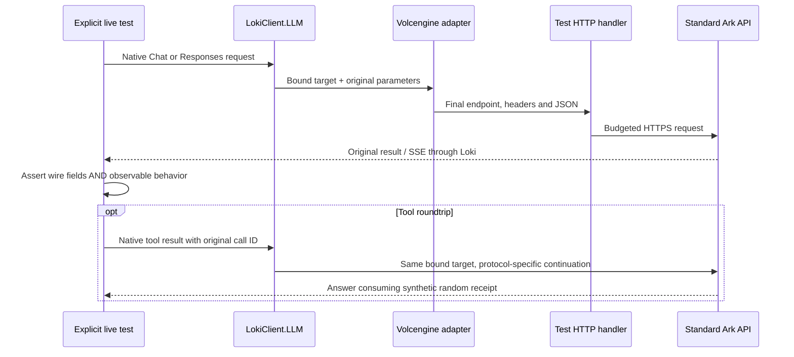

# LLM parameter and protocol verification

Verified locally on **2026-10-16 (Asia/Shanghai)** with `doubao-seed-evolving`, using the standard Ark root `https://ark.cn-beijing.volces.com/api/v3/`. This records observations for this account/model, not a guarantee for every upstream model. No Coding Plan endpoint was used.

## Protocol contract

Loki exposes two native protocols. It maps the public model alias to the selected target's actual model, selects the endpoint and authentication, and sets `stream` from the public method. It preserves the remaining caller JSON and upstream JSON/events. It does not translate Chat Completions into Responses or compensate for upstream behavior by changing parameters.

| Concern | Chat Completions | Responses |
| --- | --- | --- |
| Input | `messages`, including assistant/tool messages | `input`, including native items |
| Function definition | `tools[].function.{name,parameters,strict}` | `tools[].{name,parameters,strict}` |
| Named tool choice | `{type:"function",function:{name:…}}` | `{type:"function",name:…}` |
| Tool result linkage | `tool` message with `tool_call_id` | `function_call_output` item with `call_id` |
| Strict JSON Schema | `response_format.json_schema` | `text.format` |
| Reasoning effort in these cases | `reasoning_effort` | `reasoning.effort` |
| Ark thinking switch | `thinking.type` | `thinking.type` |
| Output budget | `max_completion_tokens` | `max_output_tokens` |
| Reasoning data | `reasoning_content`, including deltas | Native reasoning items/events, including `encrypted_content` |
| Observed token-limit termination | `finish_reason: "length"` | `status: "incomplete"`, `incomplete_details.reason: "length"` |

The last row is an observed Ark value and remains unchanged in Loki's raw result. Do not replace it with a value assumed from another provider. See the official [Chat API](https://docs.volcengine.com/docs/ark/chat-api?lang=zh&redirect=1), [Responses API](https://docs.volcengine.com/docs/ark/create-model-responses-api?lang=en), [function calling](https://docs.volcengine.com/docs/ark/function-calling?lang=en) and [Responses structured output](https://docs.volcengine.com/docs/ark/responses-api-structured-output?lang=zh) references alongside the actual observations below.

## Offline coverage

The ordinary suite passed **219 tests**, including **93 per LLM provider**. Shared payload tests go through the public Loki client, real provider adapter and substitute HTTP handler. They verify final address/authentication/model mapping, both stream modes, request immutability, zero/false/null, empty containers, Unicode, nested unknown fields, protocol-native tool/reasoning items, reserved-field rejection and omitted-versus-explicit-null semantics. Existing tests cover fragmented SSE and response/error preservation.

These are wire-preservation checks. They do not show that every field is accepted or honored by a real model. OpenAI has this offline coverage only; no OpenAI live credential was available.

## Real parameter cases

| Scenario | Cases / requests | Latest result and evidence |
| --- | --- | --- |
| Existing smoke and continuation | 1 / 5 | Passed: Chat JSON/SSE, Responses JSON/SSE and a new client's continuation using the same Session/cache |
| Strict structured output | 4 / 4 | Passed across both protocols and JSON/SSE; check six exact fields, types, enum, nested object, array, false and null |
| Function calling and result return | 4 / 8 | Passed across both protocols and JSON/SSE; named choice in JSON cases, required choice in SSE cases; accumulate tool argument deltas, validate strict arguments and consume a random local receipt on continuation |
| Thinking enabled/disabled | 8 / 8 | Passed across both protocols and JSON/SSE; enabled has positive reasoning tokens and native reasoning fields/events, disabled has zero reasoning tokens |
| `tool_choice="none"` | 2 / 2 | **Failed on both protocols:** final request contains `none`, but upstream returns one function call |
| Output token cap of one | 2 / 2 | Passed: actual truncation, native length termination and output usage at most one token |
| Stateless encrypted reasoning replay | 1 / 2 | Passed: resubmit original output items unchanged with `store=false`, no previous response ID; upstream accepts the opaque reasoning item and answers the follow-up |

The latest per-case evidence is **20 passing cases and 2 failures**. This combines a full run with a targeted rerun of the eight reasoning cases after separating answer-quality metrics from protocol assertions; it is not a claim that a single full run passed. Reasoning cases record plain-integer formatting and arithmetic accuracy separately. A free-form answer's correctness is not evidence that a reasoning parameter was serialized correctly. Strict output-format behavior is checked by the separate schema cases.

### Known upstream failure: tool choice none

The final HTTP payload explicitly contains `tool_choice: "none"` and the supplied function definition. Both endpoints nevertheless return a function call; Responses also echoes `tool_choice: "none"`. Thus the covered requests establish correct Loki transmission and an upstream behavior mismatch. This does not establish the cause inside the provider or generalize to other models.

`ToolChoiceLiveTests.None_MustPreventActualToolCalls` intentionally retains a strict zero-tool-call assertion. The `ToolChoice`, `Parameters` and `All` suites consequently exit nonzero while this behavior persists. Do not skip those cases, weaken the assertion, remove the caller's tools, rewrite tool choice, or discard returned calls to make the suite green. Callers must validate returned tool calls before executing them; Loki itself does not execute functions.

### Limits of the evidence

- Effort `low` is checked at its native wire path; positive reasoning usage verifies thinking, not a causal performance difference between effort levels.
- Temperature, top-p, seed, parallel-tool settings and arbitrary extensions have preservation checks; a single generated answer does not establish statistical effects or concurrency guarantees.
- Reports save sanitized counts, statuses, field names and assertion evidence under ignored `artifacts/live/volcengine-llm/`. They do not save keys, headers, full response bodies, reasoning text or encrypted blocks. Require `passed: true` for a successful scenario; a report from a failed run can contain partial evidence.
- The fixture uses `MemoryDistributedCache` and a process-local test coordinator. Real Redis, cross-process coordination, other models, OpenAI, speech, images and video remain outside this live verification.

See [testing.md](testing.md) for opt-in configuration, suites, request budgets and commands. No package publication is part of these checks.
