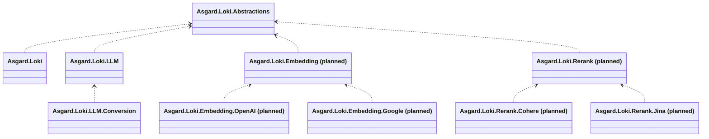

# Model-call gap assessment and roadmap

Updated: 2026-10-19. Loki baseline: [`d0d6a4c`](https://github.com/BenLampson/Asgard.Loki/commit/d0d6a4c7ed40cc586552adcc951486736da75eb7), with 456 passing offline tests and Windows/Linux CI passing. Reference: New API `main` at [`058c8231b68c51ee02abee15befcd720fee9f4a2`](https://github.com/QuantumNous/new-api/tree/058c8231b68c51ee02abee15befcd720fee9f4a2). This is a source comparison at a fixed snapshot, not a statement about every released New API deployment or live model behavior.

This plan covers an embeddable .NET SDK: model requests, authentication, protocol conversion, transport, results and operation state. Package and API names below are proposals until their implementation is reviewed. [architecture.md](architecture.md) remains authoritative. No additional feature is implemented by this document.

## Implementation progress after the baseline

- M1.1 implemented: embedded independently authored four-protocol source/golden fixtures, 36 request/response/stream comparisons, and explicit response-envelope metadata/echo retention.
- M1.2 first slice implemented: qualitative effort across all directions, representable numeric/dynamic/off reasoning modes and output intent, JSON Schema wrappers copied without changing constraints, explicit name/budget/effort options, and OpenAI/Claude parallel-tool switches. Twenty-four additional public SDK/HTTP settings cases cover both call modes. Model acceptance is still separate from offline protocol verification.
- Current validation after this slice: 582 offline tests passed, including 305 conversion tests; Release build has no warnings. The package set remains thirteen independently packaged libraries. Dual-platform CI is required on the committed result.
- Remaining M1 work includes Gemini's separate `responseSchema` dialect, advanced tool/media/result mappings, representable multi-candidate/interleaved output and broader model-specific capability policies. Opaque signed/encrypted state remains native-only.
- M2–M6 remain pending. This goal is not complete after the first M1 slice; subsequent work must preserve the full model-call parity scope and the SDK exclusions.

## Completed baseline

- Native OpenAI/Ark Chat Completions and Responses creation/continuation, Claude Messages and Gemini generateContent, with complete JSON and SSE calls.
- Native extension parameters and complete upstream result/event JSON, including tools, reasoning, opaque signatures, media, usage and future fields. Native acceptance still depends on the upstream model/account.
- Explicit optional conversion between all four text protocols: twelve directions for the documented common subset, not complete native-feature parity. Ordinary functions, call/result IDs, text, inline images, base generation parameters and supported usage counters are covered.
- Complete LLM target binding to server, actual model, credential identity and implementation/conversion configuration; distributed-cache Session ownership and explicit first-binding coordination.
- Volcengine HTTP TTS, OpenAI image generation with JSON/SSE, and a reserved Video project.
- 179 conversion tests, 22 Claude native tests, 36 Gemini native tests and the existing 219-test baseline. The recent review added field-loss, pending-call/ID-collision and stream lifecycle regressions. These are offline protocol tests, not new live-provider verification.

The [conversion matrix](../src/Asgard.Loki.LLM.Conversion/README.md) and individual provider READMEs define the implemented boundary. Native JSON transmission must not be listed as missing merely because there is no dedicated convenience property.

## Evidence and remaining gaps

New API's [relay routes][n-routes], [protocol/task routes][n-task-protocols], [adapter contract][n-adapter] and concrete implementations were inspected. An interface method, model-name list or registered route alone is not evidence that every supplier implements that operation.

| Area | New API evidence at this snapshot | Loki status | SDK action |
| --- | --- | --- | --- |
| Four native text protocols | Relay routes and supplier adapters | Implemented for JSON/SSE | Retain fidelity; add realistic envelope fixtures as upstream shapes evolve |
| Broader conversion settings | [RelayKit][n-kit]: reasoning effort/budget/output intent, more tools and media | First M1 slice now supports four-protocol effort/JSON Schema wrappers and representable budget/output intent; advanced mappings remain | Continue bounded M1 extensions; do not change native calls |
| Advanced tools | RelayKit encodes custom/namespaced tools and hosted web search, retaining request conversion state | Ordinary function tools only across protocols; native tools already pass through | M1 opt-in mappings with reversible identity and explicit semantic diagnostics |
| File/media conversion | RelayKit media resolver and file/image blocks | Inline images supported; some image URLs map directly; other file/media conversion is limited | M1 caller-supplied media data/resolution; preserve provider-local IDs |
| Responses compaction | [Dedicated compact handler][n-compact] and active route | No compact operation; ordinary Responses already preserves opaque input/output items | M2 native compact call, separate from generation and automatic history management |
| Responses WebSocket | [WebSocket implementation][n-responses-ws] with per-connection request state | HTTP/JSON/SSE only | M2 native duplex connection contract bound to one complete LLM target |
| Embeddings | [Embedding handler][n-embedding]; Gemini adapter supports embedContent/batchEmbedContents | No public capability/provider | M3 independent Embedding capability, OpenAI first, Google next |
| Rerank | [Rerank handler][n-rerank], Cohere/Jina adapters | No public capability/provider | M3 independent Rerank capability and explicit supplier dialects |
| OpenAI audio | [Audio handler][n-audio] and speech/transcription/translation routes | Volcengine TTS only | M4 Audio.OpenAI with native binary/JSON/SSE and multipart contracts as applicable |
| Image editing and more image suppliers | [OpenAI adapter][n-openai], [image-edit tests][n-image-tests], [Gemini adapter][n-gemini] | OpenAI generations only; native Gemini multimodal generation remains available through LLM | M4 Image edits; later Image.Google/Volcengine where a separate image API is required |
| Cloud-specific authentication/endpoints | [Azure branches][n-openai], [AWS adapter][n-aws], [Vertex adapter][n-vertex] | Native bearer/API-key endpoints only; no dedicated Azure/AWS/Vertex integration | M5 provider packages with explicit cloud identity/configuration |
| Other supplier dialects | Adapter contract and supplier implementations, including Cohere, Ollama and others | OpenAI-compatible endpoints can already use the OpenAI provider when the wire contract matches | M5 add packages for actual protocol/auth differences; no package per marketing model name |
| Realtime multimodal conversations | [Realtime WebSocket handler][n-realtime] and route | No native Realtime API | M6 LLM-owned realtime connection state; no Audio dependency or voice-agent loop |
| Video and other asynchronous generation | [Video][n-video] and [task][n-tasks] routes; protocol registry; task plugins | Video skeleton only; no music/Midjourney task clients | M6 minimal native video calls first; supplier-specific music/image-task clients only on demand |
| Model discovery | [Model controller][n-models] builds an authorized gateway catalog | No remote model-list operation; configured routes are explicit | Optional provider-native discovery; keep gateway catalogs/permissions outside the SDK |
| Legacy completion, moderation, standalone search/fetch | Active routes in the reference; search includes supplier/host-specific interfaces | No dedicated clients | Demand-driven backlog; verify public upstream contract before implementing |

Two important qualifications prevent an inflated backlog:

- New API marks images/variations, generic files and fine-tuning routes as unimplemented. Claude count_tokens is disabled, and Gemini countTokens is explicitly rejected. These are not confirmed upstream parity gaps; token-count APIs or file lifecycle helpers can be considered later for an actual caller need.
- The reference's Responses retrieve route is handled by task-plugin state. It does not establish a complete general-purpose native Responses retrieve/cancel/delete API. Full lifecycle operations need a separate upstream audit. Similarly, generic plugin/video/music availability depends on installed plugins and configuration.

## Architecture rules for every milestone

1. `Asgard.Loki` references only `Asgard.Loki.Abstractions`, whose public abstractions remain module/client mechanisms. No model, auth, task, transport or usage business model is moved there.
2. An existing capability owns new operations belonging to it. New Embedding/Rerank capabilities own their own contracts, routing, metadata and errors. Provider names follow `Asgard.Loki.{Capability}.{Vendor}`; provider packages reference only their own capability. New capability names are proposed, not existing packages.
3. `LLM.Conversion` stays optional and references only LLM. Native providers never depend on it or on each other. Its private conversion representation is not a new public universal model.
4. A provider receives an already-resolved complete target. Stateful calls remain bound to server/model/credential identity/implementation. Stateless embedding/rerank calls do not acquire a conversational Session or depend on LLM. Async video handles retain their own complete upstream identity.
5. Only provider calls requested by the caller are performed. No generation retry, target failover, hidden model suffix rewrite, implicit media download, tool execution, automatic history reconstruction or background job service is added. A read/poll helper, if introduced, requires an explicit bounded call and cancellation.
6. Native signed/encrypted reasoning, compaction items and provider-local references remain native and opaque. Cross-protocol inability is an explicit unsupported case, not a requirement to invent signatures or promise universal equivalence.
7. Usage means returned protocol counters and source metadata. It does not include pricing, quota, invoicing or settlement.

Proposed dependency direction for the first new capabilities:

Audio/Image/Video retain the existing dependency pattern. Shared byte/SSE helpers may remain internal source-linked implementation details; they are not a public cross-capability coordinator or transport package.

## Ordered delivery plan

### M1 — Expand explicit conversion and its acceptance fixtures (P1)

Ownership: `Asgard.Loki.LLM.Conversion`, its tests and README; LLM public metadata only when a reviewed contract requires it.

1. **Representative native envelopes and golden fixtures first.** Add independently authored complete request/response/event fixtures containing realistic protocol envelope fields, optional nulls, annotations, usage details and error/finish variants. Classify each field as represented, retained in source metadata, diagnosed or rejected. Expand safe envelope handling deliberately; do not solve strict conversion failures with a blanket unknown-field ignore list. Keep semantic path assertions alongside normalized JSON/event snapshots.
2. **Generation settings and structured outputs.** Extend documented mappings to supported Claude/Gemini structures, including JSON Schema/MIME configuration, strictness, parallel-tool settings and reasoning effort/budget/output intent where the destination can express them. Require explicit conversion policy when semantics differ. Model limits/capabilities come from explicit configuration, not a stale model-name table, heuristic suffix stripping, automatic budget ratios or silent token-limit adjustment. A missing source budget is not an exact destination budget.
3. **Advanced tools.** Handle supported custom tools, namespaces and tool-result content with explicit request-local reversible mapping. Preserve original call IDs and namespace/name identity across request, response, stream and result replay. Map hosted web search only when enabled for the selected target; differences in execution behavior, sources/citations and provider availability remain diagnosed. Unsupported hosted/computer/code tools remain explicit. The SDK never runs a tool itself.
4. **Media and result blocks.** Add representable document/file content, richer tool results, annotations/citations and media metadata by protocol pair. Prefer caller-supplied bytes, MIME and provider-valid references. If resolution is necessary, introduce an explicit borrowed per-call or per-instance resolver with cancellation and limits; no global resolver and no default network fetch. A file ID/URI owned by one provider is never asserted to work on another. Keep signed/encrypted state as a hard native-only boundary.
5. **Broader streams only with an explicit contract.** Support multiple candidates or interleaved blocks only when the target can represent them and indices/order remain stable; otherwise keep explicit rejection. Any buffering must be bounded. Cover empty output, refusals/blocks, tool-only results, usage tails, late errors, malformed frames and all done/terminal combinations. Missing required counters remain unknown or fail when the target requires them.

Acceptance: update the exact pair/field support matrix; add positive and rejection fixtures for every newly claimed mapping; exercise affected directions through the public SDK and substitute HTTP handlers; retain all field-loss/tool-association/terminal regressions and strict native-only failures. No promise of arbitrary lossless four-way conversion.

### M2 — Extend native Responses operations (P1)

Ownership: `Asgard.Loki.LLM`, `LLM.OpenAI`, and `LLM.Volcengine` only for independently verified compatible operations. No provider-to-provider references.

- Implement an explicit native compaction operation with its own request/result and optional adapter capability. Return the compacted opaque items unchanged; the caller chooses subsequent history. This is not a summarization workflow or an automatic step in CreateAsync.
- Add a Responses WebSocket connection abstraction and an injectable testable connection factory. Define connection ownership, single-call/concurrency rules, cancellation, close/error propagation, send/receive ordering and Session/previous-response ownership. Keep connection lifetime distinct from distributed logical Session lifetime. No reconnect/resend, event replay or claim that cache restores a socket.
- Advertise operation/transport support explicitly rather than assuming that a provider implementing Responses creation also supports compact or WebSocket. Fixed conversion targets must not claim these new native capabilities automatically.
- Audit retrieve/cancel/delete/background lifecycle separately when needed. Preserve complete-target ownership for any response ID; do not treat New API's plugin-backed retrieval as proof of native lifecycle parity.

Acceptance: offline compact wire-payload/opaque-item tests and deterministic duplex tests for framing, concurrent attempts, cancellation, failed/incomplete terminals and connection loss. Verify ordinary HTTP/SSE and Session behavior is unchanged. Recheck each provider's current public protocol before implementation; no live execution is authorized by this plan.

### M3 — Add Embedding and Rerank as independent capabilities (P1)

Ownership: proposed `Asgard.Loki.Embedding` and `Asgard.Loki.Rerank`, their supplier packages and tests. Each registers with the existing module mechanism and does not reference LLM or the other capability.

- Embedding first slice: OpenAI-compatible native request/result, text/token-array and batch inputs where supported, dimensions/encoding and extension parameters; preserve vector index/order and original usage. Then add Google embedContent/batchEmbedContents with its own native shapes and per-item/task-type semantics. Synchronous batch inputs are not a hosted asynchronous Batch API.
- Rerank first slice: Cohere native provider, then Jina after its wire differences are covered. Retain document inputs, original document indices, relevance scores, top-n/options, usage and unknown fields. Do not silently turn a supplier error or absent score into a valid ranking.
- Use explicit complete targets and credentials appropriate to each capability. Add only capability-owned request/result/error and selection behavior; no conversational cache, embedding database, vector store, retrieval pipeline or RAG coordinator.

Acceptance: public SDK initialization and final-wire tests, batches/order/indexes, optional/zero/null values, errors/cancellation, metadata preservation and actual NuGet dependency inspection. New provider READMEs must record support, initialization, limits and offline/live status.

### M4 — Complete the existing Audio and Image call surfaces (P2)

- `Audio` + proposed `Audio.OpenAI`: native speech generation, transcription and translation. Define caller-owned input streams, multipart metadata, binary/text/JSON results, timestamps/segments and native streaming events where supported. Keep pure audio request/state independent of LLM. Extend Volcengine ASR later through the same Audio-owned pattern after its protocol is verified.
- `Image` + `Image.OpenAI`: native image edits, including image/mask inputs, multiple files where supported, extension fields, complete results and supported partial/final streams. Multipart handling must preserve file bytes/names/content types and leave borrowed streams under documented caller ownership.
- Add independent `Image.Google`/`Image.Volcengine` providers when needed. Existing Gemini generateContent can already return native multimodal JSON through LLM; a separate Image API must serve image-specific contracts, not claim that all Gemini image output was previously unavailable. Do not coerce unrelated quality/size semantics into undocumented equivalence.

Acceptance: substitute HTTP byte-level multipart/binary tests, ordering and stream termination, cancellation/disposal, image masks and multiple inputs, native metadata and package boundaries. Image variations are optional supplier coverage, not a confirmed implemented New API advantage in this snapshot.

### M5 — Add suppliers with real endpoint/authentication differences (P2)

Proposed ownership: `LLM.Azure`, `LLM.AWS` and `LLM.GoogleVertex` for Azure OpenAI, AWS Bedrock and Google Vertex AI; equivalent other-capability provider packages only when that capability is implemented.

- Keep deployment/API version, region/project/location, request signing or access-token acquisition in the provider. Borrow caller-supplied credential/token sources. Cloud SDK dependencies stay in the supplier package.
- Review the core credential extension before implementation: stable principal/credential reference and configuration affect binding identity; normal short-lived token refresh must not invalidate a Session, while changing the authenticated principal must. Do not serialize temporary tokens into cache bindings.
- Cloud endpoints are separate configured targets even when they offer familiar Messages/Gemini/Responses shapes. Unsupported native cloud dialects need explicit adapters; do not route them through another supplier package or silently remove call IDs/signatures.
- Reuse `LLM.OpenAI` for an endpoint that actually accepts its wire contract. Add Ollama, Cohere, DashScope or another provider only for demonstrated protocol/auth differences and caller demand. Model-specific quality claims require separate evidence.

Acceptance: deterministic signing/token-source stubs, endpoint/header/body checks, expiry/cancellation behavior, principal identity binding and no dependency leakage. External cloud identity libraries must not become entry/abstraction dependencies.

### M6 — Native Realtime and minimal asynchronous generation (P3)

- Add OpenAI Realtime under LLM's native protocol surface with its own connection state in `LLM.OpenAI`; multimodal conversation events, input buffers, tool events and cancellation remain native. Audio TTS/ASR state is separate. Gemini Live is an independent future investigation, not verified New API parity in this audit.
- Implement the existing Video capability with one verified supplier first: submit, fetch status/result and explicitly requested result content access. Return an operation handle bound to the complete target and credential identity; keep supplier status/errors and output metadata. Do not reuse LLM Session or create a generic cross-capability task engine.
- A caller-driven, bounded wait helper may poll an existing task; it never resubmits generation. Task hosting, webhook listeners, persistence, distributed workers, scheduled polling and artifact proxy servers belong to the application.
- Music, Midjourney-style tasks and generic gateway-plugin calls remain demand-driven. Add a capability/supplier client only after its upstream contract and value are established; do not embed New API's JavaScript plugin host or task database.

Acceptance: in-memory duplex transport and deterministic status-sequence tests, complete-target handles, task-ID isolation, progress/failure/terminal mapping, cancellation, content-stream ownership and unknown metadata preservation.

## Optional work and deliberate exclusions

Provider-native model discovery, token counting, moderation, legacy completions, file lifecycle and standalone search/fetch can be independently scoped when needed. Discovery must not auto-register routes or equate list visibility with model entitlement. Moderation is a model-call client, not application policy enforcement. Standalone search/fetch requires a documented callable upstream contract; do not build a generic web fetcher from a gateway route name. A common upstream batch array is distinct from a persistent batch-job service.

The following are outside this roadmap: a web/API server, controllers, ports, gateway protocol endpoints, administration, users/tenants/groups, API-key issuance, channel databases, quotas, pricing, billing, settlement, dashboards, audit stores, automatic channel failure recovery, multi-key rotation, background orchestration, workflow/agent loops, tool execution, application RAG and a plugin runtime. No generic business coordination layer is added to share LLM, Audio, Image or Video state.

New API's permissive/default loss policy, suffix heuristics and continuation-loss behavior are reference observations, not features Loki must reproduce. Loki keeps strict conversion by default for requests, complete responses and streams, and preserves explicit native-only boundaries.

## Validation and documentation gates

New API has real [golden conversion tests][n-golden], [module-boundary tests][n-boundary], [tool-loss tests][n-tool-tests] and [terminal-stream tests][n-terminal-tests]. This audit inspected those sources; it did not execute their test suite or treat its snapshots as an independent protocol specification.

For every milestone:

1. Add xUnit v3 tests in the owning capability/provider package. Use independent fixtures and protocol assertions plus normalized snapshots where useful; snapshots alone do not prove semantic equivalence. Use seeded, deterministic combinations for IDs, optional fields and event order where these expose real failures.
2. Preserve unknown native fields and check known conversion fields, zero/false/null versus omission, tool call/result identity, source immutability, opaque items, usage and failure/terminal consistency. No snapshot update may silently approve a changed tool link or successful terminal after truncation.
3. Run affected public SDK/HTTP or duplex tests, then the required Release build, ordinary offline suite and package-boundary/metadata checks on Windows/Linux. No real Key, Redis or provider network in those suites.
4. Update architecture/UML for public API or dependency changes, root English README and Chinese companion, exact conversion support matrix, and each new supplier README. Planned capability names must not appear in the implemented support table until delivered.
5. Keep live tests separate and explicitly opted in under [testing.md](testing.md). The existing four-variable Volcengine contract is unchanged; new provider credentials/scenarios require their own reviewed extension. Preserve the known Ark `tool_choice=none` failure and distinguish transmitted parameters from observed effects.
6. Develop on `dev` or a `ben/` feature branch; require the existing dual-platform CI. No direct push/merge to `main`, protection bypass or package publication is authorized by this plan.

The next native delivery slice after the initial M1 work is Responses compaction, followed by the WebSocket contract and independent Embedding/Rerank capabilities. Remaining M1 Schema-dialect/tool/media/interleaving work is delivered in separately bounded increments and need not block those native operations or new capabilities. Later milestones remain part of the SDK model-call alignment effort; gateway operations stay excluded.

[n-routes]: https://github.com/QuantumNous/new-api/blob/058c8231b68c51ee02abee15befcd720fee9f4a2/router/relay-router.go
[n-task-protocols]: https://github.com/QuantumNous/new-api/blob/058c8231b68c51ee02abee15befcd720fee9f4a2/router/task-plugin-protocol-router.go
[n-adapter]: https://github.com/QuantumNous/new-api/blob/058c8231b68c51ee02abee15befcd720fee9f4a2/relay/channel/adapter.go
[n-kit]: https://github.com/QuantumNous/new-api/blob/058c8231b68c51ee02abee15befcd720fee9f4a2/relaykit/README.md
[n-compact]: https://github.com/QuantumNous/new-api/blob/058c8231b68c51ee02abee15befcd720fee9f4a2/relay/channel/openai/relay_responses_compact.go
[n-responses-ws]: https://github.com/QuantumNous/new-api/blob/058c8231b68c51ee02abee15befcd720fee9f4a2/relay/responses_websocket.go
[n-embedding]: https://github.com/QuantumNous/new-api/blob/058c8231b68c51ee02abee15befcd720fee9f4a2/relay/embedding_handler.go
[n-rerank]: https://github.com/QuantumNous/new-api/blob/058c8231b68c51ee02abee15befcd720fee9f4a2/relay/rerank_handler.go
[n-audio]: https://github.com/QuantumNous/new-api/blob/058c8231b68c51ee02abee15befcd720fee9f4a2/relay/audio_handler.go
[n-openai]: https://github.com/QuantumNous/new-api/blob/058c8231b68c51ee02abee15befcd720fee9f4a2/relay/channel/openai/adaptor.go
[n-image-tests]: https://github.com/QuantumNous/new-api/blob/058c8231b68c51ee02abee15befcd720fee9f4a2/relay/channel/openai/image_edit_test.go
[n-gemini]: https://github.com/QuantumNous/new-api/blob/058c8231b68c51ee02abee15befcd720fee9f4a2/relay/channel/gemini/adaptor.go
[n-aws]: https://github.com/QuantumNous/new-api/blob/058c8231b68c51ee02abee15befcd720fee9f4a2/relay/channel/aws/adaptor.go
[n-vertex]: https://github.com/QuantumNous/new-api/blob/058c8231b68c51ee02abee15befcd720fee9f4a2/relay/channel/vertex/adaptor.go
[n-realtime]: https://github.com/QuantumNous/new-api/blob/058c8231b68c51ee02abee15befcd720fee9f4a2/relay/channel/openai/relay_realtime.go
[n-video]: https://github.com/QuantumNous/new-api/blob/058c8231b68c51ee02abee15befcd720fee9f4a2/router/video-router.go
[n-tasks]: https://github.com/QuantumNous/new-api/blob/058c8231b68c51ee02abee15befcd720fee9f4a2/router/task-router.go
[n-models]: https://github.com/QuantumNous/new-api/blob/058c8231b68c51ee02abee15befcd720fee9f4a2/controller/model.go
[n-golden]: https://github.com/QuantumNous/new-api/blob/058c8231b68c51ee02abee15befcd720fee9f4a2/relaykit/relayconvert/golden_test.go
[n-boundary]: https://github.com/QuantumNous/new-api/blob/058c8231b68c51ee02abee15befcd720fee9f4a2/relaykit/relayconvert/boundary_test.go
[n-tool-tests]: https://github.com/QuantumNous/new-api/blob/058c8231b68c51ee02abee15befcd720fee9f4a2/relaykit/relayconvert/tool_loss_policy_test.go
[n-terminal-tests]: https://github.com/QuantumNous/new-api/blob/058c8231b68c51ee02abee15befcd720fee9f4a2/relaykit/relayconvert/terminal_stream_test.go
