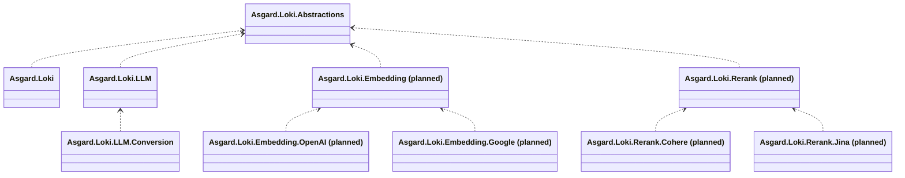

# Model-call gap assessment and roadmap

Updated: 2026-10-19. Comparison anchor: [`4be4511`](https://github.com/BenLampson/Asgard.Loki/commit/4be45116fd44c7222f6235fa9b081b90e827839f), with 1361 passing offline tests (928 conversion), thirteen packages and [Windows/Linux CI passing](https://github.com/BenLampson/Asgard.Loki/actions/runs/39196363435). New API `main` was rechecked through the GitHub API and remains [`058c8231b68c51ee02abee15befcd720fee9f4a2`](https://github.com/QuantumNous/new-api/tree/058c8231b68c51ee02abee15befcd720fee9f4a2), committed at 2026-10-18 15:46:10 UTC. Earlier and subsequent implementation checkpoints are recorded below. This is a source comparison, not a statement about every released New API deployment or live model behavior.

This plan covers an embeddable .NET SDK: model requests, authentication, protocol conversion, transport, results and operation state. Package and API names below are proposals until their implementation is reviewed. [architecture.md](architecture.md) remains authoritative. No additional feature is implemented by this document.

## Implementation progress after the baseline

- M1.1 implemented: embedded independently authored four-protocol source/golden fixtures, 36 request/response/stream comparisons, and explicit response-envelope metadata/echo retention.
- M1.2 first slice implemented: qualitative effort across all directions, representable numeric/dynamic/off reasoning modes and output intent, JSON Schema wrappers copied without changing constraints, explicit name/budget/effort options, and OpenAI/Claude parallel-tool switches. Twenty-four additional public SDK/HTTP settings cases cover both call modes. Model acceptance is still separate from offline protocol verification.
- M1.2 modern Gemini envelope slice [`1ecbc6c`](https://github.com/BenLampson/Asgard.Loki/commit/1ecbc6c0403e6b1bfc40b8850f60e9a8433e89d8) adds source `responseFormat.text`, explicit target `GeminiOutputFormat.ResponseFormat`, unchanged Schema bodies, six authored complete-request snapshots and twelve additional public HTTP/SSE cases. The legacy default envelope stays unchanged. Current upstream docs mark typed `responseSchema` deprecated. This current-upstream extension is not a claim that every New API supplier/model supports the new field.
- M1.2a implemented in [`a382bae`](https://github.com/BenLampson/Asgard.Loki/commit/a382bae): typed `responseSchema` source translation, exact ProtoJSON int64 limits, nested validation/nullable/enum handling and explicit property-order diagnostics. Three independent full-request snapshots, six public HTTP/SSE cases and fifty focused/rejection cases cover this slice. Its 848 offline tests and [Windows/Linux CI](https://github.com/BenLampson/Asgard.Loki/actions/runs/39185045588) pass. That checkpoint uses `conversion-v5`; native provider bindings are unchanged.
- M1.2b implemented in [`746c24d`](https://github.com/BenLampson/Asgard.Loki/commit/746c24d): typed function `parameters` input reuses the reviewed mapper, with conflicting-dialect rejection and explicit function-order diagnostics. Eighteen new cases cover three complete authored snapshots with reverse history/schema replay, six final-wire HTTP/SSE calls, strict errors and native copying. That checkpoint uses `conversion-v6`, with 866 offline tests (433 conversion) and [Windows/Linux CI passing](https://github.com/BenLampson/Asgard.Loki/actions/runs/39185487851).
- M1.2c1 implemented in [`c1961a0`](https://github.com/BenLampson/Asgard.Loki/commit/c1961a0): explicit `GeminiOutputFormat.LegacySchema` writes representable typed output schemas without changing the JSON Schema default. Fifty-one new cases cover full snapshots/replay, final HTTP/SSE, unavailable constraints, numeric roundtrip precision, ordering, annotations, native copies and Session option changes. That checkpoint uses `conversion-v7`, with 917 offline tests (484 conversion) and [Windows/Linux CI passing](https://github.com/BenLampson/Asgard.Loki/actions/runs/39186445398).
- M1.2c2 implemented in [`f485eaf`](https://github.com/BenLampson/Asgard.Loki/commit/f485eaf): independent `GeminiFunctionSchemaFormat` selects unchanged JSON Schema by default or explicit typed `parameters`. Twenty-four new cases cover complete tool-history snapshots/replay, final HTTP/SSE, all six text/function option combinations, rejected constraints, native/default behavior, option validation and Session binding. That checkpoint uses `conversion-v8`, with 941 offline tests (508 conversion) and [Windows/Linux CI passing](https://github.com/BenLampson/Asgard.Loki/actions/runs/39187031023).
- M1.2d implemented: optional caller-declared target settings validate final native converted fields, including explicit defaults/replacements. Independent collection snapshots and canonical set identity participate in binding; unsupported settings fail before HTTP even with loss consent. The 113 new cases include all twelve directions in complete/stream modes, native invariance, modes/budgets/formats/control presence and binding/configuration regressions. This checkpoint uses `conversion-v9`; current offline totals are 1054 (621 conversion). No model lookup, automatic adjustment, native filtering or billing policy is added.
- M1.3a1 implemented: opt-in free-text custom-tool encoding from Responses to Chat/Claude/Gemini, immutable request-local context and complete response restoration, original call-ID/result-kind checks, arbitrary text replay and an explicit custom-only Gemini result envelope. Sixty-four new cases cover independent complete wire/response goldens, public SDK replay/concurrent isolation, limits, wrong context, ID reuse and semantic rejection. This checkpoint uses `conversion-v10`, with 1118 offline tests (685 conversion). That checkpoint rejected custom streaming; M1.3a2 delivers it separately. Grammar/namespace/program/async/deferred semantics and rich result arrays remain unsupported; native structures are preserved. No tool is executed by the SDK.
- M1.3a2 implemented: matching-context stream conversion uses the original source lifecycle validation and restores custom item/input delta/input done/item done/final snapshots. Completed message/tool metadata can replay without mutating the source; ordinary functions remain distinct. Optional raw argument and combined returned-call bounds reject overflow before aggregation. Fifty-nine new cases include independent 17-event goldens, fifteen public SDK fragmented-SSE/replay/failure cases, incomplete status, bad wrappers, context/ID mistakes, split escapes and native/stateless invariance. This checkpoint uses `conversion-v11`, with 1177 offline tests (744 conversion); native supplier identities remain unchanged. Namespace/hosted-tool/media slices were still pending at that checkpoint.
- M1.3b identity slice implemented: separate namespace/name/kind keys, collision-checked request-local function aliases, independent namespace/custom opt-ins and complete/stream/history restoration. Nonempty group descriptions require diagnosed loss consent; native selectors not defined by the verified contract, deferred/program/async semantics and unknown fields remain hard boundaries. Ninety new cases include independent full and 17-event goldens, 28 public SDK HTTP/SSE/replay/concurrency/failure cases, unchanged constraints, optional result identity validation, empty-group bounds and binding changes. This checkpoint uses `conversion-v12`, with 1267 offline tests (834 conversion); no registry, execution loop, account policy or new package dependency is introduced.
- M1.3c1 request/diagnostic slice implemented: explicit fixed-target native search enums, six request directions, independent function-combination declaration, common bare-domain/location transfer and hard scope/offline/count/trigger boundaries. Search context-size omission needs diagnosed consent. Known execution/citation/grounding losses receive dedicated diagnostics; Claude encrypted search/reference state is native-only in complete/history/stream conversion. Ninety-four cases include independent request goldens, 18 public SDK HTTP/SSE/failure cases and binding/native/user-JSON regressions. Text-only substitute replies do not verify actual search or complete results/citations. This checkpoint uses `conversion-v13`, with 1361 offline tests (928 conversion); full result/citation and broader search control mappings remain pending.
- M1.3c2a complete OpenAI URL citation slice implemented: Chat nested and Responses flat URL annotations preserve text/source/title/order and unchanged indices. ASCII preceding text permits safe block-offset rebasing; unknown Unicode prefix units require a dedicated diagnostic. Sixty-four new cases include two independent full response goldens, four public HTTP/SSE cases, malformed/unknown fields, Unicode/unit boundaries, tool identity and native/strict/consented stream behavior. This checkpoint uses `conversion-v14`, with 1425 offline tests (992 conversion). The verified Chat chunk/request contracts do not establish citation delta/replay fields; those conversions remain explicit unsupported boundaries rather than invented native fields. Broader search results, grounding and verified target citation streams remain pending.
- M1.4a1 user PDF input slice implemented: four native inline PDF structures across twelve directions, unchanged Base64 data, ordered multiple files and full tool-history roundtrips. OpenAI filenames transfer between Chat/Responses; unavailable filename/metadata fields require diagnosed consent. Claude URL-PDF transfers to Responses without an SDK fetch. Provider file IDs/URIs, unknown MIME, conflicting sources and invalid/empty data remain explicit failures. The 126 new cases include twelve full authored request comparisons and 42 public HTTP/SSE cases. This checkpoint uses `conversion-v15`, with 1551 offline tests (1118 conversion); opaque transport bytes and text-only replies do not verify real PDF parsing. No public resolver, file store or dependency is introduced. Non-PDF inputs, generated files and rich results remain pending.
- M1.4b1 rich-result container slice implemented: text arrays across Chat/Responses/Claude, image/PDF arrays between Responses/Claude and supported custom-array history with its original kind/name/call identity. Strings, empty arrays and individual blocks remain distinct. The 120 new cases include eight full request/roundtrip goldens, 40 public HTTP/SSE cases, custom JSON byte/Unicode bounds and namespace/parallel associations. Consecutive Responses calls form one valid Chat tool turn; pending-turn interleaving is rejected. Explicit Claude errors and nested encrypted citations cannot become ordinary successful results, even with loss consent. This checkpoint uses `conversion-v16`, with 1671 offline tests (1238 conversion). Gemini rich-result parts, other media and verified error equivalents remain pending; no tool is executed.
- M1.3c2a2 complete Gemini Web grounding slice implemented: explicit endpoint citation units, original part/source association, exact UTF-8 boundaries and Unicode rebasing into Chat/Responses. Sixty-three new cases include six full authored goldens, ten public SDK HTTP/SSE cases, malformed indices, source/metadata loss, tool identity, incomplete terminals and binding changes. This checkpoint uses `conversion-v17`, with 1734 offline tests (1301 conversion). Query/display/confidence metadata still needs diagnosed consent; stream/history/reverse grounding and private sources remain explicit boundaries. No search execution ID, tool run or live model verification is invented.
- The first optional WebSocket contract checkpoint is [`c2f8e38`](https://github.com/BenLampson/Asgard.Loki/commit/c2f8e38), with 633 offline tests and [Windows/Linux CI passing](https://github.com/BenLampson/Asgard.Loki/actions/runs/39177886801). The connection/Session checkpoint [`6b86b10`](https://github.com/BenLampson/Asgard.Loki/commit/6b86b10) adds complete-target feature validation, bound sends, continuation/cancellation ownership and duplex concurrency tests, with 668 offline tests and [both CI platforms passing](https://github.com/BenLampson/Asgard.Loki/actions/runs/39178568764). A separate steering checkpoint adds required-response-ID and cross-session ownership checks for the current native `response.steer` event. Bundled-provider native transport was still pending at that checkpoint. The package set remains thirteen independently packaged libraries; each new checkpoint requires its own full validation.
- Remaining M1 work includes advanced tool/media/result mappings and representable multi-candidate/interleaved output. Opaque signed/encrypted state remains native-only.
- M2 compaction slice implemented: native OpenAI `Responses.CompactAsync`, explicit target feature and optional adapter contract, full opaque window preservation, previous-response ownership and feature-aware complete-target binding. Ordinary compatible Responses endpoints and conversion decorators do not implicitly gain this optional capability. No live compaction call was made.
- M2 WebSocket checkpoints 1–2 define optional adapter/connection contracts, a source-compatible unsupported client default, and SDK binding/ownership enforcement. Separate commits cover steering ownership and close-during-validation races.
- The provider transport foundation [`022f19f`](https://github.com/BenLampson/Asgard.Loki/commit/022f19f) adds a borrowed OpenAI socket factory, one-shot default handshake and bounded/strict UTF-8 JSON framing, with 697 offline tests and [Windows/Linux CI passing](https://github.com/BenLampson/Asgard.Loki/actions/runs/39179747679). Native integration [`b10c0ac`](https://github.com/BenLampson/Asgard.Loki/commit/b10c0ac) adds explicit target-feature support, multiple lanes/FIFO queues, error/control correlation, steering successors and response/terminal validation, with 737 offline tests and [both CI platforms passing](https://github.com/BenLampson/Asgard.Loki/actions/runs/39180999423). A separate hardening checkpoint retains bounded completed-control event IDs and rejects reuse so late errors cannot consume a new queued generation. No live OpenAI WebSocket call was made.
- M2's planned explicit compaction and native OpenAI WebSocket operations are implemented. Broader Responses lifecycle operations remain separately audited backlog. Remaining M1 and M3–M6 are still incomplete; the full model-call alignment goal is not achieved by this milestone.

## Reassessment and next checkpoints

### Current audit decision

The verified comparison anchor is [`4be4511`](https://github.com/BenLampson/Asgard.Loki/commit/4be45116fd44c7222f6235fa9b081b90e827839f), not the earlier `1ecbc6c` settings baseline. Its [CI run](https://github.com/BenLampson/Asgard.Loki/actions/runs/39196363435) passed on Windows and Linux, with 1361 tests including 928 conversion tests. The complete URL citation checkpoint raises totals to 1425 (992 conversion); the user-PDF slice raises them to 1551 (1118 conversion), followed by the rich-result slice at 1671 (1238 conversion) and complete Web grounding at 1734 (1301 conversion). These do not claim broader search or citation stream delivery. The source recheck verified the anchor CI SHA and reread the local conversion implementation, pinned New API routes, supplier adapters and conversion tests. No New API Go tests or live-provider calls were executed for this comparison. New API `main` still points to `058c8231b68c51ee02abee15befcd720fee9f4a2`; there is no newly observed upstream feature delta at this snapshot.

Use three separate completion criteria: a native operation exists, a specific protocol pair can convert its documented fields, and the supplier has been verified live. Native extension JSON already supports many settings/tools/media fields. It does not establish cross-protocol conversion, and an offline substitute response does not establish model behavior. The current native compaction/WebSocket and custom/namespace identity work is delivered; hosted search is delivered only for the declared request subset and diagnostics. The overall model-call parity goal remains incomplete.

The reference has not changed since the previous audit; Loki has. Compaction, native Claude/Gemini calls, four-protocol fixtures, the first reasoning/structured-output slice, modern Gemini text-format envelopes and native OpenAI Responses WebSocket transport must no longer appear as wholly missing. Twelve conversion directions still do not imply complete field coverage. The current WebSocket implementation includes transport and lifecycle validation, not just interfaces.

The next work is ordered below. Each row contains separate, reviewable commits rather than one combined milestone commit. Every implementation checkpoint includes its focused tests and relevant README/architecture changes. The comparison baseline and subsequent typed-source implementation are distinguished above; new work must carry its own validation evidence.

| Order | Small checkpoints | Owning package(s) | Exit evidence |
| --- | --- | --- | --- |
| 1 (P1) | M1.3c2: representable search result/citation structures and trigger controls after the delivered native request-configuration/diagnostic slice | `LLM.Conversion` | Realistic complete/stream source/result fixtures and offset/source identity checks; known encrypted replay state stays native-only; no SDK tool execution |
| 2 (P1) | M1.4a: extend user-PDF inputs to verified non-PDF formats/encoding/resolution; M1.4b: classify Gemini/error pairs by verified equivalence; M1.4c: annotations/citations; M1.5: candidate/interleaving inventory | `LLM.Conversion` | Independent positive/rejection fixtures, no cross-provider file-ID reuse, bounded buffering and terminal-state regressions |
| 3 (P1) | Embedding core + OpenAI provider; then Google provider; each with its own tests/docs | Proposed `Embedding`, `Embedding.OpenAI`, `Embedding.Google` | Native final-wire inputs, indexed vectors/batches, usage and errors; no LLM dependency or conversational Session |
| 4 (P1) | Rerank core + Cohere provider; then Jina dialect | Proposed `Rerank`, `Rerank.Cohere`, `Rerank.Jina` | Original document indices/scores/options, native results/errors and package-boundary checks |
| 5 (P2) | Image edits/multipart; then OpenAI speech; then transcription/translation; add other image/audio suppliers separately | `Image.OpenAI`; `Audio` + proposed `Audio.OpenAI` | File-byte/stream-ownership checks, native formats/events and explicit partial/final termination |
| 6 (P2) | Provider-scoped cloud credential contract; then Azure, Bedrock and Vertex in separate supplier slices | `LLM` + proposed `LLM.Azure`, `LLM.AWS`, `LLM.GoogleVertex` | Endpoint/authentication/signing and stable-principal Session tests; cloud dependencies remain provider-local |
| 7 (P3) | OpenAI Realtime; then one native Video submit/status/result client | `LLM`/`LLM.OpenAI`; `Video` + selected supplier | Independent conversation/operation state, duplex/status-sequence tests and caller-driven calls |

Orders 1–2 close the remaining confirmed M1 inventory with implemented mappings or tested native-only boundaries; unconfirmed native extensions do not indefinitely block orders 3–7. They do not restart already completed fixtures/settings work. Orders 3–7 cover missing capability families, not a promise that every New API supplier or hosted plugin has an equivalent public upstream SDK. M2's compaction and native OpenAI WebSocket delivery is complete and stays under regression coverage. Recheck real supplier contracts before each slice. A larger slice can require several small commits; passing offline tests, package checks and both CI platforms are required before calling that slice delivered. Never merge or push `main` as part of this work.

### Next conversion commits and explicit stop conditions

These checkpoints refine orders 1–2 above. They are planned work, not additional supported mappings. Each positive claim must identify its source/target pair and cover both the complete reply and the corresponding stream before claiming both modes. Search execution records, displayed citations and replay state are different data and must not be collapsed into one invented function result.

| Checkpoint | Concrete implementation work | Required evidence and stop condition |
| --- | --- | --- |
| M1.3c2a: URL citations (OpenAI complete slice delivered) | Complete Chat `annotations` ↔ Responses `output_text.annotations`, unchanged indices and ASCII-prefix rebasing are implemented. Complete Gemini Web grounding → Chat/Responses is also delivered with explicit endpoint index units and exact byte/part/source validation; stream/history/reverse grounding remains separate | Authored complete replies/public SDK tests cover Unicode, emoji, multiple blocks, invalid ranges and source identity. Unknown Unicode prefix units remain diagnosed; explicit declarations enable exact scalar/UTF-16/UTF-8 boundaries and rebasing, with no default unit assumption |
| M1.3c2b: citation streams | Add the representable citation events and final annotation snapshots to the existing per-call state machine | Independent event fixtures; output/item/content/annotation indices, duplicate/late events, part/item done and final snapshot equality, truncated streams and bounded pending state. A complete-only mapping remains documented as complete-only until this passes |
| M1.3c2c: search results and controls | Separately inventory execution/source/error records, query/trigger semantics and remaining controls. Audit Chat `web_search_options`, currently outside the delivered Responses/Claude/Gemini request matrix; add only proven target equivalents | Realistic searched replies rather than text-only stubs; default/required/disabled choice and mixed function tools. No function-calling switch may pretend to control Gemini search. Claude encrypted search content/index and other opaque replay state remain hard native-only boundaries even with loss consent |
| M1.4a: documents/files/media (user PDF slice delivered) | Twelve-direction inline PDF inputs and Claude URL-PDF → Responses are implemented. Next audit non-PDF documents/media and explicit caller-owned resolution; this does not defer the remaining search result/grounding work | Full-history/byte/order fixtures and 42 SDK cases cover the delivered subset. Any future resolver must define size/cancellation/ownership limits, without hidden downloads, cross-provider file-ID reuse or global storage |
| M1.4b: rich and failed tool results (container slice delivered) | Text arrays across Chat/Responses/Claude and Responses/Claude image/PDF arrays are implemented, including supported custom histories. Audit Gemini multipart/error equivalence; retain tested native-only boundaries where no parity gap or equivalent contract is established | Forty SDK cases plus golden/identity/empty/byte/error regressions cover the delivered scope. Native error flags and opaque state cannot be dropped; no invented array wrapper or executor |
| M1.4c / M1.5: other annotations and output shapes | Reuse reviewed citation primitives for document references; audit refusal/safety metadata, usage detail, candidate counts and text/tool interleaving by pair. Classify remaining native fields as mapped, diagnosed or hard rejected | Positive and rejection samples for every claimed pair; stable candidate/block indices and order, usage tails, incomplete/error terminals and bounded buffering. Do not select candidate zero or synthesize a successful final response to hide an unrepresentable source |

The last row is a field-inventory audit, not a claim that New API faithfully maps every listed field. Native hosted code/computer tools, custom grammars, namespace selection and deferred/program/async execution semantics require a separate equivalence decision; the SDK may transmit their native JSON without executing them. Where the target has no equivalent, the correct completion is an explicit documented boundary with tests, not a fabricated mapping. This does not defer the still-representable search/media/result work.

### Concrete conversion gaps found in this recheck

| Current local implementation | Remaining checkpoint and acceptance boundary |
| --- | --- |
| `GeminiOutputMapping.Read` translates typed input; explicit `LegacySchema` now writes typed output; modern and legacy JSON Schema envelopes remain supported | M1.2a/c1 delivered. Retain nullable/enum, exact integer/double precision, unsupported-keyword and property-order tests. Native calls keep all dialects unchanged. Never remove constraints just to produce an accepted target request. |
| `ToolMapping.Add` reads typed/JSON Schema parameters; `Write` now selects the explicitly configured function dialect | M1.2b/c2 delivered. Retain conflicting-field, nested-constraint and full request/result replay coverage, with independent text/function options. Ordinary function order does not inherit text-format output-order guarantees. |
| `ToolRequestCodec` / `ToolConversionHistory` / `LlmConversionContext` encode custom and namespace identities; `HostedSearchCodec` adds declared native search settings; private `ResponseCitations` maps complete OpenAI URL citations; `HostedSearchOutput` guards remaining losses/opaque state | Complete Gemini Web grounding → Chat/Responses is delivered with declared endpoint units. Remaining M1.3c2: search execution/results, representable citation streams, reverse/other grounding and controls. Delivered request/display mappings do not establish full hosted-search conversation support. Namespace selectors and deferred/program semantics remain native-only pending equivalent contracts. Never guess selectors, grammar state, Unicode units or encrypted indices. |
| `ContentMapping`, private `InputFileMapping` and `ToolResultMapping` support user PDFs and the documented rich text/image/PDF result arrays; Gemini multipart results, non-PDF inputs and generated files remain limited | M1.4a2/b2: verify explicit document encodings/formats and Gemini/error result contracts. Any resolver is explicit and borrowed; no automatic downloads, invented MIME, guessed wrappers or provider-local file-ID reuse. |
| `ResponseMapping` / `SourceStream` restrict candidates and some interleaving; lifecycle and truncation regressions already exist | M1.5: add only representable pairs, preserving candidate/block indices and ordered events. Extend golden/public SDK tests for usage tails, failures and truncation; never synthesize a successful finish after missing source terminal events. |

New API's [Gemini Schema helper][n-gemini-schema] distinguishes typed and JSON Schema fields and includes cleanup paths. This establishes missing dialect coverage, not an instruction to copy constraint removal. Its [tool encoding][n-tool-encoding] demonstrates request-local restoration and hosted search; its model adjustment and optional [signature-bypass paths][n-gemini-request] are not requirements for SDK parity. We retain explicit configuration, native opaque-state boundaries and strict diagnostics.

## Completed baseline

- Native OpenAI/Ark Chat Completions and Responses creation/continuation, Claude Messages and Gemini generateContent, with complete JSON and SSE calls.
- Native extension parameters and complete upstream result/event JSON, including tools, reasoning, opaque signatures, media, usage and future fields. Native acceptance still depends on the upstream model/account.
- Explicit optional conversion between all four text protocols: twelve directions for the documented common subset, not complete native-feature parity. Ordinary functions, call/result IDs, text, inline images, base generation parameters and supported usage counters are covered.
- Complete LLM target binding to server, actual model, credential identity and implementation/conversion configuration; distributed-cache Session ownership and explicit first-binding coordination.
- Volcengine HTTP TTS, OpenAI image generation with JSON/SSE, and a reserved Video project.
- The initial native/conversion delivery had 179 conversion tests and 456 solution tests. At the search request/boundary checkpoint there are 928 conversion tests and 1361 solution tests, including native compaction/WebSocket, field-loss, pending-call/ID-collision and stream lifecycle regressions. These are offline protocol tests, not new live-provider verification.

The [conversion matrix](../src/Asgard.Loki.LLM.Conversion/README.md) and individual provider READMEs define the implemented boundary. Native JSON transmission must not be listed as missing merely because there is no dedicated convenience property.

## Evidence and remaining gaps

New API's [relay routes][n-routes], [protocol/task routes][n-task-protocols], [adapter contract][n-adapter] and concrete implementations were inspected. An interface method, model-name list or registered route alone is not evidence that every supplier implements that operation.

| Area | New API evidence at this snapshot | Loki status | SDK action |
| --- | --- | --- | --- |
| Four native text protocols | Relay routes and supplier adapters | Implemented for JSON/SSE | Retain fidelity; add realistic envelope fixtures as upstream shapes evolve |
| Broader conversion settings | [RelayKit][n-kit] and [Gemini Schema helper][n-gemini-schema]: reasoning effort/budget/output intent and typed/JSON Schema selection | Four-protocol effort/JSON Schema wrappers, modern Gemini text format and representable budget/output intent implemented; caller-declared target-setting checks implemented; advanced mappings remain | Continue bounded M1 extensions; preserve constraints and do not change native calls |
| Advanced tools | RelayKit encodes custom/namespaced tools and hosted web search, retaining request conversion state | Custom/namespace identity implemented; six declared hosted-search request directions, complete OpenAI URL citations and declared-unit Gemini Web grounding implemented; broader execution/results/streams/controls pending | M1 representable result/citation mappings with explicit encrypted-state and selector boundaries; no SDK executor |
| File/media conversion | RelayKit media resolver and file/image blocks | Inline images and user PDFs supported; some native URL references map directly; other formats/resolution remain limited | M1 explicit formats and caller-supplied media/resolution; do not assume provider-local IDs are portable |
| Responses compaction | [Dedicated compact handler][n-compact] and active route | Native OpenAI operation implemented with explicit target feature and complete opaque output | Preserve native-only state; other suppliers require independent verification |
| Responses WebSocket | [WebSocket implementation][n-responses-ws] with per-connection request state | Native OpenAI adapter, factory, bounded framing, multi-lane/steering/terminal state and SDK ownership implemented | Preserve native fidelity; other suppliers require independent protocol/entitlement verification |
| Embeddings | [Embedding handler][n-embedding]; Gemini adapter supports embedContent/batchEmbedContents | No public capability/provider | M3 independent Embedding capability, OpenAI first, Google next |
| Rerank | [Rerank handler][n-rerank], Cohere/Jina adapters | No public capability/provider | M3 independent Rerank capability and explicit supplier dialects |
| OpenAI audio | [Audio handler][n-audio] and speech/transcription/translation routes | Volcengine TTS only | M4 Audio.OpenAI with native binary/JSON/SSE and multipart contracts as applicable |
| Image editing and more image suppliers | [OpenAI adapter][n-openai], [image-edit tests][n-image-tests], [Gemini adapter][n-gemini] | OpenAI generations only; native Gemini multimodal generation remains available through LLM | M4 Image edits; later Image.Google/Volcengine where a separate image API is required |
| Cloud-specific authentication/endpoints | [Azure branches][n-openai], [AWS adapter][n-aws], [Vertex adapter][n-vertex] | Native bearer/API-key endpoints only; no dedicated Azure/AWS/Vertex integration | M5 provider packages with explicit cloud identity/configuration |
| Other supplier dialects | Adapter contract and supplier implementations, including Cohere, Ollama and others | OpenAI-compatible endpoints can already use the OpenAI provider when the wire contract matches | M5 add packages for actual protocol/auth differences; no package per marketing model name |
| Realtime multimodal conversations | [Realtime WebSocket handler][n-realtime] and route | No native Realtime API | M6 LLM-owned realtime connection state; no Audio dependency or voice-agent loop |
| Video and other asynchronous generation | [Video][n-video] and [task][n-tasks] routes; protocol registry; task plugins | Video skeleton only; no music/Midjourney task clients | M6 minimal native video calls first; supplier-specific music/image-task clients only on demand |
| Model discovery | [Model controller][n-models] builds an authorized gateway catalog | No remote model-list operation; configured routes are explicit | Optional provider-native discovery; keep gateway catalogs/permissions outside the SDK |
| Legacy completion, moderation, standalone search/fetch | Active routes in the reference; search includes supplier/host-specific interfaces | No dedicated clients | Lower-priority confirmed call-surface gaps; verify callable upstream implementations before selecting provider/API ownership |

Two important qualifications prevent an inflated backlog:

- New API marks images/variations, generic files and fine-tuning routes as unimplemented. Claude count_tokens is disabled, and Gemini countTokens is explicitly rejected. These are not confirmed upstream parity gaps; token-count APIs or file lifecycle helpers can be considered later for an actual caller need.
- The reference's Responses retrieve route is handled by task-plugin state. It does not establish a complete general-purpose native Responses retrieve/cancel/delete API. Full lifecycle operations need a separate upstream audit. Similarly, generic plugin/video/music availability depends on installed plugins and configuration.

Other distinctions matter when assessing conversion parity:

- [RelayKit's documentation][n-kit] and [tool encoding][n-tool-encoding] demonstrate custom tools, namespace restoration, hosted search and file/image conversion, but also report omissions and approximations. These establish areas to extend, not universal lossless support.
- Native hosted tools, provider schemas, media and reasoning settings can already travel through Loki's native JSON surfaces. The gaps above concern explicit conversion or a genuinely absent operation, not missing convenience properties.
- Multiple candidates, interleaved blocks, citations and typed Schema keywords need pair-specific evidence. Loki currently rejects several such cases. Do not claim New API handles every one of them or silently collapse them to a single output to claim parity.
- Model lists and marketing supplier names are not new capabilities. A genuinely wire-compatible endpoint can use `LLM.OpenAI`; gateway catalogs, permission filtering, model-name suffix adaptation and channel policies remain outside the SDK.

### Follow-up source audit: grounding, text files and Gemini rich results

The pinned [Gemini grounding mapper][n-grounding] validates UTF-8 segments and source links, converts offsets to Unicode scalar counts and has separate streaming accumulation. Loki now delivers the complete Web-citation subset with caller-declared endpoint units; it does not copy silent skipping of invalid links or assume every compatible endpoint uses scalar indices. The remaining stream work must establish target-native citation events, bounded part/source accumulation and terminal snapshot consistency before being called supported. Query lists cannot establish a search call ID or exact per-call execution association.

The reference [media helper][n-media] decodes UTF-8 `text/*` and `application/json`; its [Claude mapper][n-claude-media] emits a `text/plain` document, while Chat conversion can flatten a text file into ordinary text. That is an approximation with container/MIME implications. Loki's follow-up requires explicit encoding and diagnosed representation changes; it must not automatically copy flattening or guess MIME/charset from a filename. Provider references still need caller-owned data or an explicit bounded resolver.

The inspected [Gemini-to-Chat request mapper][n-gemini-to-chat-request] serializes `functionResponse.response`; it does not establish complete modern `functionResponse.parts` conversion. Gemini multipart/error mappings remain optional, pair-specific upstream extensions until independently justified, rather than a confirmed New API parity deficit that blocks Embedding/Rerank. Likewise, unsupported generated media must not be silently rendered as Markdown strings just to resemble the reference. Finish the bounded citation/control/media audit with mapped/diagnosed/native-only decisions, then move to the missing independent capability families. Do not keep expanding M1 with speculative native features.

## Architecture rules for every milestone

1. `Asgard.Loki` references only `Asgard.Loki.Abstractions`, whose public abstractions remain module/client mechanisms. No model, auth, task, transport or usage business model is moved there.
2. An existing capability owns new operations belonging to it. New Embedding/Rerank capabilities own their own contracts, routing, metadata and errors. Provider names follow `Asgard.Loki.{Capability}.{Vendor}`; provider packages reference only their own capability. New capability names are proposed, not existing packages.
3. `LLM.Conversion` stays optional and references only LLM. Native providers never depend on it or on each other. Its private conversion representation is not a new public universal model.
4. A provider receives an already-resolved complete target. Stateful calls remain bound to server/model/credential identity/implementation. Stateless embedding/rerank calls do not acquire a conversational Session or depend on LLM. Async video handles retain their own complete upstream identity.
5. Only provider calls requested by the caller are performed. No generation retry, target failover, hidden model suffix rewrite, implicit media download, tool execution, automatic history reconstruction or background job service is added. A read/poll helper, if introduced, requires an explicit bounded call and cancellation.
6. Native signed/encrypted reasoning, compaction items and provider-local references remain native and opaque. Cross-protocol inability is an explicit unsupported case, not a requirement to invent signatures or promise universal equivalence.
7. Usage means returned protocol counters and source metadata. It does not include pricing, quota, invoicing or settlement.

Proposed dependency direction for the first new capabilities:

Audio/Image/Video retain the existing dependency pattern. Shared byte/SSE helpers may remain internal source-linked implementation details; they are not a public cross-capability coordinator or transport package.

## Ordered delivery plan

### M1 — Expand explicit conversion and its acceptance fixtures (P1)

Ownership: `Asgard.Loki.LLM.Conversion`, its tests and README; LLM public metadata only when a reviewed contract requires it.

1. **Retain and extend the delivered native envelopes and golden fixtures.** M1.1 and the modern Gemini text-envelope samples are delivered. Add independent request/response/event fixtures for each remaining mapping, including realistic envelope fields, optional nulls, annotations, usage details and error/finish variants. Classify each field as represented, retained in source metadata, diagnosed or rejected. Expand safe envelope handling deliberately; do not solve strict conversion failures with a blanket unknown-field ignore list. Keep semantic path assertions alongside normalized JSON/event snapshots.
2. **Remaining generation settings and typed schemas.** The first effort/budget/output-intent, parallel-tool and JSON Schema-envelope mappings are delivered. Typed Gemini output `responseSchema` input (M1.2a) and function `parameters` input (M1.2b) are delivered. Explicit typed output-schema and function targets are delivered (M1.2c1/c2). Caller-configured target setting support is delivered (M1.2d), with no automatic model lookup, parameter adjustment or native-call filtering. Cover nested nullable/enum combinations, exact numeric limits, property ordering, unsupported constraints and conflicting dialect fields. Existing JSON Schema bodies and the default Gemini envelope remain unchanged. Require explicit conversion policy when semantics differ; unsupported validation constraints cannot be silently discarded. Model limits/capabilities come from explicit configuration, not a stale model-name table, heuristic suffix stripping, automatic budget ratios or silent token-limit adjustment. A missing source budget is not an exact destination budget.
3. **Advanced tools.** Handle supported custom tools, namespaces and tool-result content with explicit request-local reversible mapping. Preserve original call IDs and namespace/name identity across request, response, stream and result replay. Map hosted web search only when enabled for the selected target; differences in execution behavior, sources/citations and provider availability remain diagnosed. Unsupported hosted/computer/code tools remain explicit. The SDK never runs a tool itself.
4. **Media and result blocks.** Add representable document/file content, richer tool results, annotations/citations and media metadata by protocol pair. Prefer caller-supplied bytes, MIME and provider-valid references. If resolution is necessary, introduce an explicit borrowed per-call or per-instance resolver with cancellation and limits; no global resolver and no default network fetch. A file ID/URI owned by one provider is never asserted to work on another. Keep signed/encrypted state as a hard native-only boundary.
5. **Broader streams only with an explicit contract.** Support multiple candidates or interleaved blocks only when the target can represent them and indices/order remain stable; otherwise keep explicit rejection. Any buffering must be bounded. Cover empty output, refusals/blocks, tool-only results, usage tails, late errors, malformed frames and all done/terminal combinations. Missing required counters remain unknown or fail when the target requires them.

Acceptance: update the exact pair/field support matrix; add positive and rejection fixtures for every newly claimed mapping; exercise affected directions through the public SDK and substitute HTTP handlers; retain all field-loss/tool-association/terminal regressions and strict native-only failures. No promise of arbitrary lossless four-way conversion.

### M2 — Extend native Responses operations (P1)

Ownership: `Asgard.Loki.LLM`, `LLM.OpenAI`, and `LLM.Volcengine` only for independently verified compatible operations. No provider-to-provider references.

- **Delivered:** explicit native OpenAI compaction with its own request/result, target feature and optional adapter capability. Return the compacted opaque items unchanged; the caller chooses subsequent history. Retain its regression tests; no automatic compaction step is planned for CreateAsync.
- **Delivered for native OpenAI:** Responses WebSocket with an injectable testable connection factory. Core and provider tests cover complete-target enforcement, ownership, input snapshots, single-reader/serialized-writer behavior, bounded UTF-8 framing, same-lane queues, parallel named lanes, steering successors, cancellation, close/errors and terminal validation. Connection lifetime remains distinct from distributed logical Session lifetime. No reconnect/resend, event replay or claim that cache restores a socket. The reference permits one active generation per connection; current official OpenAI supports named-lane multiplexing and is handled natively. No arbitrary gateway scheduling restriction is imposed.
- Advertise operation/transport support explicitly rather than assuming that a provider implementing Responses creation also supports compact or WebSocket. Fixed conversion targets must not claim these new native capabilities automatically.
- Audit retrieve/cancel/delete/background lifecycle separately when needed. Preserve complete-target ownership for any response ID; do not treat New API's plugin-backed retrieval as proof of native lifecycle parity.

Acceptance: offline compact wire-payload/opaque-item tests and deterministic duplex tests for framing, concurrent attempts, cancellation, failed/incomplete terminals and connection loss. Verify ordinary HTTP/SSE and Session behavior is unchanged. Recheck each provider's current public protocol before implementation; no live execution is authorized by this plan.

### M3 — Add Embedding and Rerank as independent capabilities (P1)

Ownership: proposed `Asgard.Loki.Embedding` and `Asgard.Loki.Rerank`, their supplier packages and tests. Each registers with the existing module mechanism and does not reference LLM or the other capability.

- Embedding first slice: OpenAI-compatible native request/result, text/token-array and batch inputs where supported, dimensions/encoding and extension parameters; preserve vector index/order and original usage. Then add Google embedContent/batchEmbedContents with its own native shapes and per-item/task-type semantics. Synchronous batch inputs are not a hosted asynchronous Batch API.
- Rerank first slice: Cohere native provider, then Jina after its wire differences are covered. Retain document inputs, original document indices, relevance scores, top-n/options, usage and unknown fields. Do not silently turn a supplier error or absent score into a valid ranking.
- Use explicit complete targets and credentials appropriate to each capability. Add only capability-owned request/result/error and selection behavior; no conversational cache, embedding database, vector store, retrieval pipeline or RAG coordinator.

Acceptance: public SDK initialization and final-wire tests, batches/order/indexes, optional/zero/null values, errors/cancellation, metadata preservation and actual NuGet dependency inspection. New provider READMEs must record support, initialization, limits and offline/live status.

### M4 — Complete the existing Audio and Image call surfaces (P2)

- `Audio` + proposed `Audio.OpenAI`: native speech generation, transcription and translation. Define caller-owned input streams, multipart metadata, binary/text/JSON results, timestamps/segments and native streaming events where supported. Keep pure audio request/state independent of LLM. Extend Volcengine ASR later through the same Audio-owned pattern after its protocol is verified.
- `Image` + `Image.OpenAI`: native image edits, including image/mask inputs, multiple files where supported, extension fields, complete results and supported partial/final streams. Multipart handling must preserve file bytes/names/content types and leave borrowed streams under documented caller ownership.
- Add independent `Image.Google`/`Image.Volcengine` providers when needed. Existing Gemini generateContent can already return native multimodal JSON through LLM; a separate Image API must serve image-specific contracts, not claim that all Gemini image output was previously unavailable. Do not coerce unrelated quality/size semantics into undocumented equivalence.

Acceptance: substitute HTTP byte-level multipart/binary tests, ordering and stream termination, cancellation/disposal, image masks and multiple inputs, native metadata and package boundaries. Image variations are optional supplier coverage, not a confirmed implemented New API advantage in this snapshot.

### M5 — Add suppliers with real endpoint/authentication differences (P2)

Proposed ownership: `LLM.Azure`, `LLM.AWS` and `LLM.GoogleVertex` for Azure OpenAI, AWS Bedrock and Google Vertex AI; equivalent other-capability provider packages only when that capability is implemented.

- Keep deployment/API version, region/project/location, request signing or access-token acquisition in the provider. Borrow caller-supplied credential/token sources. Cloud SDK dependencies stay in the supplier package.
- Review the core credential extension before implementation: stable principal/credential reference and configuration affect binding identity; normal short-lived token refresh must not invalidate a Session, while changing the authenticated principal must. Do not serialize temporary tokens into cache bindings.
- Cloud endpoints are separate configured targets even when they offer familiar Messages/Gemini/Responses shapes. Unsupported native cloud dialects need explicit adapters; do not route them through another supplier package or silently remove call IDs/signatures.
- Reuse `LLM.OpenAI` for an endpoint that actually accepts its wire contract. Add Ollama, Cohere, DashScope or another provider only for demonstrated protocol/auth differences and caller demand. Model-specific quality claims require separate evidence.

Acceptance: deterministic signing/token-source stubs, endpoint/header/body checks, expiry/cancellation behavior, principal identity binding and no dependency leakage. External cloud identity libraries must not become entry/abstraction dependencies.

### M6 — Native Realtime and minimal asynchronous generation (P3)

- Add OpenAI Realtime under LLM's native protocol surface with its own connection state in `LLM.OpenAI`; multimodal conversation events, input buffers, tool events and cancellation remain native. Audio TTS/ASR state is separate. Gemini Live is an independent future investigation, not verified New API parity in this audit.
- Implement the existing Video capability with one verified supplier first: submit, fetch status/result and explicitly requested result content access. Return an operation handle bound to the complete target and credential identity; keep supplier status/errors and output metadata. Do not reuse LLM Session or create a generic cross-capability task engine.
- A caller-driven, bounded wait helper may poll an existing task; it never resubmits generation. Task hosting, webhook listeners, persistence, distributed workers, scheduled polling and artifact proxy servers belong to the application.
- Music, Midjourney-style tasks and generic gateway-plugin calls remain demand-driven. Add a capability/supplier client only after its upstream contract and value are established; do not embed New API's JavaScript plugin host or task database.

Acceptance: in-memory duplex transport and deterministic status-sequence tests, complete-target handles, task-ID isolation, progress/failure/terminal mapping, cancellation, content-stream ownership and unknown metadata preservation.

## Optional work and deliberate exclusions

Keep the following lower-priority queue visible rather than claiming complete parity after M1–M6:

| Queue | Status and SDK boundary |
| --- | --- |
| Legacy completions, moderation | Registered New API call surfaces absent from Loki. Audit concrete supplier implementations, then add only a native client in its owning capability; moderation does not become application policy enforcement. |
| Standalone search/fetch | Concrete [alpha search][n-alpha-search] and [DeepSeek search/fetch][n-deepseek-tools] handlers exist; supported channel types are restricted and include gateway-specific endpoints. Loki has no dedicated client. Verify an independently callable public upstream/auth contract before choosing capability/provider ownership. This is separate from hosted search inside a model request; no generic web fetcher or hosted search service. |
| Native model discovery | Optional convenience API. New API's authorized gateway catalog is not equivalent to fetching an upstream model list; discovery must not auto-register routes or promise entitlement. |
| Token counting, generic file lifecycle, variations/fine-tuning | Not confirmed implemented advantages in the inspected routes; token routes are disabled/rejected and the generic file/variation/fine-tune routes are placeholders. Evaluate separately for actual SDK demand. |
| Responses retrieve/cancel/delete/background and hosted Batch jobs | Separate upstream lifecycle audit required. Native JSON can already transmit background creation parameters; that does not implement retrieve/cancel/delete. Synchronous batch arrays do not implement a persistent Batch job service. |
| Music/Midjourney/task plugins | Conditional upstream coverage, not a reason to embed a gateway runtime. A verified supplier call can receive its own capability/provider; plugin hosting, task persistence and webhook servers remain excluded. |

The following are outside this roadmap: a web/API server, controllers, ports, gateway protocol endpoints, administration, users/tenants/groups, API-key issuance, channel databases, quotas, pricing, billing, settlement, dashboards, audit stores, automatic channel failure recovery, multi-key rotation, background orchestration, workflow/agent loops, tool execution, application RAG and a plugin runtime. No generic business coordination layer is added to share LLM, Audio, Image or Video state.

New API's permissive/default loss policy, suffix heuristics and continuation-loss behavior are reference observations, not features Loki must reproduce. Loki keeps strict conversion by default for requests, complete responses and streams, and preserves explicit native-only boundaries.

## Validation and documentation gates

New API has real [golden conversion tests][n-golden], [module-boundary tests][n-boundary], [tool-loss tests][n-tool-tests] and [terminal-stream tests][n-terminal-tests]. This audit inspected those sources; it did not execute their test suite or treat its snapshots as an independent protocol specification.

The golden suite normalizes generated IDs/timestamps and compares requests, complete responses and event sequences; its media resolver is replaced for offline execution. Boundary tests enforce isolation from host/Gin packages. Tool-loss tests include deliberately permitted continuation loss, and terminal tests cover usage tails and finish propagation. This is evidence of automated validation, not proof that all transformations preserve semantics. Loki keeps independent fixtures plus explicit field/tool/terminal assertions; it does not copy their expected output or weaker loss policy to obtain a passing snapshot. Current conversion tests: 1238, with 1671 across the solution after the rich-result checkpoint. The recheck read source and confirmed that baseline's successful dual-platform CI; it did not rerun New API's Go tests or perform live-provider calls. Test counts describe coverage size, not correctness or live model acceptance.

For every milestone:

1. Add xUnit v3 tests in the owning capability/provider package. Use independent fixtures and protocol assertions plus normalized snapshots where useful; snapshots alone do not prove semantic equivalence. Use seeded, deterministic combinations for IDs, optional fields and event order where these expose real failures.
2. Preserve unknown native fields and check known conversion fields, zero/false/null versus omission, tool call/result identity, source immutability, opaque items, usage and failure/terminal consistency. No snapshot update may silently approve a changed tool link or successful terminal after truncation.
3. Run affected public SDK/HTTP or duplex tests, then the required Release build, ordinary offline suite and package-boundary/metadata checks on Windows/Linux. No real Key, Redis or provider network in those suites.
4. Update architecture/UML for public API or dependency changes, root English README and Chinese companion, exact conversion support matrix, and each new supplier README. Planned capability names must not appear in the implemented support table until delivered.
5. Keep live tests separate and explicitly opted in under [testing.md](testing.md). The existing four-variable Volcengine contract is unchanged; new provider credentials/scenarios require their own reviewed extension. Preserve the known Ark `tool_choice=none` failure and distinguish transmitted parameters from observed effects.
6. Develop on `dev` or a `ben/` feature branch; require the existing dual-platform CI. No direct push/merge to `main`, protection bypass or package publication is authorized by this plan.
7. Commit small checkpoints: keep one coherent contract, mapping or transport change with its tests/docs together. Separate new capabilities and suppliers into separate commits; do not accumulate M1–M6 into one commit. Push tested checkpoints to `dev` and record which commit/CI result supports a completion claim.

The next delivery extends the request/complete URL citation slices with representable search execution/results, remaining grounding pairs, verified citation-stream contracts and source/offset validation; the bounded non-PDF media/encoding audit extends the delivered PDF slice. Gemini/error results receive explicit equivalence decisions, and unsupported or unconfirmed extensions do not block the independent Embedding/Rerank capabilities that follow. Native encrypted search references and unverified trigger/namespace/deferred/program semantics remain explicit boundaries rather than guessed mappings. Later milestones and the lower-priority call-surface queue remain visible until individually delivered or explicitly deferred. SDK parity does not require a web gateway, billing or background execution infrastructure.

[n-routes]: https://github.com/QuantumNous/new-api/blob/058c8231b68c51ee02abee15befcd720fee9f4a2/router/relay-router.go
[n-task-protocols]: https://github.com/QuantumNous/new-api/blob/058c8231b68c51ee02abee15befcd720fee9f4a2/router/task-plugin-protocol-router.go
[n-adapter]: https://github.com/QuantumNous/new-api/blob/058c8231b68c51ee02abee15befcd720fee9f4a2/relay/channel/adapter.go
[n-kit]: https://github.com/QuantumNous/new-api/blob/058c8231b68c51ee02abee15befcd720fee9f4a2/relaykit/README.md
[n-compact]: https://github.com/QuantumNous/new-api/blob/058c8231b68c51ee02abee15befcd720fee9f4a2/relay/channel/openai/relay_responses_compact.go
[n-responses-ws]: https://github.com/QuantumNous/new-api/blob/058c8231b68c51ee02abee15befcd720fee9f4a2/relay/responses_websocket.go
[n-embedding]: https://github.com/QuantumNous/new-api/blob/058c8231b68c51ee02abee15befcd720fee9f4a2/relay/embedding_handler.go
[n-rerank]: https://github.com/QuantumNous/new-api/blob/058c8231b68c51ee02abee15befcd720fee9f4a2/relay/rerank_handler.go
[n-audio]: https://github.com/QuantumNous/new-api/blob/058c8231b68c51ee02abee15befcd720fee9f4a2/relay/audio_handler.go
[n-openai]: https://github.com/QuantumNous/new-api/blob/058c8231b68c51ee02abee15befcd720fee9f4a2/relay/channel/openai/adaptor.go
[n-image-tests]: https://github.com/QuantumNous/new-api/blob/058c8231b68c51ee02abee15befcd720fee9f4a2/relay/channel/openai/image_edit_test.go
[n-gemini]: https://github.com/QuantumNous/new-api/blob/058c8231b68c51ee02abee15befcd720fee9f4a2/relay/channel/gemini/adaptor.go
[n-gemini-schema]: https://github.com/QuantumNous/new-api/blob/058c8231b68c51ee02abee15befcd720fee9f4a2/relaykit/relayconvert/internal/shared/gemini/schema.go
[n-gemini-request]: https://github.com/QuantumNous/new-api/blob/058c8231b68c51ee02abee15befcd720fee9f4a2/relaykit/relayconvert/internal/shared/gemini/request.go
[n-alpha-search]: https://github.com/QuantumNous/new-api/blob/058c8231b68c51ee02abee15befcd720fee9f4a2/relay/alpha_search_handler.go
[n-deepseek-tools]: https://github.com/QuantumNous/new-api/blob/058c8231b68c51ee02abee15befcd720fee9f4a2/relay/deepseek_tools_handler.go
[n-aws]: https://github.com/QuantumNous/new-api/blob/058c8231b68c51ee02abee15befcd720fee9f4a2/relay/channel/aws/adaptor.go
[n-vertex]: https://github.com/QuantumNous/new-api/blob/058c8231b68c51ee02abee15befcd720fee9f4a2/relay/channel/vertex/adaptor.go
[n-realtime]: https://github.com/QuantumNous/new-api/blob/058c8231b68c51ee02abee15befcd720fee9f4a2/relay/channel/openai/relay_realtime.go
[n-video]: https://github.com/QuantumNous/new-api/blob/058c8231b68c51ee02abee15befcd720fee9f4a2/router/video-router.go
[n-tasks]: https://github.com/QuantumNous/new-api/blob/058c8231b68c51ee02abee15befcd720fee9f4a2/router/task-router.go
[n-models]: https://github.com/QuantumNous/new-api/blob/058c8231b68c51ee02abee15befcd720fee9f4a2/controller/model.go
[n-golden]: https://github.com/QuantumNous/new-api/blob/058c8231b68c51ee02abee15befcd720fee9f4a2/relaykit/relayconvert/golden_test.go
[n-boundary]: https://github.com/QuantumNous/new-api/blob/058c8231b68c51ee02abee15befcd720fee9f4a2/relaykit/relayconvert/boundary_test.go
[n-tool-tests]: https://github.com/QuantumNous/new-api/blob/058c8231b68c51ee02abee15befcd720fee9f4a2/relaykit/relayconvert/tool_loss_policy_test.go
[n-tool-encoding]: https://github.com/QuantumNous/new-api/blob/058c8231b68c51ee02abee15befcd720fee9f4a2/relaykit/relayconvert/internal/toolconv/encode.go
[n-terminal-tests]: https://github.com/QuantumNous/new-api/blob/058c8231b68c51ee02abee15befcd720fee9f4a2/relaykit/relayconvert/terminal_stream_test.go

[n-grounding]: https://github.com/QuantumNous/new-api/blob/058c8231b68c51ee02abee15befcd720fee9f4a2/relaykit/relayconvert/internal/gemini_chat/grounding.go

[n-media]: https://github.com/QuantumNous/new-api/blob/058c8231b68c51ee02abee15befcd720fee9f4a2/relaykit/relayconvert/internal/media/media.go

[n-claude-media]: https://github.com/QuantumNous/new-api/blob/058c8231b68c51ee02abee15befcd720fee9f4a2/relaykit/relayconvert/internal/shared/claude/media.go

[n-gemini-to-chat-request]: https://github.com/QuantumNous/new-api/blob/058c8231b68c51ee02abee15befcd720fee9f4a2/relaykit/relayconvert/internal/gemini_chat/to_oai_chat_req.go
